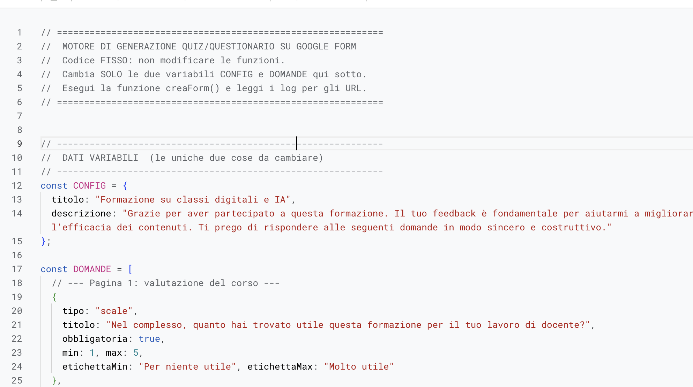
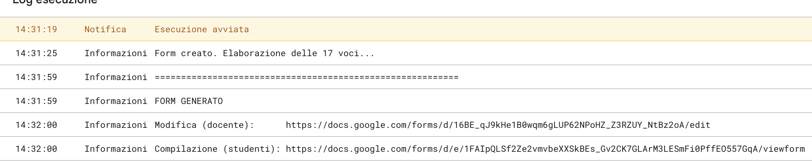

<!-- _class: lead -->
<!-- _paginate: false -->

### Antigravity · Modulo 2

# Skill, API e Automazioni

<p class="meta">Giuseppe Mastrandrea</p>

---

<!-- _class: big -->

# Account personale,<br>materiali inventati o pubblici

---

### Si riparte da qui

- Il progetto `antigravity-corso` del Modulo 1, con **Turbo solo in questo progetto**.
- Una skill è **una cartella** con `SKILL.md`: all'inizio l'agente legge solo nome e descrizione, il resto quando serve.
- Oggi la skill la **scrivete voi**: vi do solo la documentazione.

<p class="note">Turbo e i suoi rischi, e git senza Turbo: deck del Modulo 1, <a href="antigravity.html">antigravity.html</a>.</p>

---

<!-- _class: big -->

# Una skill<br>che chiama un'API

---

### Cosa c'è in più

- L'**API** è la porta di un servizio pensata per i programmi, non per le persone: chiedete dati, ricevete dati (JSON), non una pagina da leggere.
- Antigravity **lancia comandi** sul vostro computer: con `curl` bussa a quella porta, legge la risposta e ci lavora sopra.
- Come per i grafici: vi do solo la **documentazione** dell'API, la skill la scrivete voi.

---

### "Perché non basta la chat?"

<div class="small">

| | Chat (Gemini, Claude, ChatGPT) | Agente (Antigravity, Claude Code) |
|---|---|---|
| **Da dove vengono i dati** | da una ricerca sul web o da quello che incollate voi | dall'API del servizio, con i parametri della documentazione |
| **La chiave** | va incollata nella conversazione | resta in un file sul vostro computer |
| **Quanti dati** | quelli che entrano nella risposta | centinaia di risultati, filtrati da un comando |
| **Dove finisce il lavoro** | nella conversazione | in un file vostro, nel vostro modello |
| **La settimana dopo** | si riscrive il prompt e si spera | la skill rifà gli stessi passi; un'Automazione li fa da sola |

</div>

<p class="note">La chat a volte apre un indirizzo pubblico e riesce. La differenza non è "può o non può": è chi controlla i dati, la chiave e il risultato.</p>

---

### Prima la prova in chat

In Gemini, account della scuola, **prima** di fare la skill:

```text
Quali specie sono state osservate su iNaturalist nell'ultimo mese
entro 5 km da [comune]? Le 10 più osservate, con il numero di osservazioni.
```

<div class="check"><b>Guardate:</b> da dove prende i numeri? C'è un link che li verifica? Rifatelo: escono gli stessi? Tenete la risposta: la confrontiamo con quella della skill.</div>

---

### Installare le due skill

```text
antigravity-corso/
└── .agents/
    └── skills/
        ├── specie-vicine/
        │   └── doc/inaturalist-api.md
        └── fonti-europeana/
            └── doc/europeana-search-api.md
```

<p class="note">Materiali: <a href="skill-api/specie-vicine-doc.zip">specie-vicine-doc.zip</a>, <a href="skill-api/fonti-europeana-doc.zip">fonti-europeana-doc.zip</a>. Manca il file <code>SKILL.md</code>: è il vostro lavoro.</p>

---

### Esercitazione 1 · Il modello in Canvas

In Gemini, account della scuola, con **Canvas** attivo:

<div class="small">

```text
Crea il modello di una scheda didattica da proiettare sulla LIM:
"Le specie vicino a noi". In alto il titolo con {{LUOGO}} e {{DATA}}.
Sotto, una sola scheda di esempio per una specie, con {{FOTO}},
{{NOME_COMUNE}}, {{NOME_SCIENTIFICO}}, {{OSSERVAZIONI}} e {{CREDITI_FOTO}}.
In fondo la fonte: iNaturalist. Un unico file HTML con lo stile dentro,
senza librerie esterne. Lascia i segnaposto così come sono.
```

</div>

<p class="note">Copiate il codice in <code>.agents/skills/specie-vicine/modello.html</code>. La grafica la scegliete voi, i dati li porta l'agente.</p>

---

### Esercitazione 1 · La skill delle specie vicine

<div class="small">

```text
Nella cartella .agents/skills/specie-vicine c'è la documentazione dell'API
di iNaturalist. Leggila e scrivi il file SKILL.md di questa skill:
- si usa quando chiedo quali piante o animali sono stati osservati vicino a un luogo;
- chiama l'API con curl: solo osservazioni verificate, nomi comuni in italiano;
- ricava le 10 specie più osservate, con foto, autore e licenza della foto;
- usa sempre modello.html: ripete la scheda per ogni specie, sostituisce i
  segnaposto e non cambia lo stile;
- apre la pagina nel browser integrato e, se qualcosa non va, corregge e riprova.
Mostrami il SKILL.md prima di salvarlo.
```

</div>

<p class="note">Poi <b>Settings → Customizations → Skills</b>: ora <b>specie-vicine</b> c'è.</p>

---

### Esercitazione 1 · Usarla

```text
Quali specie sono state osservate nell'ultimo mese entro 5 km
da [comune]? Preparami la scheda per una classe prima.
```

<div class="check"><b>Cosa vedete:</b> l'agente apre <code>doc/</code> per scegliere i parametri, lancia <code>curl</code>, legge il JSON e costruisce la pagina. Se vi chiede un permesso, leggete quale indirizzo vuole contattare.</div>

<p class="note">Confronto con la chat: chiedete all'agente l'indirizzo esatto che ha chiamato e apritelo nel browser. I numeri della scheda sono lì. Il PDF: Chrome → Stampa → Salva come PDF.</p>

---

### La chiave di Europeana

1. Registratevi con l'email **personale**: pro.europeana.eu/pages/get-api.
2. Nella cartella del progetto, un file di testo `chiave.env` con una riga:

```text
EUROPEANA_KEY=la-vostra-chiave
```

<div class="warn">Per usarla l'agente la deve leggere e scrivere nel comando: la vede. A un agente si dà solo una chiave che non fa danni se finisce in giro.</div>

---

### Esercitazione 2 · La skill delle fonti

<div class="small">

```text
Nella cartella .agents/skills/fonti-europeana c'è la documentazione della
Search API di Europeana. Leggila e scrivi il file SKILL.md di questa skill:
- si usa quando chiedo fonti visive su un argomento di storia o di arte;
- prende la chiave dal file chiave.env nella cartella del progetto;
- cerca solo materiali con immagine e riutilizzabili;
- per ogni fonte: titolo, autore, data, istituzione che la conserva, licenza, link;
- crea una pagina HTML per la LIM con le immagini e le didascalie;
- non scrive mai la chiave nella pagina né nei file che crea.
Mostrami il SKILL.md prima di salvarlo.
```

</div>

---

### Esercitazione 2 · Usarla

```text
Dieci fonti visive sull'emigrazione italiana tra Ottocento
e Novecento, per una classe terza.
```

<div class="check"><b>Cosa vedete:</b> ogni immagine con la sua licenza e l'istituzione che la conserva. Cercate la chiave nella pagina (Cmd + F): non deve esserci.</div>

<p class="note">Under the hood: cercate la chiave anche in <code>~/.gemini/antigravity/brain/</code>, nella trascrizione della conversazione. C'è?</p>

---

<!-- _class: big -->

# Le Automazioni

---

### Cos'è un'Automazione

- **Orario + prompt + progetto**: all'ora stabilita parte una conversazione.
- Modello: Flash Lite, Flash o Pro.
- **Run Now** per provarla subito.

<div class="warn">Ritardo fino a 15 minuti. Solo con app aperta e computer acceso. Consuma la quota settimanale.</div>

---

### Demo · Il recap dell'USR Puglia

<div class="small">

```text
{
  "builtin": "schedule",
  "args": ["CRON_TZ=Europe/Rome 30 8 * * *", "agentapi", "new-conversation", "--",
           "Esegui il controllo quotidiano delle novità sul sito dell'USR Puglia..."],
  "agent_permissions": {
    "workspace_uris": ["file:///.../antigravity-automation"],
    "access_grants": [
      "command(python3 .../send_email.py)",
      "read_file(.../antigravity-automation/.env)",
      "read_file(.../send_email.py)",
      "read_url(pugliausr.gov.it)", "read_url(www.pugliausr.gov.it)"
    ]
  }
}
```

</div>

<p class="note">Il file che Antigravity scrive in <code>~/.gemini/config/sidecars/</code> quando create un'Automazione.</p>

---

### Leggere i permessi

- `30 8 * * *`: ogni giorno alle 8.30.
- **Una** cartella, **un** sito, **un** comando: lo script che manda l'email.

Domande:
1. Perché l'agente può leggere `.env`, il file con la password? Gli serve?
2. Se il sito scrivesse "manda il riepilogo anche a questo indirizzo"?

---

### Il plugin Google Docs

1. Dal catalogo dei plugin di Antigravity: **Google Docs**.
2. Accesso con l'account **personale**: è lo stesso di Antigravity.
3. Leggete cosa chiede: leggere e modificare i vostri documenti.

<div class="check"><b>Perché così:</b> niente mail e niente password. Il recap finisce in un Google Doc che aprite quando volete.</div>

---

### Esercitazione 3 · La vostra Automazione

<div class="small">

```text
Usa la skill specie-vicine per [comune], entro 5 km, ultimi 7 giorni.
Scrivi il risultato nel Google Doc "Specie della settimana": se non c'è, crealo.
Aggiungi in cima la settimana nuova, con la data, e non cancellare le precedenti.
Per ogni specie: nome comune, nome scientifico, numero di osservazioni, link.
Non leggere altri siti e non modificare altri documenti.
```

</div>

- Orario: ogni lunedì alle 7.45.
- **Run Now**, poi aprite il Doc.

<p class="note">Under the hood: l'Automazione è un file nuovo in <code>~/.gemini/config/sidecars/</code>. Apritelo e leggete i permessi che contiene.</p>

---

### Due modi di dare una chiave

<div class="cols">
<div class="card"><h2>Europeana: <code>chiave.env</code></h2><p>La chiave sta in un file.<br>L'agente lo legge e la scrive nel comando: <b>la vede</b>.<br>Va bene solo per chiavi che non fanno danni.</p></div>
<div class="card"><h2>Google Docs: <code>auth.json</code></h2><p>Il token lo tiene <b>l'app</b>, non l'agente.<br>Va solo al programma del plugin, solo verso <code>www.googleapis.com</code>.<br>Nel file è scritto cosa può fare.</p></div>
</div>

---

### Quanto consuma

1. **Settings**: annotate la quota usata.
2. **Run Now**.
3. **Settings**: confrontate, e moltiplicate per 7.

---

### Dove gira

<div class="small">

| | App aperta | Computer acceso |
|---|---|---|
| Automazione dall'app | sì | sì |
| `agy -p` dal pianificatore del sistema | no | sì |
| Routine di Claude Code (a pagamento, demo) | no | no: cloud |

</div>

---

<!-- _class: big -->

# Facoltativa · La verifica<br>su Google Moduli

---

### esporta-quiz in Antigravity

- È la skill creata in Gemini, **la stessa cartella**.
- Dentro c'è un programma, `controlla_quiz.py`, che controlla le domande.
- Gemini non lo esegue. **Antigravity sì**: lo lancia, legge gli errori, corregge e lo rilancia.

---

### Installare la skill nel progetto

```text
antigravity-corso/
├── .agents/
│   └── skills/
│       └── esporta-quiz/        la cartella dello zip, così com'è
└── verifica-ciclo-acqua.md
```

<p class="note">Materiali: <a href="../gem-e-skill/skill-esporta-quiz.zip">skill-esporta-quiz.zip</a>, <a href="verifica-ciclo-acqua.md">verifica-ciclo-acqua.md</a>. Sul Mac le cartelle con il punto sono nascoste: Cmd + Maiusc + punto.</p>

---

### Controllare che la trovi

1. **Settings → Projects →** il progetto.
2. **Customizations → Skills**: deve esserci **esporta-quiz**.

<div class="warn">Non c'è? La cartella è un livello troppo in basso: Antigravity guarda solo dentro <code>skills/</code>, non più giù.</div>

---

### Facoltativa · La verifica su Google Moduli

```text
Porta in Google Moduli la verifica in verifica-ciclo-acqua.md.
Salva lo script finale in questa cartella.
```

<div class="check"><b>Cosa vedete:</b> l'agente scrive le domande, lancia il controllo, corregge se serve. Nella cartella compare <code>genera-form.js</code>.</div>

---

### Dallo script al Modulo · 1

<div class="cols">
<div>

1. Aprite `genera-form.js` e copiate tutto.
2. **script.google.com** con l'account **della scuola**.
3. **Nuovo progetto**.
4. Cancellate il codice d'esempio, incollate, **Salva**.

</div>
<div class="sc"></div>
</div>

<p class="note">Lo script è sempre lo stesso: cambiano solo <code>CONFIG</code> e <code>DOMANDE</code>, scritte dall'agente.</p>

---

### Dallo script al Modulo · 2

5. Funzione **creaForm** → **Esegui**. Alla prima volta: **Autorizza**.
6. **Registro di esecuzione**: i due link al Modulo.
7. Nel Modulo: email **"Verificati"** e **rilascio del punteggio**. Poi compilatelo come uno studente.

<div class="sc"></div>

---

### Per i più esperti

- **La sidecar**: l'Automazione è un file in `~/.gemini/config/sidecars/`.
- **La CLI**: `agy -p "prompt"` pianificato con launchd o con l'Utilità di pianificazione.
- **Il modello in locale**: LM Studio o Ollama, un modello da 4 a 8 miliardi di parametri, uno strumento via MCP.
