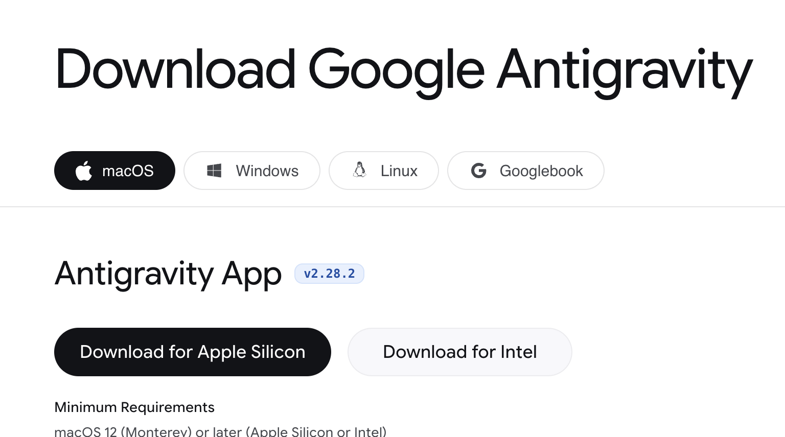
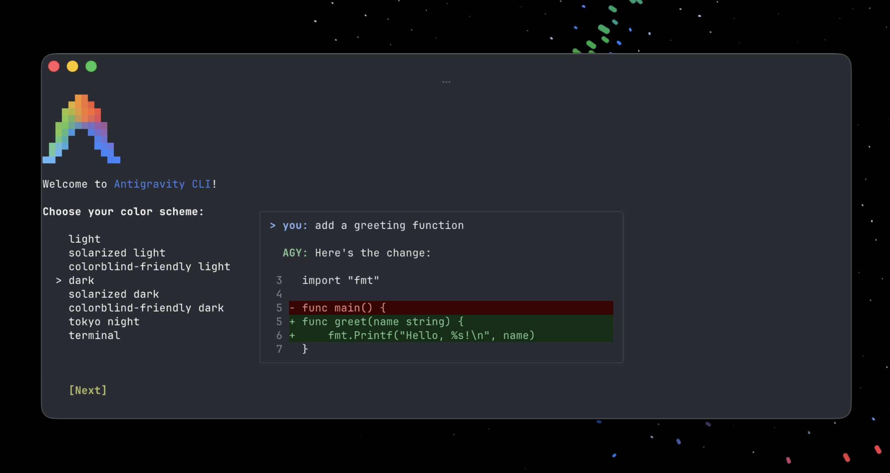
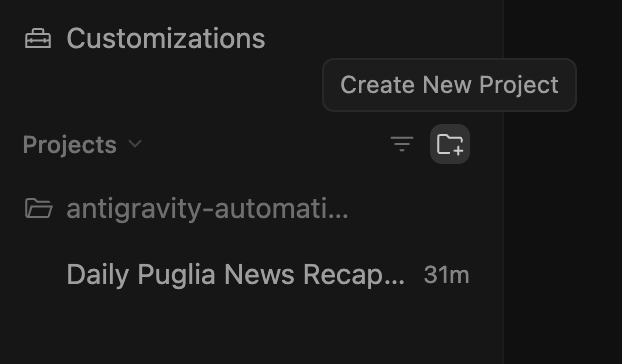
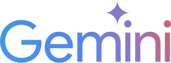
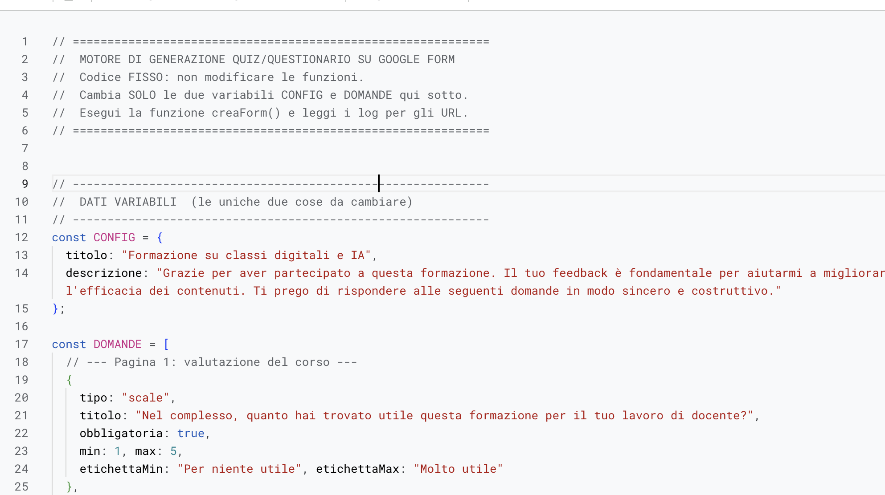
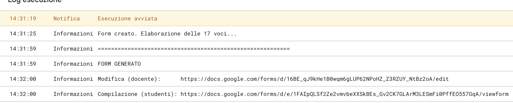

<!-- _class: lead -->
<!-- _paginate: false -->

### Antigravity · Modulo

# Un agente sul proprio computer

<p class="meta">Giuseppe Mastrandrea</p>

---

<!-- _class: big -->

# Account personale,<br>materiali inventati o pubblici

---

### Cos'è Antigravity

<div class="cols">
<div>

- App gratuita di Google: **antigravity.google/download**.
- Dentro c'è un **agente**: file, terminale, browser.
- Lavora in un **progetto**: le cartelle che scegliete voi.
- Quota gratuita **settimanale**.

</div>
<div class="sc"></div>
</div>

---

### App o CLI

<div class="cols">
<div class="small">

| | App | CLI (`agy`) |
|---|---|---|
| Interfaccia | finestre, browser e PDF integrati | terminale |
| Permessi | per progetto, con preset | file `settings.json` |
| **Automazioni** | **sì** | no |
| Esecuzione senza interfaccia | no | **sì**: `agy -p "..."` |
| Skill, regole, MCP, hook | sì | sì |

</div>
<div class="sc"></div>
</div>

<p class="note">Oggi usiamo l'app. Fonte: antigravity.google/docs/features (02/11/2026).</p>

---

### Sul proiettore: la spia

- Mentre lavorate, sul mio computer gira Antigravity con lo stesso compito.
- Accanto, **la spia**: ogni file che l'agente crea o modifica compare sullo schermo, con una riga che dice cos'è.
- Voi non installate niente: guardate.

<p class="note">La spia legge soltanto, e token e password non li mostra.</p>

<!--
Per il formatore, prima di creare il progetto:
python3 04-sito/materiali/antigravity/spia/spia.py ~/antigravity-corso
-->

---

### Il primo progetto

<div class="cols">
<div>

1. Accesso con l'**account personale**.
2. Una cartella vuota: `antigravity-corso`.
3. **Create New Project**: l'icona della cartella con il +, accanto a Projects.
4. Permessi predefiniti: solo le cartelle del progetto. **Turbo** no.

</div>
<div class="sc"></div>
</div>

<div class="check"><b>Sul proiettore, nella spia:</b> un file nuovo in <code>config/projects/</code>. Il progetto è un file JSON: nome, cartella, permessi.</div>

---

### I comandi con la barra

<div class="small">

| Comando | Cosa fa | Quando ci serve |
|---|---|---|
| `/plan` | studia il compito e scrive un piano da approvare, prima di toccare i file | Es. 1: il piano prima dell'app |
| `/grill-me` | vi fa domande una alla volta, con una risposta consigliata per ciascuna | prima di scrivere una skill |
| `/btw` | una domanda a parte, senza fermare il lavoro in corso | "cosa stai facendo adesso, e perché?" |
| `/browser` | un agente che naviga e controlla le pagine | Es. 1: provare l'app |
| `/generative_ui` | schemi, grafici e spiegazioni interattive nella chat (solo nell'app) | il confronto con Canvas |
| `/learn` | trasforma le correzioni della sessione in regole o skill, da approvare | dopo le Es. 3 e 4 |
| `/plugin` | installa e gestisce i plugin | Es. 6: Google Docs |
| `/schedule` | un'istruzione a un orario, una volta o a ripetizione | Es. 6 |

</div>

<p class="note">Scrivete <code>/</code> nella casella del messaggio: compare l'elenco con le descrizioni. Fonte: antigravity.google/docs/slash-commands (10/11/2026).</p>

---

### Da usare con cautela

- **`/goal`**: lavora finché l'obiettivo non è raggiunto, **senza fermarsi a chiedere**. Solo con un compito chiaro e una cartella di prova.
- **`/boost`** e **`/teamwork`**: più agenti insieme. Solo nei piani a pagamento.

---

### Prerequisiti per GitHub

1. Un **account GitHub** e un repository vuoto, che raccoglierà tutte le vostre app fatte con Canvas.
2. **git**. Windows: **Git for Windows** (git-scm.com), opzioni predefinite. Mac: nel Terminale scrivete `git` e accettate l'installazione degli strumenti.
3. Solo Mac: **Git Credential Manager**, il pacchetto `.pkg` da github.com/git-ecosystem/git-credential-manager/releases.
4. Nel Terminale (su Windows: Git Bash), una volta sola: `git credential-manager github login`. Si apre il browser, accedete a GitHub e autorizzate.

<p class="note">Senza il passo 4 il push dall'agente non parte: il login nel browser non si apre da solo. Commit e push li fa l'agente con la skill predefinita <b>permissioned-github</b>, chiedendo un vostro permesso. Pages lo attiviamo a mano.</p>

---

### Esercitazione 1 · L'app in Canvas

In Gemini, account della scuola, con **Canvas** attivo:

<div class="small">

```text
Ambito: scuola secondaria di primo grado, classe seconda, [materia].
Crea un'app da proiettare sulla LIM: un quiz a tempo su [argomento],
10 domande a scelta multipla, 20 secondi per domanda, punteggio visibile,
pulsante "Ricomincia". Tutto in un unico file HTML, senza librerie esterne.
```

</div>

<p class="note">Provatela nel Canvas, poi copiate tutto il codice.</p>

---

### Esercitazione 1 · Dal Canvas a GitHub Pages

In Antigravity, nel progetto `antigravity-corso`:

<div class="small">

```text
Qui sotto c'è il codice di un'app fatta con Gemini Canvas.
Salvalo nella cartella app-canvas con un nome che dica cos'è
(per esempio quiz-ciclo-acqua.html), aprilo nel browser integrato e provalo:
se qualcosa non funziona, correggi e dimmi cosa hai cambiato.
Poi crea o aggiorna app-canvas/index.html: l'elenco di tutte le app della
cartella, con titolo, una riga di descrizione e il link.
Infine commit e push di app-canvas sul ramo main di
https://github.com/[utente]/[repository].
Prima di ogni azione su GitHub dimmi quale permesso ti serve e perché.

[il codice copiato dal Canvas]
```

</div>

<div class="check"><b>Cosa vedete:</b> l'app nella cartella, la prova nel browser, l'indice, la richiesta di permesso, il push. Poi attiviamo Pages a mano: Settings → Pages → ramo main. L'indirizzo del sito apre l'indice.</div>

<p class="note">Ogni nuova app fatta con Canvas: stesso prompt, e l'indice si aggiorna. Il repository è solo <code>app-canvas/</code>: skill e chiavi del progetto restano fuori.</p>

---

### Esercitazione 1 · Cosa osservare

- Gli errori trovati provando l'app, e come li ha **corretti**.
- Cosa ha **cambiato** rispetto al codice del Canvas.
- I punti in cui si è **fermato** a chiedere un permesso.

---

### Esercitazione 1 · Cosa ha visto la spia

<div class="small">

| Quando | Cosa compare | Cos'è |
|---|---|---|
| Primo prompt | `antigravity/conversations/[id].db` | la conversazione, salvata sul vostro computer |
| Ogni azione | `antigravity/brain/[id]/.system_generated/steps/[n]/output.txt` | **il risultato di un'azione**, che l'agente rilegge prima di decidere la mossa dopo: il loop |
| Sempre | `brain/[id]/.system_generated/logs/transcript.jsonl` | la trascrizione completa |
| Salva l'app | `[progetto]/app-canvas/quiz-ciclo-acqua.html`, `index.html` | i vostri file |
| Il permesso per GitHub | `config/projects/[id].json` | il permesso, scritto nel progetto |

</div>

<p class="note">Il riepilogo della spia: quante azioni sono servite per salvare, provare e pubblicare un file?<br>Sul vostro computer le stesse cartelle: Finder → Vai → Vai alla cartella → <code>~/.gemini</code>. Su Windows: <code>%USERPROFILE%\.gemini</code> in Esplora file.</p>

---

### Canvas o Antigravity

<div class="cols">
<div class="card logo"><p>Canvas</p><ul><li>un riquadro nella chat</li><li>un file</li><li>lo provate voi</li><li>account della scuola</li></ul></div>
<div class="card logo"><p>Antigravity</p><ul><li>una cartella vostra</li><li>tutti i file che servono</li><li>lo prova e lo pubblica l'agente</li><li>account personale</li></ul></div>
</div>

---

<!-- _class: big -->

# Skill e comportamenti<br>ripetibili

---

### Com'è fatta una skill

```text
nome-della-skill/
├── SKILL.md       obbligatorio: nome, descrizione, istruzioni
├── scripts/       programmi che l'agente esegue
├── references/    documentazione da consultare
├── resources/     modelli e file da riusare
└── examples/      esempi
```

<p class="note">Solo <code>SKILL.md</code> è obbligatorio. I nomi delle cartelle sono quelli suggeriti da Antigravity, ma conta che <code>SKILL.md</code> dica dove guardare: nelle nostre skill troverete <code>doc/</code> e <code>modello.html</code>.</p>

---

### Il file SKILL.md

<div class="small">

```text
---
name: grafici-mermaid
description: Crea mappe concettuali, mappe mentali e linee del tempo con
  Mermaid, per la LIM. Da usare quando l'utente chiede uno di questi grafici.
---

# Grafici Mermaid

1. Leggi solo la pagina di doc/ del tipo di grafico richiesto.
2. Scrivi il grafico in una pagina HTML: caratteri grandi, al massimo 12 nodi, un titolo.
3. Apri la pagina nel browser integrato. Se vedi un errore, correggi e riprova.
```

</div>

<p class="note">In alto, tra i trattini, la <b>descrizione</b>: è la parte più importante, perché è lì che l'agente decide se usare la skill.</p>

---

### Quando entra nel contesto

<div class="flow">
<div>All'inizio<span>nome e descrizione di tutte le skill: poche righe</span></div>
<b>→</b>
<div>Se la richiesta combacia<span>tutto il file SKILL.md</span></div>
<b>→</b>
<div>Solo se serve<span>i file annessi: la documentazione si legge, gli script si eseguono</span></div>
</div>

<p class="note">Antigravity lo chiama <i>progressive disclosure</i>: venti skill installate costano quasi niente finché non servono. Le regole (<code>AGENTS.md</code>, <code>GEMINI.md</code>) invece sono sempre attive.</p>

---

### esporta-quiz in Antigravity

- È la skill creata in Gemini, **la stessa cartella**.
- Dentro c'è un programma, `controlla_quiz.py`, che controlla le domande.
- Gemini non lo esegue. **Antigravity sì**: lo lancia, legge gli errori, corregge e lo rilancia.

---

### Installare la skill nel progetto

```text
antigravity-corso/
├── .agents/
│   └── skills/
│       └── esporta-quiz/        la cartella dello zip, così com'è
└── verifica-ciclo-acqua.md
```

<p class="note">Materiali: <a href="../gem-e-skill/skill-esporta-quiz.zip">skill-esporta-quiz.zip</a>, <a href="verifica-ciclo-acqua.md">verifica-ciclo-acqua.md</a>. Sul Mac le cartelle con il punto sono nascoste: Cmd + Maiusc + punto.</p>

---

### Controllare che la trovi

1. **Settings → Projects →** il progetto.
2. **Customizations → Skills**: deve esserci **esporta-quiz**.

<div class="warn">Non c'è? La cartella è un livello troppo in basso: Antigravity guarda solo dentro <code>skills/</code>, non più giù.</div>

---

### Esercitazione 2 · La verifica su Google Moduli

```text
Porta in Google Moduli la verifica in verifica-ciclo-acqua.md.
Salva lo script finale in questa cartella.
```

<div class="check"><b>Cosa vedete:</b> l'agente scrive le domande, lancia il controllo, corregge se serve. Nella cartella compare <code>genera-form.js</code>.</div>

---

### Dallo script al Modulo · 1

<div class="cols">
<div>

1. Aprite `genera-form.js` e copiate tutto.
2. **script.google.com** con l'account **della scuola**.
3. **Nuovo progetto**.
4. Cancellate il codice d'esempio, incollate, **Salva**.

</div>
<div class="sc"></div>
</div>

<p class="note">Lo script è sempre lo stesso: cambiano solo <code>CONFIG</code> e <code>DOMANDE</code>, scritte dall'agente.</p>

---

### Dallo script al Modulo · 2

5. Funzione **creaForm** → **Esegui**. Alla prima volta: **Autorizza**.
6. **Registro di esecuzione**: i due link al Modulo.
7. Nel Modulo: email **"Verificati"** e **rilascio del punteggio**. Poi compilatelo come uno studente.

<div class="sc"></div>

---

<!-- _class: big -->

# Una skill<br>con la sua documentazione

---

### Esercitazione 3 · La skill dei grafici

```text
antigravity-corso/
└── .agents/
    └── skills/
        └── grafici-mermaid/
            └── doc/   flowchart.md, mindmap.md, timeline.md, VERSIONE.txt
```

<p class="note">Materiali: <a href="skill-mermaid/grafici-mermaid-doc.zip">grafici-mermaid-doc.zip</a>, la documentazione ufficiale di Mermaid 12.2.0. Manca il file <code>SKILL.md</code>: è il vostro lavoro.</p>

---

### Esercitazione 3 · Scrivere la skill

<div class="small">

```text
Nella cartella .agents/skills/grafici-mermaid c'è la documentazione ufficiale
di Mermaid per tre tipi di grafico: mappa concettuale (flowchart),
mappa mentale (mindmap) e linea del tempo (timeline). Scrivi il file SKILL.md:
- si usa quando chiedo una mappa concettuale, una mappa mentale o una linea del tempo;
- prima di scrivere un grafico legge solo la pagina di doc/ di quel tipo;
- il grafico va in una pagina HTML che carica Mermaid nella versione di doc/VERSIONE.txt;
- regole per la LIM: caratteri grandi, al massimo 12 nodi, sempre un titolo;
- apre la pagina nel browser integrato e, se vede un errore, corregge e riprova.
Mostrami il SKILL.md prima di salvarlo.
```

</div>

---

### Esercitazione 3 · Usarla

```text
Una mappa mentale sul ciclo dell'acqua per una classe seconda.
```

```text
Ora una linea del tempo delle tappe dell'Unità d'Italia.
```

<div class="check"><b>Cosa vedete:</b> per la mappa mentale apre solo <code>doc/mindmap.md</code>, per la linea del tempo solo <code>doc/timeline.md</code>. La documentazione si carica quando serve, non tutta insieme.</div>

<p class="note">Il PDF: aprite la pagina in Chrome → Stampa → Salva come PDF.</p>

---

<!-- _class: big -->

# Una skill<br>che chiama un'API

---

### Cosa c'è in più

- L'**API** è la porta di un servizio pensata per i programmi, non per le persone: chiedete dati, ricevete dati (JSON), non una pagina da leggere.
- Antigravity **lancia comandi** sul vostro computer: con `curl` bussa a quella porta, legge la risposta e ci lavora sopra.
- Come per i grafici: vi do solo la **documentazione** dell'API, la skill la scrivete voi.

---

### "Perché non basta la chat?"

<div class="small">

| | Chat (Gemini, Claude, ChatGPT) | Agente (Antigravity, Claude Code) |
|---|---|---|
| **Da dove vengono i dati** | da una ricerca sul web o da quello che incollate voi | dall'API del servizio, con i parametri della documentazione |
| **La chiave** | va incollata nella conversazione | resta in un file sul vostro computer |
| **Quanti dati** | quelli che entrano nella risposta | centinaia di risultati, filtrati da un comando |
| **Dove finisce il lavoro** | nella conversazione | in un file vostro, nel vostro modello |
| **La settimana dopo** | si riscrive il prompt e si spera | la skill rifà gli stessi passi; un'Automazione li fa da sola |

</div>

<p class="note">La chat a volte apre un indirizzo pubblico e riesce. La differenza non è "può o non può": è chi controlla i dati, la chiave e il risultato.</p>

---

### Prima la prova in chat

In Gemini, account della scuola, **prima** di fare la skill:

```text
Quali specie sono state osservate su iNaturalist nell'ultimo mese
entro 5 km da [comune]? Le 10 più osservate, con il numero di osservazioni.
```

<div class="check"><b>Guardate:</b> da dove prende i numeri? C'è un link che li verifica? Rifatelo: escono gli stessi? Tenete la risposta: la confrontiamo con quella della skill.</div>

---

### Installare le due skill

```text
antigravity-corso/
└── .agents/
    └── skills/
        ├── specie-vicine/
        │   └── doc/inaturalist-api.md
        └── fonti-europeana/
            └── doc/europeana-search-api.md
```

<p class="note">Materiali: <a href="skill-api/specie-vicine-doc.zip">specie-vicine-doc.zip</a>, <a href="skill-api/fonti-europeana-doc.zip">fonti-europeana-doc.zip</a>. Manca il file <code>SKILL.md</code>: è il vostro lavoro.</p>

---

### Esercitazione 4 · Il modello in Canvas

In Gemini, account della scuola, con **Canvas** attivo:

<div class="small">

```text
Crea il modello di una scheda didattica da proiettare sulla LIM:
"Le specie vicino a noi". In alto il titolo con {{LUOGO}} e {{DATA}}.
Sotto, una sola scheda di esempio per una specie, con {{FOTO}},
{{NOME_COMUNE}}, {{NOME_SCIENTIFICO}}, {{OSSERVAZIONI}} e {{CREDITI_FOTO}}.
In fondo la fonte: iNaturalist. Un unico file HTML con lo stile dentro,
senza librerie esterne. Lascia i segnaposto così come sono.
```

</div>

<p class="note">Copiate il codice in <code>.agents/skills/specie-vicine/modello.html</code>. La grafica la scegliete voi, i dati li porta l'agente.</p>

---

### Esercitazione 4 · La skill delle specie vicine

<div class="small">

```text
Nella cartella .agents/skills/specie-vicine c'è la documentazione dell'API
di iNaturalist. Leggila e scrivi il file SKILL.md di questa skill:
- si usa quando chiedo quali piante o animali sono stati osservati vicino a un luogo;
- chiama l'API con curl: solo osservazioni verificate, nomi comuni in italiano;
- ricava le 10 specie più osservate, con foto, autore e licenza della foto;
- usa sempre modello.html: ripete la scheda per ogni specie, sostituisce i
  segnaposto e non cambia lo stile;
- apre la pagina nel browser integrato e, se qualcosa non va, corregge e riprova.
Mostrami il SKILL.md prima di salvarlo.
```

</div>

<p class="note">Poi <b>Settings → Customizations → Skills</b>: ora <b>specie-vicine</b> c'è.</p>

---

### Esercitazione 4 · Usarla

```text
Quali specie sono state osservate nell'ultimo mese entro 5 km
da [comune]? Preparami la scheda per una classe prima.
```

<div class="check"><b>Cosa vedete:</b> l'agente apre <code>doc/</code> per scegliere i parametri, lancia <code>curl</code>, legge il JSON e costruisce la pagina. Se vi chiede un permesso, leggete quale indirizzo vuole contattare.</div>

<p class="note">Confronto con la chat: chiedete all'agente l'indirizzo esatto che ha chiamato e apritelo nel browser. I numeri della scheda sono lì. Il PDF: Chrome → Stampa → Salva come PDF.</p>

---

### La chiave di Europeana

1. Registratevi con l'email **personale**: pro.europeana.eu/pages/get-api.
2. Nella cartella del progetto, un file di testo `chiave.env` con una riga:

```text
EUROPEANA_KEY=la-vostra-chiave
```

<div class="warn">Per usarla l'agente la deve leggere e scrivere nel comando: la vede. A un agente si dà solo una chiave che non fa danni se finisce in giro.</div>

---

### Esercitazione 5 · La skill delle fonti

<div class="small">

```text
Nella cartella .agents/skills/fonti-europeana c'è la documentazione della
Search API di Europeana. Leggila e scrivi il file SKILL.md di questa skill:
- si usa quando chiedo fonti visive su un argomento di storia o di arte;
- prende la chiave dal file chiave.env nella cartella del progetto;
- cerca solo materiali con immagine e riutilizzabili;
- per ogni fonte: titolo, autore, data, istituzione che la conserva, licenza, link;
- crea una pagina HTML per la LIM con le immagini e le didascalie;
- non scrive mai la chiave nella pagina né nei file che crea.
Mostrami il SKILL.md prima di salvarlo.
```

</div>

---

### Esercitazione 5 · Usarla

```text
Dieci fonti visive sull'emigrazione italiana tra Ottocento
e Novecento, per una classe terza.
```

<div class="check"><b>Cosa vedete:</b> ogni immagine con la sua licenza e l'istituzione che la conserva. Cercate la chiave nella pagina (Cmd + F): non deve esserci.</div>

<p class="note">Sul proiettore, nella spia: <code>chiave.env</code> compare come segreto. Ma la chiave è finita nella trascrizione della conversazione?</p>

---

<!-- _class: big -->

# Dove stanno le cose

---

### Quello che scrivete voi, quello che scrive lui

<div class="cols">
<div class="card"><h2>Voi: le personalizzazioni</h2><p><code>.agents/</code> nel progetto, oppure <code>~/.gemini/config/</code> per tutti i progetti.<br><br><code>skills/</code> procedure caricate quando servono<br><code>rules/</code>, <code>AGENTS.md</code>, <code>GEMINI.md</code> istruzioni sempre attive<br><code>mcp_config.json</code> strumenti esterni<br><code>hooks.json</code> script in punti del loop</p></div>
<div class="card"><h2>Lui: lo stato</h2><p><code>~/.gemini/antigravity/</code><br><br><code>conversations/</code> le conversazioni, in locale<br><code>brain/</code> l'area di lavoro dell'agente<br><code>builtin/skills/</code> le skill predefinite<br><code>~/.gemini/config/projects/</code> cartelle e permessi di ogni progetto<br><code>~/.gemini/config/sidecars/</code> le Automazioni</p></div>
</div>

---

### Tre cose da notare

1. Le conversazioni restano sul computer, ma **il modello gira nel cloud**.
2. I **permessi** stanno in file che si possono aprire.
3. Una **skill è una cartella**: copiarla basta.

---

<!-- _class: big -->

# Le Automazioni

---

### Cos'è un'Automazione

- **Orario + prompt + progetto**: all'ora stabilita parte una conversazione.
- Modello: Flash Lite, Flash o Pro.
- **Run Now** per provarla subito.

<div class="warn">Ritardo fino a 15 minuti. Solo con app aperta e computer acceso. Consuma la quota settimanale.</div>

---

### Demo · Il recap dell'USR Puglia

<div class="small">

```text
{
  "builtin": "schedule",
  "args": ["CRON_TZ=Europe/Rome 30 8 * * *", "agentapi", "new-conversation", "--",
           "Esegui il controllo quotidiano delle novità sul sito dell'USR Puglia..."],
  "agent_permissions": {
    "workspace_uris": ["file:///.../antigravity-automation"],
    "access_grants": [
      "command(python3 .../send_email.py)",
      "read_file(.../antigravity-automation/.env)",
      "read_file(.../send_email.py)",
      "read_url(pugliausr.gov.it)", "read_url(www.pugliausr.gov.it)"
    ]
  }
}
```

</div>

<p class="note">Il file che Antigravity scrive in <code>~/.gemini/config/sidecars/</code> quando create un'Automazione.</p>

---

### Leggere i permessi

- `30 8 * * *`: ogni giorno alle 8.30.
- **Una** cartella, **un** sito, **un** comando: lo script che manda l'email.

Domande:
1. Perché l'agente può leggere `.env`, il file con la password? Gli serve?
2. Se il sito scrivesse "manda il riepilogo anche a questo indirizzo"?

---

### Il plugin Google Docs

1. Dal catalogo dei plugin di Antigravity: **Google Docs**.
2. Accesso con l'account **personale**: è lo stesso di Antigravity.
3. Leggete cosa chiede: leggere e modificare i vostri documenti.

<div class="check"><b>Perché così:</b> niente mail e niente password. Il recap finisce in un Google Doc che aprite quando volete.</div>

---

### Esercitazione 6 · La vostra Automazione

<div class="small">

```text
Usa la skill specie-vicine per [comune], entro 5 km, ultimi 7 giorni.
Scrivi il risultato nel Google Doc "Specie della settimana": se non c'è, crealo.
Aggiungi in cima la settimana nuova, con la data, e non cancellare le precedenti.
Per ogni specie: nome comune, nome scientifico, numero di osservazioni, link.
Non leggere altri siti e non modificare altri documenti.
```

</div>

- Orario: ogni lunedì alle 7.45.
- **Run Now**, poi aprite il Doc.

<p class="note">Sul proiettore, nella spia: il file nuovo in <code>config/sidecars/</code>. Leggiamo insieme i permessi che contiene.</p>

---

### Due modi di dare una chiave

<div class="cols">
<div class="card"><h2>Europeana: <code>chiave.env</code></h2><p>La chiave sta in un file.<br>L'agente lo legge e la scrive nel comando: <b>la vede</b>.<br>Va bene solo per chiavi che non fanno danni.</p></div>
<div class="card"><h2>Google Docs: <code>auth.json</code></h2><p>Il token lo tiene <b>l'app</b>, non l'agente.<br>Va solo al programma del plugin, solo verso <code>www.googleapis.com</code>.<br>Nel file è scritto cosa può fare.</p></div>
</div>

---

### Quanto consuma

1. **Settings**: annotate la quota usata.
2. **Run Now**.
3. **Settings**: confrontate, e moltiplicate per 7.

---

### Dove gira

<div class="small">

| | App aperta | Computer acceso |
|---|---|---|
| Automazione dall'app | sì | sì |
| `agy -p` dal pianificatore del sistema | no | sì |
| Routine di Claude Code (a pagamento, demo) | no | no: cloud |

</div>

---

### Per i più esperti

- **La sidecar**: l'Automazione è un file in `~/.gemini/config/sidecars/`.
- **La CLI**: `agy -p "prompt"` pianificato con launchd o con l'Utilità di pianificazione.
- **Il modello in locale**: LM Studio o Ollama, un modello da 4 a 8 miliardi di parametri, uno strumento via MCP.
