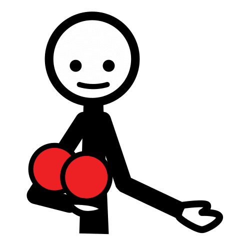
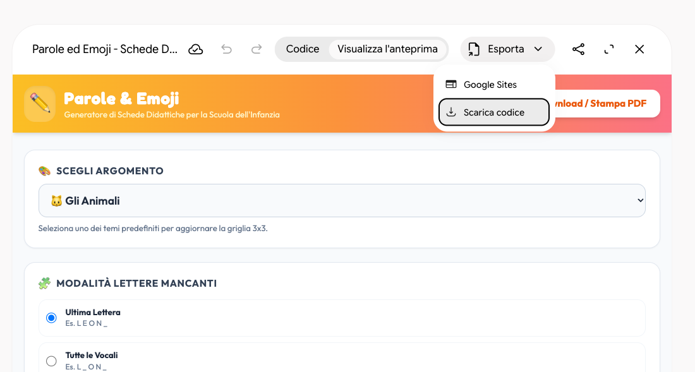
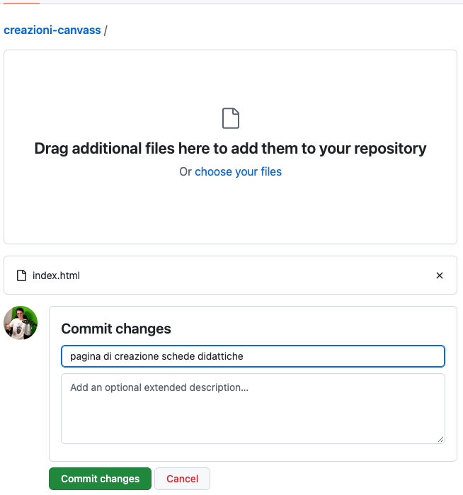

<!-- _class: lead -->
<!-- _paginate: false -->

### Canvas · Esercitazione

# Una tabella CAA per la merenda

<p class="meta">Giuseppe Mastrandrea</p>

---

### Cosa facciamo

<div class="cols">
<div>

Dal vocabolario alla **tabella stampabile**, con i pittogrammi ARASAAC, fino a una pagina pubblicata con un indirizzo vostro.

<p class="meta">Tecniche: prompt strutturato, iterazione, generare uno strumento con Canvas</p>

</div>
</div>

---

### Come lavoriamo

<div class="cols">
<div class="card"><h2>Un passo alla volta</h2><p>Ogni slide chiede una sola azione. Si passa alla slide successiva solo quando l'azione è riuscita.</p></div>
<div class="card"><h2>Il riquadro verde</h2><p>Dice cosa dovete vedere sullo schermo. Se vedete altro, alzate la mano: si sistema subito, prima di andare avanti.</p></div>
</div>

<div class="check"><b>Cosa vedete:</b> qui, in ogni slide, il controllo da fare.</div>

---

<!-- _class: big -->

# Parte 1 · Il vocabolario

---

### La CAA in tre righe

- **Comunicazione aumentativa alternativa**: simboli che affiancano o sostituiscono la parola.
- La tabella raccoglie i simboli di una situazione: la merenda, la palestra, il cerchio del mattino.
- Il sistema di CAA di un alunno lo decide **il team con il logopedista**. Qui prepariamo solo materiali.

---

### Passo 1 · Il prompt povero

Aprite Gemini in una chat nuova e incollate:

```text
Fammi una tabella CAA per la merenda.
```

<p class="note">Leggete la risposta. Cosa manca? Per chi è, quante parole, in che formato.</p>

<div class="check"><b>Cosa vedete:</b> una tabella generica, spesso con parole che un bambino non indicherebbe mai.</div>

---

### Passo 2 · Il prompt strutturato

<div class="small">

```text
Ambito: insegnamento di sostegno nella primaria,
comunicazione aumentativa alternativa.
Compito: prepara il vocabolario per una tabella di comunicazione da usare
durante la merenda in classe con un bambino di 7 anni
che comunica con singoli simboli.
Vincoli: massimo 16 parole; metà vocabolario di base
(es. voglio, ancora, finito, aiuto), metà specifico della merenda;
solo parole rappresentabili con un pittogramma.
Formato: tabella con colonne
Parola | Categoria (persona, azione, oggetto, aggettivo, sociale) |
Colore (chiave di Fitzgerald modificata).
```

</div>

<div class="check"><b>Cosa vedete:</b> una tabella con 16 righe al massimo e tre colonne. Confrontatela con quella del passo 1.</div>

---

### Passo 3 · Iterare, prima richiesta

Nella stessa chat:

```text
Togli le parole troppo astratte e sostituiscile.
```

<div class="check"><b>Cosa vedete:</b> la tabella di prima con qualche parola cambiata. Gemini di solito dice quali ha tolto.</div>

---

### Passo 3 · Iterare, seconda richiesta

Sempre nella stessa chat:

```text
Aggiungi 5 frasi che l'adulto può dire indicando
i simboli durante la merenda.
```

<div class="check"><b>Cosa vedete:</b> 5 frasi brevi sotto la tabella. Contatele: se sono 4 o 6, chiedete di correggere.</div>

---

### Passo 4 · E se i simboli li disegna Gemini?

```text
Genera 4 simboli in stile pittogramma: mela, bere, ancora, finito.
```

Guardate lo stile: tratto, colori, proporzioni. In CAA i simboli devono essere **della stessa famiglia grafica**, altrimenti il bambino fatica a riconoscerli.

<p class="note">Anche Global Symbols, che offre uno strumento per generare simboli con l'IA, scrive che serve la supervisione umana perché i simboli siano sicuri e comprensibili (globalsymbols.com, 13 maggio 2026).</p>

---

<!-- _class: big -->

# Parte 2 · I pittogrammi di ARASAAC

---

### ARASAAC

<div class="cols">
<div>

- Oltre **10.000 pittogrammi**, cercabili in italiano
- Licenza **CC BY-NC-SA**: uso libero a scuola, con attribuzione, senza fini commerciali
- Un'**API pubblica**: un indirizzo web che restituisce i pittogrammi per una parola

</div>
</div>

<p class="note">Come funziona un'API e come si prova dal browser: deck <a href="api.html">Le API</a>, da fare prima di questa esercitazione.</p>

---

<!-- _class: big -->

# Parte 3 · La pagina con Canvas

---

### Passo 5 · Come funzionerà la pagina

<div class="schema"></div>

<p class="note" style="text-align:center">Gemini scrive la pagina; i pittogrammi arrivano da ARASAAC, non sono generati. La costruiamo in cinque richieste, una per volta.</p>

---

### Passo 5 · Aprire Canvas

1. Aprite Gemini in una **chat nuova**.
2. Cliccate **Strumenti** sotto la casella del prompt.
3. Scegliete **Canvas**.

<div class="check"><b>Cosa vedete:</b> la voce Canvas evidenziata vicino alla casella del prompt. Non scrivete ancora nulla.</div>

---

### Richiesta 1 · Solo le parole

<div class="small">

```text
Ambito: comunicazione aumentativa alternativa nella scuola primaria.
Compito: crea una pagina web con un riquadro dove incollo una lista
di parole, una per riga, e un pulsante "Crea tabella".
Quando premo il pulsante, mostra le parole in una griglia
a 4 colonne, una parola per casella.
Per ora niente immagini.
```

</div>

<div class="check"><b>Cosa vedete:</b> a destra la pagina con il riquadro e il pulsante. Incollate <i>voglio, ancora, finito, bere</i> (una per riga) e premete il pulsante: compaiono 4 caselle con le parole.</div>

---

### Richiesta 2 · I pittogrammi

<div class="small">

```text
Ora in ogni casella metti il pittogramma sopra la parola.
Cercalo con l'API di ARASAAC:
https://api.arasaac.org/v1/pictograms/it/search/PAROLA
prendi il campo _id del primo risultato e mostra l'immagine
https://static.arasaac.org/pictograms/ID/ID_500.png
```

</div>

<p class="note">Sono i due indirizzi provati a mano nel deck <a href="api.html">Le API</a>.</p>

<div class="check"><b>Cosa vedete:</b> premendo di nuovo "Crea tabella", sopra ogni parola il suo pittogramma.</div>

---

### Se qualcosa non va

Descrivete a Gemini **cosa vedete**, non cosa pensate sia rotto:

```text
Le immagini non compaiono: al loro posto c'è un'icona rotta.
Mostrami nella pagina il messaggio di errore.
```

<div class="warn">Una correzione per messaggio. Se dopo tre tentativi non funziona, alzate la mano.</div>

---

### Richiesta 3 · Le parole senza pittogramma

```text
Se una parola non ha pittogramma, lascia la casella
senza immagine e scrivi la parola in rosso.
```

<div class="check"><b>Cosa vedete:</b> aggiungete alla lista la parola <i>xyzabc</i> e premete "Crea tabella". Le altre caselle restano uguali, xyzabc è scritta in rosso.</div>

---

### Guardate "ancora"

<div class="cols">
<div class="card" style="text-align:center"><h2>Primo risultato</h2><p>L'àncora della nave</p></div>
<div class="card" style="text-align:center"><h2>Quello che serve</h2><p>"Ne voglio ancora"</p></div>
</div>

<p class="note">Prova del 3 ottobre 2026: per "ancora" l'API restituisce 4 pittogrammi e il primo è la nave. La pagina prende il primo: il controllo resta alla docente. Lo sistemiamo nel passo 6.</p>

---

### Richiesta 4 · Scaricare il PDF

Prima provate a stampare la pagina con **Ctrl+P** (**Cmd+P**): dentro Canvas non funziona, perché la pagina gira in un riquadro protetto. Allora:

```text
Aggiungi un pulsante "Scarica PDF" che salva solo la griglia,
con le librerie html2canvas e jsPDF.
Carica le immagini con crossOrigin="anonymous".
```

<div class="check"><b>Cosa vedete:</b> premendo "Scarica PDF" parte un download. Apritelo: dentro c'è la sola griglia, con i pittogrammi.</div>

---

### Richiesta 5 · La dicitura ARASAAC

```text
In fondo alla pagina inserisci questa dicitura:
"Autore pittogrammi: Sergio Palao. Origine: ARASAAC (arasaac.org).
Licenza: CC BY-NC-SA. Proprietà: Governo di Aragona".
```

<p class="note">La licenza chiede l'attribuzione: senza questa riga la pagina non si può condividere.</p>

<div class="check"><b>Cosa vedete:</b> la dicitura in fondo alla pagina, sotto la griglia.</div>

---

### Il collaudo

<div class="cols">
<div>

Incollate questa lista:

```text
voglio
ancora
finito
bere
succo
aiuto
mela
xyzabc
```

</div>
<div>

- 7 caselle con il pittogramma
- **xyzabc**: casella vuota con la scritta in rosso
- **Scarica PDF**: un file con la sola griglia
- In fondo, la dicitura ARASAAC

</div>
</div>

---

### Il risultato

<div class="shot">Screenshot: la pagina generata in Canvas con la griglia della merenda</div>

---

### Passo 6 · Scegliere il pittogramma

Nella stessa chat di Canvas:

```text
Quando una parola ha più pittogrammi, mostrali in piccolo sotto
la casella e fammi cliccare quello che preferisco.
```

<div class="check"><b>Cosa vedete:</b> sotto "ancora" 4 pittogrammi piccoli. Cliccate quello giusto: la casella cambia immagine.</div>

---

### Passo 6 · I colori di Fitzgerald

```text
Colora il bordo di ogni casella secondo la chiave di Fitzgerald
modificata: persone gialle, azioni verdi, aggettivi blu,
oggetti arancioni, parole sociali rosa.
```

<div class="check"><b>Cosa vedete:</b> "bere" con il bordo verde, "mela" arancione. Controllate tutte le caselle: Gemini può sbagliare la categoria di una parola.</div>

---

<!-- _class: big -->

# Parte 4 · Pubblicare la tabella

---

### Prima di questa parte

Account GitHub e repository **creazioni-canvas**, con la vostra prima pagina come index.html: si preparano con il deck <a href="github-pages.html">GitHub Pages</a>.

<div class="check"><b>Cosa vedete:</b> all'indirizzo username.github.io/creazioni-canvas/ la vostra prima pagina.</div>

<p class="note">La tabella è la vostra prima pagina? Seguite il deck GitHub Pages con la tabella, e saltate le due slide che seguono.</p>

---

### Tabella 1 · Scaricare il codice

<div class="cols">
<div>

1. Nel riquadro di Canvas cliccate **Esporta**.
2. Scegliete **Scarica codice**.
3. Nella cartella **Download** rinominate il file in `tabella-caa.html`

<div class="warn">Non index.html: quel nome è già della vostra prima pagina, e la sostituirebbe.</div>

</div>
<div class="sc"></div>
</div>

---

### Tabella 2 · Caricare il file

<div class="cols">
<div>

1. Nel repository creazioni-canvas: **Add file → Upload files**.
2. Trascinate **tabella-caa.html** nel riquadro.
3. Cliccate **Commit changes**.

<div class="check"><b>Cosa vedete:</b> nel repository due file: index.html e tabella-caa.html.</div>

</div>
<div class="sc"></div>
</div>

---

### Tabella 3 · Il collaudo finale

1. Aspettate un paio di minuti.
2. Aprite **username.github.io/creazioni-canvas/tabella-caa.html**.
3. Incollate la lista di parole e scaricate il PDF.
4. Provate anche la stampa del browser (**Ctrl+P** o **Cmd+P**): fuori da Canvas funziona.
5. Mandate il link a una collega e fatelo provare a lei.

<div class="check"><b>Cosa vedete:</b> la vostra tabella. Nell'esercitazione <a href="il-mio-sito.html">Il mio sito</a> le pagine si raccolgono in un indice.</div>

---

### Da ricordare

- Nel prompt **mai** nome, diagnosi o dati dell'alunno: basta "un bambino di 7 anni".
- Gemini prepara **parole e testi**, i simboli arrivano da **ARASAAC** o dalla famiglia che l'alunno usa già.
- Ogni tabella si controlla casella per casella prima di darla al bambino.

---

### Crediti

<div class="credits">

Pittogrammi: autore Sergio Palao. Origine: ARASAAC (<a href="https://arasaac.org">arasaac.org</a>). Licenza: CC BY-NC-SA. Proprietà: Governo di Aragona (Spagna).

</div>
