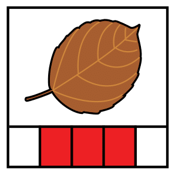
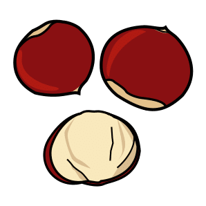
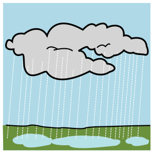
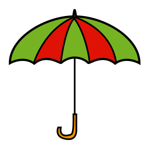
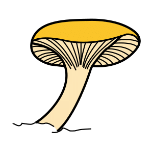
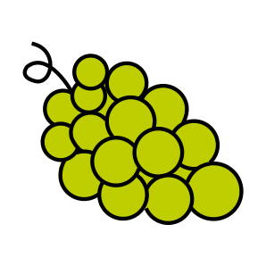
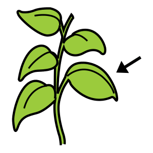
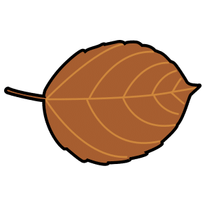
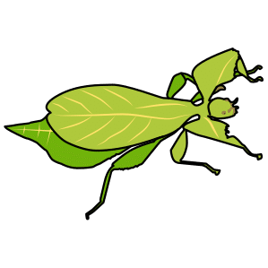

<!-- _class: lead -->
<!-- _paginate: false -->

### Canvas · Esercitazione, versione semplice

# Una tabella di pittogrammi

<p class="meta">Giuseppe Mastrandrea</p>

---

### Cosa facciamo

Una pagina dove si incolla una lista di parole e compare una **griglia di pittogrammi**, presi da un archivio gratuito. Poi la si porta su carta.

---

### Come lavoriamo

<div class="cols">
<div class="card"><h2>Un passo alla volta</h2><p>Ogni slide chiede una sola azione. Si passa alla slide successiva solo quando l'azione è riuscita.</p></div>
<div class="card"><h2>Il riquadro verde</h2><p>Dice cosa dovete vedere sullo schermo. Se vedete altro, alzate la mano.</p></div>
</div>

<div class="check"><b>Cosa vedete:</b> qui, in ogni slide, il controllo da fare.</div>

---

### Il risultato che vogliamo

<div class="griglia">
<div>autunno</div>
<div>foglia</div>
<div>castagna</div>
<div>pioggia</div>
<div>ombrello</div>
<div>fungo</div>
<div>uva</div>
<div class="vuota">xyzabc</div>
</div>

<p class="note" style="text-align:center">Una parola che l'archivio non conosce resta senza immagine, scritta in rosso.</p>

---

### Da dove vengono i pittogrammi

- **ARASAAC** è un archivio di oltre **10.000 pittogrammi**, cercabili in italiano.
- Si usano gratis a scuola, citando l'autore.
- Gemini **non li disegna**: la pagina li va a prendere da ARASAAC, parola per parola.


<p class="note">Come funziona un'API e come si prova dal browser: deck <a href="api.html">Le API</a>, da fare prima di questa esercitazione.</p>

---

### Aprire Canvas

1. Aprite Gemini in una **chat nuova**.
2. Cliccate **Strumenti** sotto la casella del prompt.
3. Scegliete **Canvas**.

<div class="check"><b>Cosa vedete:</b> la voce Canvas evidenziata vicino alla casella del prompt.</div>

---

### Il prompt

<div class="small">

```text
Crea una pagina web per costruire tabelle di comunicazione CAA.
- Un riquadro dove incollo una lista di parole, una per riga.
- Per ogni parola cerca il pittogramma con l'API di ARASAAC:
  https://api.arasaac.org/v1/pictograms/it/search/PAROLA,
  prendi il campo _id del primo risultato e mostra l'immagine
  https://static.arasaac.org/pictograms/ID/ID_500.png.
- Mostra una griglia a 4 colonne, con la parola scritta sotto ogni immagine.
- Se una parola non ha pittogramma, mostra la casella vuota
  con la scritta in rosso.
- Un pulsante "Stampa" che stampa solo la griglia.
```

</div>

<div class="check"><b>Cosa vedete:</b> a destra la pagina, con il riquadro per le parole e il pulsante Stampa.</div>

---

### Il collaudo

<div class="cols">
<div>

Incollate nel riquadro:

```text
autunno
foglia
castagna
pioggia
ombrello
fungo
uva
xyzabc
```

</div>
<div>

<div class="check"><b>Cosa vedete:</b> 7 caselle con il pittogramma e la parola sotto. La casella di <b>xyzabc</b> è vuota, con la scritta in rosso.</div>

</div>
</div>

---

### Guardate la foglia

Per "foglia" ARASAAC restituisce **4 pittogrammi**. La pagina prende sempre il primo.

<div class="cols">
<div class="card" style="text-align:center"><p>1° · quella che prende la pagina</p></div><div class="card" style="text-align:center"><p>2°</p></div><div class="card" style="text-align:center"><p>3° · la foglia secca</p></div><div class="card" style="text-align:center"><p>4° · un insetto</p></div>
</div>

<p class="note">Prova del 13 ottobre 2026. Per l'autunno servirebbe il terzo: la scelta deve restare a voi.</p>

---

### Scegliere il pittogramma

Nella stessa chat:

```text
Quando una parola ha più pittogrammi, mostrali in piccolo
sotto la casella e fammi cliccare quello che preferisco.
```

<div class="check"><b>Cosa vedete:</b> sotto "foglia" 4 miniature. Cliccate la foglia secca: l'immagine grande della casella cambia.</div>

---

### Proviamo a stampare

Premete il pulsante **Stampa**.

<div class="check"><b>Cosa vedete:</b> niente, oppure un messaggio di errore.</div>

<div class="warn">Non è colpa del prompt. Dentro Canvas la pagina gira in un riquadro protetto, e il riquadro blocca la stampa.</div>

---

### Correggere · Scarica PDF

Nella stessa chat:

```text
Il pulsante "Stampa" dentro Canvas non funziona.
Sostituiscilo con un pulsante "Scarica PDF" che salva solo la griglia,
con le librerie html2canvas e jsPDF.
Carica le immagini con crossOrigin="anonymous".
Nel PDF metti solo il pittogramma scelto, senza le miniature.
```

<div class="check"><b>Cosa vedete:</b> al posto di Stampa il pulsante Scarica PDF. Premetelo: parte un download. Aprite il file: dentro c'è la sola griglia, con i pittogrammi.</div>

---

### Se qualcosa non va

Descrivete a Gemini **cosa vedete**:

```text
Il PDF si scarica ma le caselle sono vuote, senza immagini.
```

<div class="warn">Una correzione per messaggio. Se dopo tre tentativi non funziona, alzate la mano.</div>

---

### Per chi finisce prima · Un'altra lista

Cancellate le parole nel riquadro e incollate:

```text
merenda
mela
pane
succo
biscotto
acqua
bere
tovagliolo
```

<div class="check"><b>Cosa vedete:</b> una nuova griglia, con i pittogrammi della merenda. Scaricate anche questa in PDF.</div>

---

### Da ricordare

- I pittogrammi arrivano da **ARASAAC**, non li disegna Gemini.
- Il primo risultato non è sempre quello giusto: si controlla ogni immagine e, se serve, si sceglie tra le miniature.
- Dentro Canvas la stampa è bloccata: si chiede un pulsante **Scarica PDF**.

---

### Crediti

<div class="credits">

Pittogrammi: autore Sergio Palao. Origine: ARASAAC (<a href="https://arasaac.org">arasaac.org</a>). Licenza: CC BY-NC-SA. Proprietà: Governo di Aragona (Spagna).

</div>
