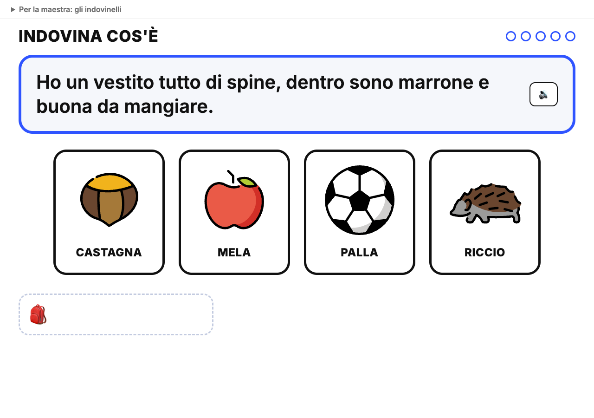
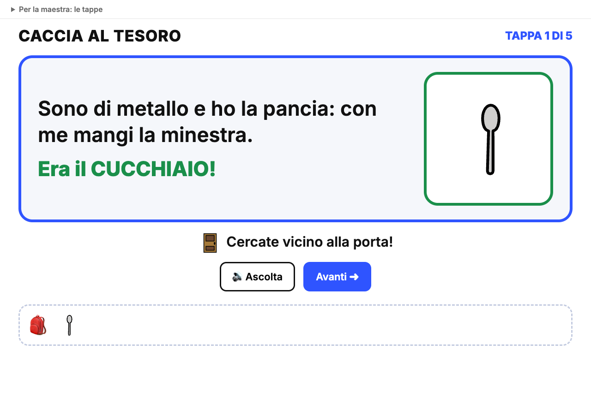

<!-- _class: lead -->
<!-- _paginate: false -->

### Canvas · Esercitazione, infanzia

# Indovina e trova

<p class="meta">Giuseppe Mastrandrea</p>

---

### Cosa facciamo

Due giochi per la LIM costruiti con **Gemini Canvas**, partendo dagli stessi indovinelli scritti con Gemini:

<div class="cols">
<div class="card"><h2>1 · Indovina cos'è</h2><p>Tutto sullo schermo: l'indovinello e 4 immagini, una giusta e 3 distrattori. "È questo? NOOO! È questo? SÌÌÌ!"</p></div>
<div class="card"><h2>2 · La caccia al tesoro</h2><p>Gli oggetti veri sono nascosti in aula. Alla LIM l'indovinello, l'aiutino e lo zaino che si riempie.</p></div>
</div>

<p class="meta">Tecniche: prompt incrementale, collaudo dopo ogni passo, controllo di quello che scrive l'IA</p>

---

### Dove arriviamo

<div class="cols">
<div><p class="note" style="text-align:center"><a href="esempio-indovina.html">esempio-indovina.html</a></p></div>
<div><p class="note" style="text-align:center"><a href="esempio-caccia-tesoro.html">esempio-caccia-tesoro.html</a></p></div>
</div>

---

### Le regole del gioco

<div class="cols">
<div class="card"><h2>Un passo per messaggio</h2><p>Ogni richiesta aggiunge una sola funzione alla pagina.</p></div>
<div class="card"><h2>Provate subito</h2><p>Dopo ogni passo toccate, ascoltate, sbagliate apposta: la pagina fa quello che avete chiesto?</p></div>
<div class="card"><h2>Descrivete il problema</h2><p>Se qualcosa non va, scrivete cosa vedete. Non riscrivete tutto da capo.</p></div>
</div>

---

<!-- _class: big -->

# Gli indovinelli

---

### Indovinelli · Il prompt

<div class="small">

```text
Ambito: scuola dell'infanzia, bambini di 4-5 anni.
Compito: scrivi un indovinello per ognuna di queste cose:
castagna, foglia, pioggia, fungo, uva.
Ogni indovinello è lungo al massimo 2 righe, parla in prima
persona ("Ho...", "Sono...") e usa parole che un bambino di 4 anni
conosce. Non scrivere mai la soluzione dentro l'indovinello.
Per ogni cosa aggiungi 3 distrattori: cose che un bambino conosce
e che NON rispondono all'indovinello.
Formato: una riga per indovinello, così:
indovinello | soluzione emoji | distrattore emoji, distrattore emoji, distrattore emoji
```

</div>

<p class="note">Per la caccia al tesoro si usano gli oggetti veri della sezione, e i distrattori non servono.</p>

---

### Indovinelli · Il controllo

<div class="cols">
<div class="card"><h2>È vero?</h2><p>Gemini non conosce la vostra sezione: può scrivere "sono rossa" per una pigna o descrivere una macchinina diversa dalla vostra.</p></div>
<div class="card"><h2>Ha una sola risposta?</h2><p>"Siamo piccoli, tondi e viola": uva, ma anche mirtilli. Se un distrattore risponde anche lui, cambiatelo.</p></div>
<div class="card"><h2>Si capisce?</h2><p>Leggetelo ad alta voce come lo direste in sezione. Le parole difficili si cambiano.</p></div>
</div>

<p class="note">Un distrattore "furbo" va bene: per la castagna ("un vestito di spine") il riccio fa pensare, ma non è buono da mangiare.</p>

---

### Le emoji che non ci sono

<div class="cols">
<div class="card"><h2>Lo scrigno</h2><p>L'emoji dello scrigno del tesoro non esiste. Cercando "tesoro" si trova 🧰, che è una cassetta degli attrezzi. Meglio 🎁.</p></div>
<div class="card"><h2>La pigna</h2><p>Non esiste nemmeno lei. Chi cerca un'emoji vicina finisce sull'albero 🌲: sotto la scritta PIGNA il bambino vede un pino.</p></div>
</div>

<p class="note">Se per un oggetto l'emoji non c'è, per la caccia al tesoro cambiate oggetto: in aula ce ne sono altri.</p>

---

<!-- _class: big -->

# 1 · Indovina cos'è

---

### Indovina · Passo 0

In Gemini, nella barra del prompt: **Strumenti → Canvas**.

Tutti i passi si scrivono **nella stessa chat**: Canvas modifica la pagina che c'è già.

---

### Indovina · Passo 1, l'indovinello e le carte

<div class="small">

```text
Ambito: scuola dell'infanzia, bambini di 4-5 anni.
Compito: crea una pagina web con un gioco da usare alla LIM.
In alto un indovinello scritto grande. Sotto, 4 carte grandi in fila,
mescolate: la soluzione e 3 distrattori. Ogni carta ha un'emoji
grande e sotto la parola in STAMPATELLO MAIUSCOLO.
Questi sono gli indovinelli, uno alla volta:
[incollate le righe preparate con Gemini]
Le carte si toccano con il dito sulla LIM, non solo con il mouse.
```

</div>

---

### Indovina · Passo 2, il NOOO e il SÌÌÌ

<div class="small">

```text
Quando tocco una carta sbagliata, la carta trema, diventa grigia e
sopra compare "NO!". La pagina dice "Nooooo!" con la sintesi vocale,
lento e allungato, come in un gioco.
Quando tocco la carta giusta, la carta si ingrandisce con il bordo
verde, sopra compare "SÌ!" e la pagina dice "Sìììì! È la castagna!".
```

</div>

<p class="note">Il "no" fa parte del gioco: la maestra lo recita insieme alla pagina, e la carta grigia aiuta a escludere.</p>

---

### Indovina · Passo 3, lo zaino

```text
In basso c'è uno zaino 🎒. Ogni soluzione indovinata
ci entra come immagine piccola.
Dopo la risposta giusta compare il pulsante "Avanti",
che passa all'indovinello successivo.
In alto a destra un pallino per ogni indovinello.
```

<p class="note">"Avanti" lo tocca la maestra: decide lei quando si passa, dopo aver festeggiato.</p>

---

### Indovina · Passo 4, la voce e le emoji

<div class="small">

```text
All'inizio di ogni indovinello la pagina lo legge ad alta voce,
in italiano e un po' più lentamente del normale.
Accanto all'indovinello metti un pulsante 🔊 per rileggerlo.
Mostra le emoji come immagini OpenMoji:
https://cdn.jsdelivr.net/npm/openmoji@15.1.0/color/svg/CODICE.svg
dove CODICE è il codice Unicode dell'emoji in maiuscolo, senza FE0F.
In fondo alla pagina scrivi: "Emoji: OpenMoji (openmoji.org),
licenza CC BY-SA 4.0".
```

</div>

---

### Indovina · Passo 5, gli indovinelli li scrive la maestra

```text
Aggiungi in alto un pannello richiudibile "Per la maestra"
con un riquadro: un indovinello per riga, nel formato
indovinello | soluzione emoji | distrattori separati da virgole.
Sotto, il pulsante "Crea il gioco".
```

---

### Indovina · Passo 6, la fine

```text
Dopo l'ultimo indovinello mostra grande "BRAVI!",
sotto tutte le soluzioni indovinate, e la pagina dice
"Bravi! Avete indovinato tutto!".
Aggiungi un pulsante "Ricomincia".
```

---

<!-- _class: big -->

# 2 · La caccia al tesoro

---

### Caccia · Prima di giocare

1. Scegliete 5 oggetti della sezione che abbiano un'emoji: cucchiaio, macchinina, palla, pennello, orsetto.
2. Fate scrivere a Gemini gli indovinelli, senza distrattori.
3. Controllate ogni indovinello **con l'oggetto in mano**.
4. Nascondete gli oggetti e segnatevi dove.

<div class="warn">Il gioco è pensato per l'aula: gli oggetti nascosti devono essere a portata dei bambini e lontani da prese, finestre aperte e scaffali alti.</div>

---

### Caccia · Passo 1, la tappa

<div class="small">

```text
Ambito: scuola dell'infanzia, bambini di 4-5 anni.
Compito: crea una pagina web per una caccia al tesoro in aula,
da usare alla LIM. Una tappa alla volta: a sinistra l'indovinello
scritto grande, a destra una casella coperta con un punto
interrogativo. Sotto, un pulsante grande verde "Trovato!".
In alto a destra: "TAPPA 1 DI 5".
Queste sono le tappe, nel formato oggetto emoji | posto emoji | indovinello:
[incollate le righe]
I pulsanti si toccano con il dito sulla LIM, non solo con il mouse.
```

</div>

---

### Caccia · Passo 2, trovato!

```text
Quando tocco "Trovato!", la casella si apre e mostra
l'emoji dell'oggetto, sotto l'indovinello compare
"Era il CUCCHIAIO!" e la pagina lo dice ad alta voce.
L'oggetto entra in uno zaino 🎒 in fondo alla pagina.
Poi compare il pulsante "Avanti" per la tappa successiva.
```

---

### Caccia · Passo 3, l'aiutino

```text
Aggiungi un pulsante "💡 Aiutino". Quando lo tocco, sotto
l'indovinello compare l'emoji del posto e la scritta
"Cercate vicino alla porta!", e la pagina la dice.
```

<p class="note">L'aiutino lo decide la maestra: si usa quando la ricerca dura troppo, non subito.</p>

---

### Caccia · Passo 4, voce, emoji, tappe

<div class="small">

```text
All'inizio di ogni tappa la pagina legge l'indovinello ad alta voce,
in italiano e un po' più lentamente del normale. Aggiungi un pulsante
"🔊 Ascolta" per rileggerlo.
Mostra le emoji come immagini OpenMoji (stesso indirizzo di prima).
Aggiungi in alto un pannello richiudibile "Per la maestra" con
le tappe, una per riga, e il pulsante "Crea la caccia".
```

</div>

---

### Caccia · Passo 5, il tesoro

```text
Dopo l'ultima tappa mostra un grande 🎁, la scritta
"BRAVI, ESPLORATORI!" e sotto tutti gli oggetti trovati.
La pagina dice "Bravi, esploratori! Avete trovato il tesoro!".
Aggiungi un pulsante "Ricomincia".
```

<p class="note">Il tesoro vero lo prepara la maestra: un disegno, un adesivo, la merenda.</p>

---

### Se qualcosa non va

```text
Tocco una carta sbagliata ma la pagina non dice niente.
```

```text
Le immagini non compaiono, vedo solo le parole.
Mostrami nella pagina il messaggio di errore.
```

```text
La voce legge anche il nome dell'emoji dopo la parola.
```

---

### Il prompt unico

Alla fine di ogni versione, nella stessa chat:

```text
Scrivi un prompt unico che, incollato in una chat nuova con
Canvas attivo, ricrei questa pagina con tutte le funzioni.
Mettilo in un blocco di codice.
```

Copiatelo nel kit. Per un tema nuovo si cambiano solo gli indovinelli o le tappe.

---

### Ritrovare e condividere il gioco

<div class="cols">
<div>

- La pagina resta nella chat: riaprendo la chat, la ritrovate.
- **Condividi** in alto nel pannello di Canvas crea un link che apre il gioco.
- Gli indovinelli si cambiano dal pannello "Per la maestra", senza tornare in Gemini.

</div>
<div class="shot">Screenshot: il menu Condividi di Canvas</div>
</div>

---

### In sezione

- **Indovina cos'è**: la maestra legge, i bambini indicano, la maestra tocca e recita "è questo? NOOO!".
- **Prima di toccare**: "perché non può essere la palla?". Si esclude a voce, poi si tocca.
- **La caccia**: a squadre, una tappa per squadra, gli altri tifano.
- **Alla fine**: "l'indovinello diceva giusto?". Se il computer ha sbagliato, lo correggono i bambini.

---

### Da ricordare

- Ogni indovinello si controlla: è vero, ha una sola risposta, si capisce.
- Ogni emoji si controlla: è la cosa giusta?
- Il "no" è un gioco: niente punti, niente classifiche.
- Nella pagina vanno solo parole ed emoji: niente nomi o foto dei bambini.

---

### Crediti

<div class="credits">

Emoji: OpenMoji (openmoji.org), licenza CC BY-SA 4.0.

</div>
