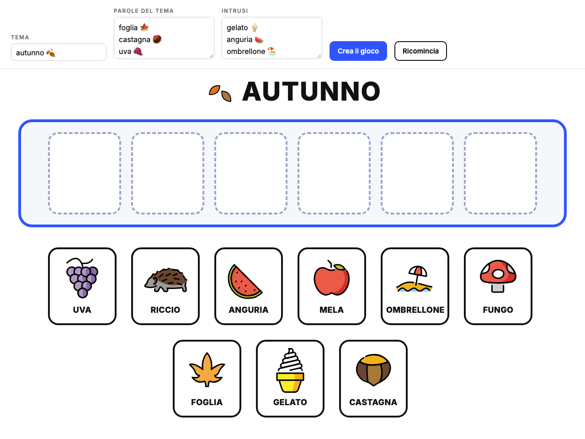

<!-- _class: lead -->
<!-- _paginate: false -->

### Canvas · Esercitazione, infanzia, versione semplice

# Ogni cosa al suo posto

<p class="meta">Giuseppe Mastrandrea</p>

---

### Cosa facciamo

Con **Gemini Canvas** costruiamo un gioco per la LIM: in alto il tema e 6 caselle vuote, sotto 9 immagini mescolate. I bambini trascinano nelle caselle le cose che c'entrano con il tema. Gli intrusi tornano al loro posto.

Si lavora tutto dentro Canvas, senza account in più. Il prompt lo costruiamo **un pezzo alla volta**, nella stessa chat.

<p class="meta">Tecniche: prompt incrementale, collaudo dopo ogni passo, correggere descrivendo il problema</p>

---

### Dove arriviamo

<div class="schema"></div>

<p class="note" style="text-align:center">Il risultato d'esempio: <a href="esempio-caselle-emoji.html">esempio-caselle-emoji.html</a></p>

---

### Le regole del gioco

<div class="cols">
<div class="card"><h2>Un passo per messaggio</h2><p>Ogni richiesta aggiunge una sola funzione alla pagina.</p></div>
<div class="card"><h2>Provate subito</h2><p>Dopo ogni passo trascinate, ascoltate, sbagliate apposta: la pagina fa quello che avete chiesto?</p></div>
<div class="card"><h2>Descrivete il problema</h2><p>Se qualcosa non va, scrivete cosa vedete. Non riscrivete tutto da capo.</p></div>
</div>

---

### Passo 0 · Attivare Canvas

In Gemini, nella barra del prompt: **Strumenti → Canvas**.

Tutti i passi successivi si scrivono **nella stessa chat**: Canvas modifica la pagina che c'è già.

---

### Passo 1 · Le caselle

<div class="small">

```text
Ambito: scuola dell'infanzia, bambini di 4-5 anni.
Compito: crea una pagina web con un gioco da usare alla LIM.
In alto il tema AUTUNNO, grande. Sotto, 6 caselle vuote.
In basso, mescolate, queste immagini: foglia, castagna, uva,
riccio, mela, fungo. Ogni immagine è un'emoji grande con sotto
la parola in STAMPATELLO MAIUSCOLO.
Il bambino trascina un'immagine in una casella vuota e lì resta.
Il trascinamento deve funzionare con il dito sulla LIM e sul
tablet, non solo con il mouse.
```

</div>

<p class="note">Le ultime due righe servono: il trascinamento pensato per il mouse spesso non risponde al dito. Se avete un tablet, provate lì.</p>

---

### Passo 2 · La voce

```text
Quando un'immagine entra in una casella, la pagina pronuncia
la parola in italiano con la sintesi vocale del browser,
un po' più lentamente del normale.
```

<p class="note">La voce è quella installata sul computer o sulla LIM: se manca la voce italiana, la parola esce con un accento straniero.</p>

---

### Passo 3 · Gli intrusi

```text
Aggiungi 3 intrusi che non c'entrano con l'autunno:
gelato, anguria, ombrellone.
Se il bambino trascina un intruso in una casella, l'intruso
torna al suo posto e la pagina dice "Riprova".
Niente croci rosse, niente suoni di errore.
```

<p class="note">L'errore non si punisce: l'immagine torna indietro e si riprova.</p>

---

### Scegliere gli intrusi

<div class="cols">
<div class="card"><h2>Il sole</h2><p>C'è anche in autunno. Un bambino che lo mette nella casella non sbaglia.</p></div>
<div class="card"><h2>La pioggia</h2><p>Vale per l'autunno e per la primavera. Meglio non usarla come intruso.</p></div>
<div class="card"><h2>Il gelato</h2><p>Si lega all'estate senza discussioni. Funziona.</p></div>
</div>

<p class="note">Se due maestre non sono d'accordo su un intruso, cambiatelo.</p>

---

### Passo 4 · Le parole le sceglie la maestra

<div class="small">

```text
Aggiungi in alto un campo per il tema e due riquadri, uno per
le parole del tema e uno per gli intrusi, una parola per riga,
con un pulsante "Crea il gioco".
Ogni riga contiene la parola e la sua emoji, per esempio: castagna 🌰
Se in una riga manca l'emoji, mostra un punto interrogativo
e scrivi la parola in rosso.
Le caselle sono tante quante le parole del tema.
```

</div>

---

### Dove trovo le emoji

<div class="cols">
<div>

Chiedetele a Gemini, in una chat a parte:

```text
Per ognuna di queste parole proponi un'emoji,
una riga per parola, nel formato: parola emoji.
Se non esiste un'emoji adatta, scrivi solo la parola.
[elenco delle parole]
```

</div>
<div>

Oppure dalla tastiera:

- **Windows**: tasto Windows + punto
- **Mac**: Ctrl + Cmd + Spazio

</div>
</div>

---

### Guardate zucca e melagrana

<div class="cols">
<div class="card" style="text-align:center"><h2>Zucca</h2><p>L'emoji della zucca semplice non esiste: questa è la zucca di Halloween, con la faccia.</p></div>
<div class="card" style="text-align:center"><h2>Melagrana</h2><p>Non esiste nemmeno lei. Chi cerca un'emoji vicina finisce sulla mela: sotto la scritta MELAGRANA il bambino vede una mela.</p></div>
</div>

<p class="note">Le emoji sono circa 3.700: per oggetti, animali e cibo bastano, per azioni e concetti spesso no. Quando non bastano, c'è la versione completa con le immagini generate.</p>

---

### Passo 5 · Le stesse emoji su ogni schermo

La stessa emoji è disegnata in modo diverso su Windows, iPad e Android. OpenMoji le ridisegna tutte nello stesso stile.

<div class="small">

```text
Mostra le emoji come immagini OpenMoji:
https://cdn.jsdelivr.net/npm/openmoji@15.1.0/color/svg/CODICE.svg
dove CODICE è il codice Unicode dell'emoji in maiuscolo, senza FE0F
(per esempio 1F330 per 🌰).
In fondo alla pagina scrivi: "Emoji: OpenMoji (openmoji.org),
licenza CC BY-SA 4.0".
```

</div>

---

### Passo 6 · La festa finale

```text
Quando tutte le caselle sono piene, mostra grande "BRAVI!"
con qualche emoji di festa e fai dire alla pagina
"Bravi! Ogni cosa al suo posto".
Aggiungi un pulsante "Ricomincia" che svuota le caselle
e rimescola le immagini.
```

---

### Se qualcosa non va

Descrivete quello che vedete:

```text
Con il dito sulla LIM le immagini non si spostano:
si muove tutta la pagina.
```

```text
Quando lascio un'immagine nella casella, finisce in un altro
punto dello schermo.
```

```text
Le immagini non compaiono, vedo solo le parole.
Mostrami nella pagina il messaggio di errore.
```

---

### Il prompt unico

Alla fine, nella stessa chat:

```text
Scrivi un prompt unico che, incollato in una chat nuova con
Canvas attivo, ricrei questa pagina con tutte le funzioni.
Mettilo in un blocco di codice.
```

Copiatelo nel kit e provatelo in una chat nuova: la pagina che esce è uguale?

---

### Ritrovare e condividere il gioco

<div class="cols">
<div>

- La pagina resta nella chat: riaprendo la chat, la ritrovate.
- **Condividi** in alto nel pannello di Canvas crea un link che apre il gioco.
- Il link si apre sulla LIM e sul tablet, senza entrare in Gemini.

</div>
<div class="shot">Screenshot: il menu Condividi di Canvas</div>
</div>

---

### In sezione

- **Prima del gioco**: si guardano insieme le immagini e si dà un nome a ognuna.
- **Alla LIM, a turno**: un bambino sceglie un'immagine e la trascina, tutti ascoltano la parola.
- **Gli intrusi**: quando uno torna indietro, si chiede "perché non c'entra?".
- **Altri temi**: gli animali della fattoria, le cose del bagno, i mestieri. Si cambiano solo le parole.

---

### Da ricordare

- Un passo per messaggio, e dopo ogni passo si prova la pagina.
- Il trascinamento con il dito va chiesto esplicitamente.
- Ogni emoji e ogni intruso si controllano: è la cosa giusta? è adatta ai bambini?
- Nella pagina vanno solo parole ed emoji: niente nomi o foto dei bambini.

---

### Per andare oltre

La versione completa, <a href="storia-caselle.html">Una storia da completare</a>, usa lo stesso gioco con tre differenze:

- le immagini le genera Gemini, una per parola, tutte nello stesso stile;
- le immagini e il gioco si pubblicano su GitHub Pages;
- una storia guida il gioco, una frase alla volta.

---

### Crediti

<div class="credits">

Emoji: OpenMoji (openmoji.org), licenza CC BY-SA 4.0.

</div>
