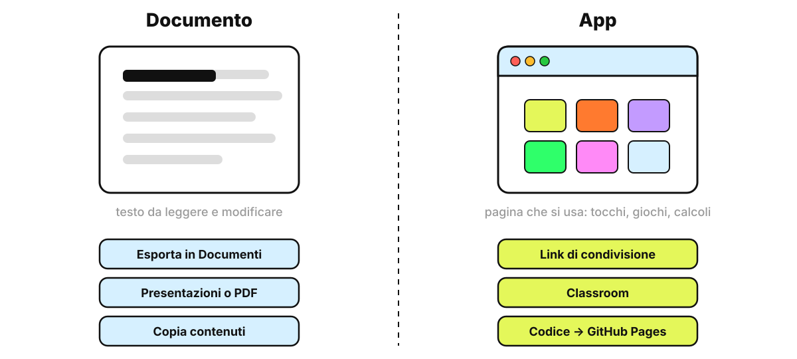
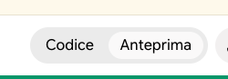
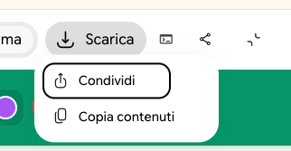

<!-- _class: lead -->
<!-- _paginate: false -->

### Strumenti

# Gemini Canvas

<p class="meta">Giuseppe Mastrandrea</p>

---

### Che cos'è

Un **pannello di lavoro accanto alla chat**: Gemini ci scrive un documento o costruisce una pagina, e a ogni richiesta successiva modifica quello che c'è già.

Si attiva dalla barra del prompt: **Strumenti → Canvas**.

<p class="note">È disponibile anche nella versione gratuita di Gemini.</p>

---

### Chat o Canvas?

<div class="cols">
<div class="card"><h2>Chat</h2><p>Ogni risposta è un messaggio nuovo che scorre via. Per correggere, Gemini riscrive tutto.</p></div>
<div class="card"><h2>Canvas</h2><p>C'è un solo oggetto, sempre visibile a destra. Le richieste lo modificano un pezzo alla volta.</p></div>
</div>

---

### Due cose diverse

<div class="schema"></div>

---

### Il documento

```text
Ambito: scuola primaria, classe terza.
Compito: crea in Canvas una scheda di lettura sul riccio:
un testo di 10 righe e 5 domande di comprensione.
Voglio un documento di testo, non una pagina web.
```

Poi si lavora sul documento: "accorcia il testo", "aggiungi due domande vero/falso", "metti in grassetto le parole nuove".

---

### L'app

```text
Ambito: scuola dell'infanzia, routine del mattino.
Compito: crea una pagina per la LIM con 4 pulsanti grandi:
☀️ sole, 🌧️ pioggia, ☁️ nuvole, ❄️ neve.
Quando tocco un pulsante, la sua emoji compare grande al centro.
```

<p class="note">Se non si specifica, è Gemini a scegliere tra documento e app.</p>

---

### Anteprima e codice

<div class="cols">
<div>

Un'app ha due viste:
- **Anteprima**: la pagina da usare;
- **Codice**: il testo che la fa funzionare.

Il codice non serve leggerlo. Per portare la pagina fuori da Canvas c'è il pulsante **Scarica**.

</div>
<div></div>
</div>

---

### Il metodo: una richiesta alla volta

<div class="cols">
<div class="card"><h2>Un passo per messaggio</h2><p>Ogni richiesta aggiunge una sola funzione o cambia una sola cosa.</p></div>
<div class="card"><h2>Provate subito</h2><p>Dopo ogni passo si tocca, si legge, si scarica: fa quello che avete chiesto?</p></div>
<div class="card"><h2>Descrivete il problema</h2><p>"Il pulsante non fa nulla" funziona meglio che riscrivere tutto il prompt.</p></div>
</div>

---

### Cosa si porta fuori

| In Canvas | Dove va |
|---|---|
| Documento | **Esporta in Documenti**, poi da Documenti in PDF, Word o Markdown |
| Presentazione | **Esporta in Presentazioni** o in PDF |
| App | **Scarica**: il file della pagina, da aprire nel browser o pubblicare<br>**Condividi**: un link che apre la pagina<br>**Copia contenuti**: il codice |
| Qualsiasi creazione | **Condividi in Classroom** |

<p class="note">Fonte: guida di Google "Create docs, apps & more with Canvas"; Classroom da giugno 2026 (Google Workspace Updates).</p>

---

### Scarica e condividi un'app

<div class="cols">
<div>

In alto nel pannello di un'app:
- **Scarica**: salva la pagina come file;
- l'icona di **condivisione**: **Condividi** crea il link, **Copia contenuti** copia il codice.

Il file scaricato si apre con Chrome, e lì la stampa funziona.

</div>
<div></div>
</div>

---

### I limiti delle app

- **La stampa è bloccata**: l'anteprima gira in un riquadro protetto. Si chiede un pulsante **"Scarica PDF"**, oppure si scarica la pagina e la si stampa da Chrome.
- **Le risorse esterne** (immagini, dati) funzionano solo se il sito che le offre lo permette: ARASAAC e GitHub Pages sì, Google Drive no.
- **Nessun dato personale**: le app condivise con un link sono pubbliche.

---

### Il prompt unico

Alla fine, nella stessa chat:

```text
Scrivi un prompt unico che, incollato in una chat nuova con
Canvas attivo, ricrei questa pagina con tutte le funzioni.
Mettilo in un blocco di codice.
```

Si salva nel kit: la prossima volta si riparte da lì.

---

### Le esercitazioni

<div class="cols">
<div class="card"><h2>Che tempo fa oggi?</h2><p>Infanzia. Una pagina, quattro pulsanti: il primo contatto con le app.</p></div>
<div class="card"><h2>La mappa che parla</h2><p>Infanzia. Una mappa per la LIM costruita in 7 passi.</p></div>
<div class="card"><h2>La tabella CAA</h2><p>Primaria. Pittogrammi ARASAAC dall'API e pubblicazione su GitHub Pages.</p></div>
</div>

---

### Da ricordare

- Prima di scrivere il prompt, decidete se vi serve un **documento** o un'**app**, e scrivetelo.
- Una richiesta per messaggio, e dopo ogni richiesta si prova.
- Il documento si esporta in Documenti, l'app si scarica o si condivide con un link.
