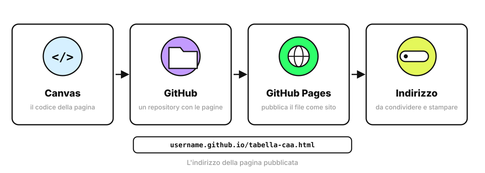
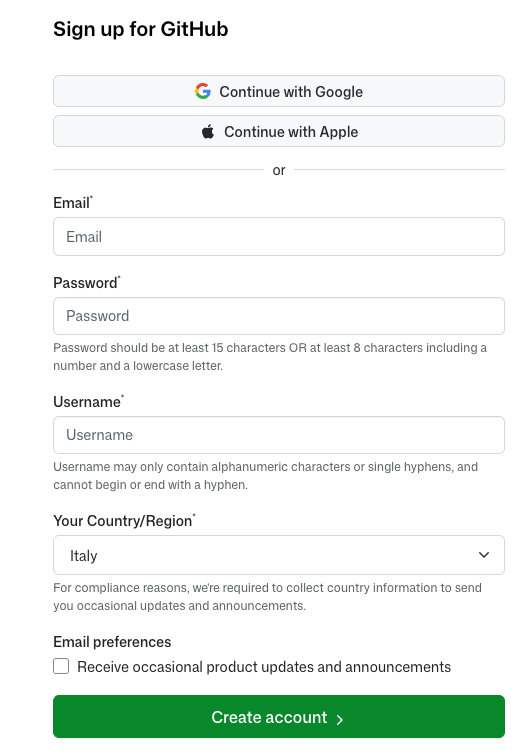
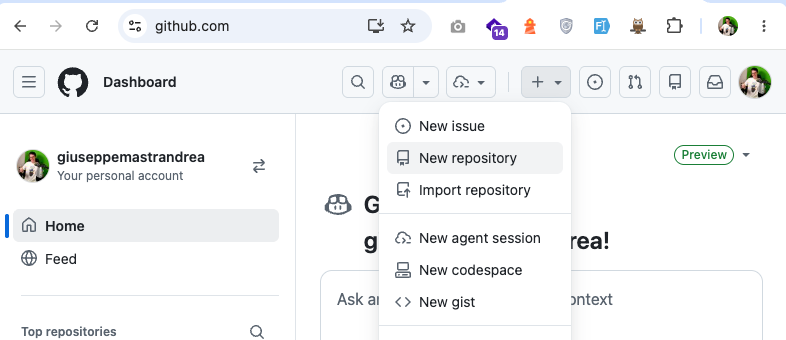
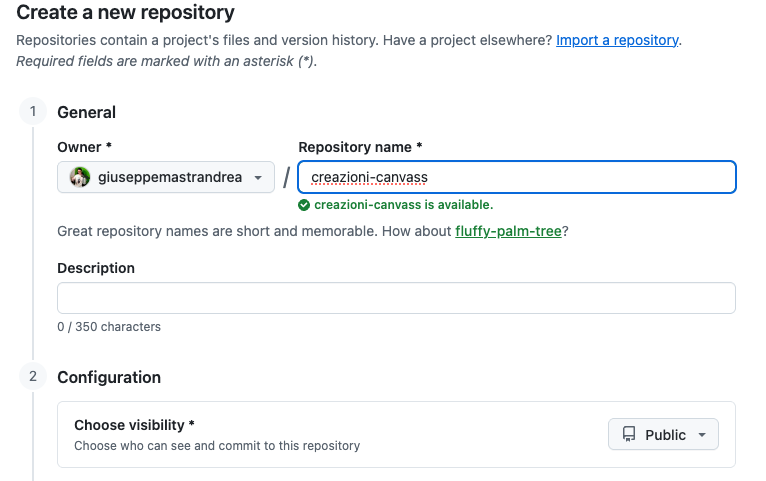
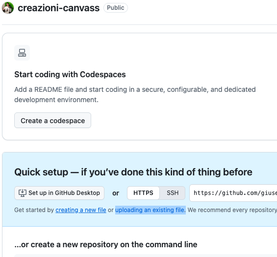
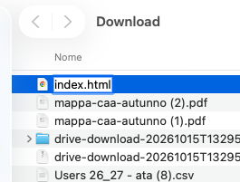
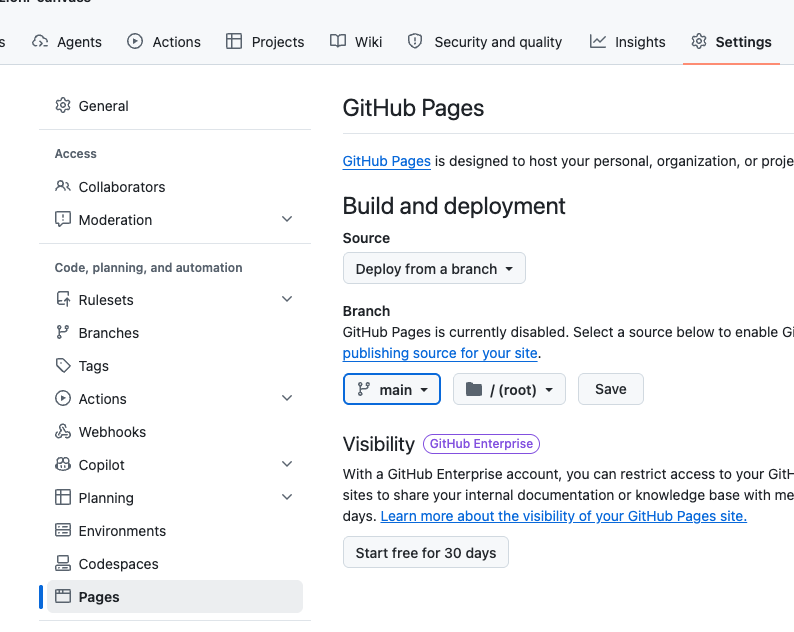
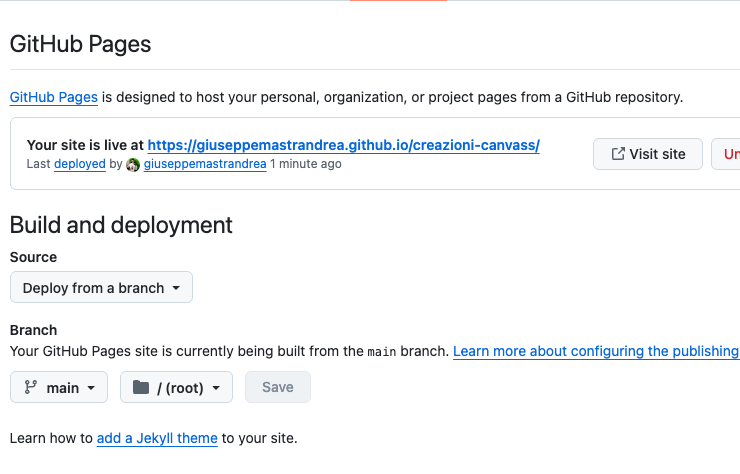

<!-- _class: lead -->
<!-- _paginate: false -->

### Canvas · Introduzione

# GitHub Pages

<p class="meta">Giuseppe Mastrandrea</p>

---

### Perché pubblicare

<div class="cols">
<div class="card"><h2>Dentro Canvas</h2><p>La pagina vive nella chat di Gemini, in un riquadro protetto che blocca la stampa. Per riusarla bisogna ritrovare la chat.</p></div>
<div class="card"><h2>Pubblicata</h2><p>Ha un indirizzo fisso, si apre da qualsiasi browser, si stampa e si passa alle colleghe.</p></div>
</div>

---

### GitHub e GitHub Pages

- **GitHub** è un sito che conserva i file di un progetto insieme alla storia delle modifiche. Ogni progetto si chiama **repository**.
- **GitHub Pages** è un servizio di GitHub che pubblica come sito i file HTML di un repository pubblico.
- L'account base è gratuito, e Pages lo è per i repository pubblici.

<p class="note">L'interfaccia di GitHub è in inglese: nelle slide i nomi dei pulsanti sono quelli originali.</p>

---

### Il percorso

<div class="schema"></div>

<p class="note" style="text-align:center">La prima pagina si chiama index.html. Le altre, nello stesso repository, hanno un nome loro.</p>

---

### Prima di iniziare: pubblico vuol dire pubblico

- Chiunque abbia il link vede la pagina, e chiunque apra il repository ne legge il codice.
- Nelle pagine e nei nomi dei file **mai nomi, foto o disegni degli alunni**.
- **Mai chiavi o password** dentro una pagina.
- Lo username di GitHub compare nell'indirizzo: sceglietene uno che vi sta bene vedere in pubblico.

---

### Account 1 · Il modulo

<div class="cols">
<div>

1. Aprite **github.com** e cliccate **Sign up**.
2. Scrivete **email**, **password** e **username**.
3. **Your Country/Region**: Italy.
4. Cliccate **Create account**.

<p class="note">La password: almeno 15 caratteri, oppure almeno 8 con un numero e una lettera minuscola.</p>

</div>
<div class="sc"></div>
</div>

---

### Account 2 · Lo username

- Solo **lettere, numeri e trattini**, senza spazi. Non può iniziare né finire con un trattino.
- Diventa l'inizio dell'indirizzo: **username**.github.io
- Si può cambiare dopo, ma i link già mandati alle colleghe smettono di funzionare.

<div class="check"><b>Cosa vedete:</b> nessuna scritta rossa sotto lo username. Se compare, il nome è già preso: aggiungete un numero o una parola.</div>

---

### Account 3 · La verifica

1. Se compare un piccolo rompicapo con le immagini, risolvetelo: serve a dimostrare che non siete un programma.
2. Aprite l'email: GitHub ha mandato un **codice**. Scrivetelo nella pagina.
3. Se GitHub fa domande su di voi, potete saltarle.

<div class="check"><b>Cosa vedete:</b> la pagina principale di GitHub, con la vostra immagine del profilo in alto a destra. L'account è pronto.</div>

---

### Repository 1 · Aprire il modulo

<div class="cols">
<div>

1. In alto a destra cliccate **+**.
2. Scegliete **New repository**.

<div class="check"><b>Cosa vedete:</b> il modulo "Create a new repository".</div>

</div>
<div class="sc"></div>
</div>

---

### Repository 2 · Compilare il modulo

<div class="cols">
<div>

1. **Repository name**: un nome breve, in minuscolo, senza spazi. Per esempio `creazioni-canvas`.
2. **Choose visibility**: **Public**.
3. Tutto il resto lasciatelo com'è.
4. In fondo cliccate **Create repository**.

<p class="note">Il nome finisce nell'indirizzo: username.github.io/<b>creazioni-canvas</b>/</p>

</div>
<div class="sc"></div>
</div>

---

### Repository 3 · Il repository vuoto

<div class="cols">
<div>

<div class="check"><b>Cosa vedete:</b> una pagina quasi vuota, con il riquadro azzurro "Quick setup" e il link <i>uploading an existing file</i>.</div>

**Non chiudete questa scheda**: ci torniamo tra poco, con il file della pagina.

</div>
<div class="sc"></div>
</div>

---

### Canvas 1 · Scaricare il codice

<div class="cols">
<div>

1. In un'altra scheda aprite la chat di Gemini con la pagina.
2. In alto, nel riquadro di Canvas, cliccate **Esporta**.
3. Scegliete **Scarica codice**.

<div class="check"><b>Cosa vedete:</b> nella cartella <b>Download</b> del computer un file nuovo, che finisce con .html.</div>

</div>
<div class="sc"></div>
</div>

---

### Canvas 2 · Rinominare in index.html

<div class="cols">
<div>

1. Aprite la cartella **Download**.
2. Rinominate il file appena scaricato in `index.html`
Windows: tasto destro → **Rinomina**. Mac: cliccate il file e premete **Invio**.

<p class="note">Il nome è obbligatorio: index.html è la pagina che GitHub Pages apre per prima.</p>

</div>
<div class="sc"></div>
</div>

<div class="warn">Windows spesso nasconde la parte finale .html. Se il nome che vedete non finisce con .html, scrivete solo <b>index</b>: altrimenti il file diventa index.html.html.</div>

---

### Caricare il file

<div class="cols">
<div>

1. Tornate alla scheda di GitHub e cliccate **uploading an existing file**.
2. Trascinate **index.html** dalla cartella Download nel riquadro.
3. Sotto **Commit changes** potete scrivere una frase che descrive la pagina.
4. Cliccate il pulsante verde **Commit changes**.

</div>
<div class="sc"></div>
</div>

<div class="check"><b>Cosa vedete:</b> la pagina del repository con un solo file, index.html.</div>

---

### Pages 1 · Trovare le impostazioni

<div class="cols">
<div>

1. Nel repository cliccate **Settings** (l'ingranaggio, in alto a destra).
2. Nella colonna di sinistra, in fondo, cliccate **Pages**.

<div class="check"><b>Cosa vedete:</b> la pagina "GitHub Pages", con la sezione "Build and deployment".</div>

</div>
<div class="sc"></div>
</div>

---

### Pages 2 · Accendere la pubblicazione

<div class="cols">
<div>

1. **Source**: Deploy from a branch.
2. **Branch**: cliccate **None** e scegliete **main**.
3. Cartella: **/ (root)**.
4. Cliccate **Save**.

</div>
<div class="sc"></div>
</div>

---

### Pages 3 · La pagina è online

<div class="cols">
<div>

1. Aspettate un paio di minuti.
2. Ricaricate la pagina delle impostazioni.
3. In cima compare **Your site is live at...**: cliccate **Visit site**.

<div class="check"><b>Cosa vedete:</b> la vostra pagina, che funziona come in Canvas.</div>

<div class="warn">Errore 404? Pages non ha ancora finito: aspettate un altro minuto e ricaricate.</div>

</div>
<div class="sc"></div>
</div>

---

### Il collaudo

1. Copiate l'indirizzo: **username.github.io/creazioni-canvas/**
2. Provate la stampa del browser (**Ctrl+P** o **Cmd+P**): fuori da Canvas funziona.
3. Mandate il link a una collega e fatelo provare a lei.

<div class="check"><b>Cosa vedete:</b> la pagina si apre anche dal telefono e dal computer della collega.</div>

---

### Gli errori più frequenti

| Cosa vedete | Cosa fare |
|---|---|
| Errore 404 | Aspettate un minuto e ricaricate |
| Errore 404 anche dopo 5 minuti | Il file non si chiama esattamente index.html |
| Su GitHub il file si chiama index.html.html | Rinominatelo bene sul computer e caricatelo di nuovo |
| Vedete la versione vecchia | Ricaricate con **Ctrl+Shift+R** (**Cmd+Shift+R**) |
| Manca Pages nelle impostazioni | Il repository non è Public |

---

### Aggiornare la pagina

Si carica un file con **lo stesso nome**: GitHub sostituisce quello vecchio.

1. In Canvas chiedete la modifica, poi **Esporta → Scarica codice**.
2. Rinominate il file in **index.html**, come la prima volta.
3. Nel repository: **Add file → Upload files**, trascinate il file, **Commit changes**.
4. Aspettate un paio di minuti.

<p class="note">L'indirizzo resta lo stesso: il link già mandato alle colleghe mostra la versione nuova.</p>

---

### Un'altra pagina, nello stesso repository

<div class="cols">
<div>

1. In Canvas: **Esporta → Scarica codice**.
2. Rinominate il file con un nome **suo**, non index.html. Per esempio `ruota_dell_autunno.html`
3. Nel repository: **Add file → Upload files**, trascinate il file, **Commit changes**.

<div class="check"><b>Cosa vedete:</b> la pagina all'indirizzo username.github.io/creazioni-canvas/ruota_dell_autunno.html</div>

</div>
<div class="sc"></div>
</div>

---

### I nomi dei file

| Sì | No |
|---|---|
| `ruota_dell_autunno.html` | `Ruota dell'autunno.html` |
| `tabella-caa.html` | `tabella-caa` (manca .html) |

- Lettere **minuscole**, parole separate da **trattini** o **trattini bassi** ( _ ).
- **Niente** spazi, accenti, apostrofi.
- Finisce sempre con **.html**.

<p class="note">Più avanti index.html diventerà la pagina indice che porta a tutte le altre: esercitazione <a href="il-mio-sito.html">Il mio sito</a>.</p>

---

### In più · Le proprie immagini

Le immagini si caricano allo stesso modo, con **Add file → Upload files**, accanto a index.html. Ognuna ha il suo indirizzo: **username.github.io/creazioni-canvas/riccio.png**.

Se i file hanno il nome della parola, Canvas costruisce l'indirizzo da solo:

```text
Per ogni parola mostra l'immagine
https://USERNAME.github.io/REPOSITORY/PAROLA.png
Se l'immagine non esiste, mostra un punto interrogativo.
```

---

### Da ricordare

- Un repository per tutte le pagine: la prima si chiama **index.html**, le altre hanno un nome loro.
- Da Canvas a GitHub: **Esporta → Scarica codice**, rinomina in index.html, carica.
- Pages si accende una volta sola: **Settings → Pages → main → Save**.
- Un file caricato con lo stesso nome sostituisce quello vecchio.
- Pubblico vuol dire pubblico: mai dati degli alunni.
