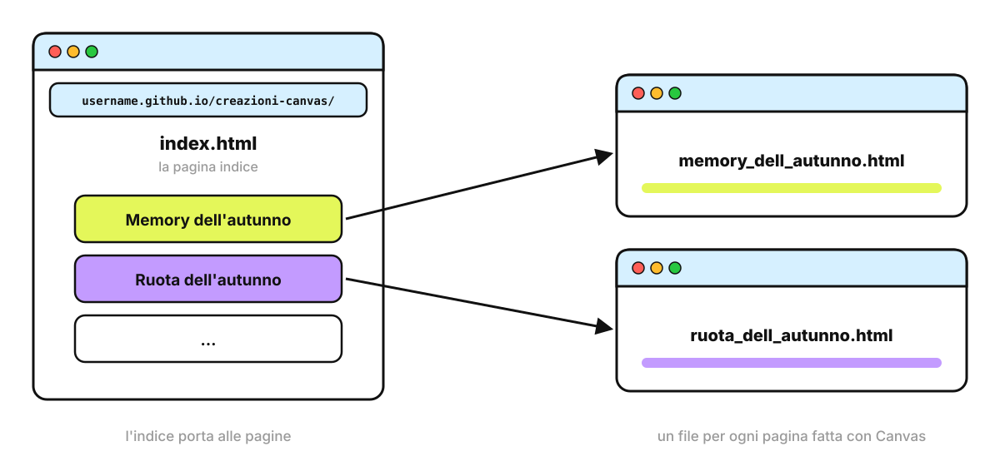

<!-- _class: lead -->
<!-- _paginate: false -->

### Canvas · Esercitazione

# Il mio sito: una pagina indice

<p class="meta">Giuseppe Mastrandrea</p>

---

### Cosa facciamo

<div class="cols">
<div>

All'indirizzo **username.github.io** oggi c'è solo "Ciao". Lo trasformiamo in una **pagina indice** che porta a tutte le pagine fatte con Canvas durante il corso.

<p class="meta">Tecniche: dare a Gemini i dati che non può conoscere, iterare, aggiornare un file su GitHub</p>

</div>
</div>

---

### Come lavoriamo

<div class="cols">
<div class="card"><h2>Un passo alla volta</h2><p>Ogni slide chiede una sola azione. Si passa alla slide successiva solo quando l'azione è riuscita.</p></div>
<div class="card"><h2>Il riquadro verde</h2><p>Dice cosa dovete vedere sullo schermo. Se vedete altro, alzate la mano: si sistema subito, prima di andare avanti.</p></div>
</div>

---

### Come sarà il sito

<div class="schema"></div>

---

### Il punto di partenza

Dal deck <a href="github-pages.html">GitHub Pages</a> e dalla tabella CAA dovreste avere:

1. un account GitHub;
2. un repository che si chiama **username.github.io**;
3. dentro, due file: **index.html** ("Ciao") e **tabella-caa.html**.

<div class="check"><b>Cosa vedete:</b> aprite github.com/username/username.github.io (con il vostro username): compaiono i due file.</div>

<div class="warn">Manca qualcosa? Riprendete il deck GitHub Pages, prima di andare avanti.</div>

---

<!-- _class: big -->

# Parte 1 · Una seconda pagina

---

### Perché una seconda pagina

Un indice con una sola voce non serve a molto. Prendete un'altra pagina fatta con Canvas durante il corso.

<p class="note">Non ne avete un'altra? Saltate la Parte 1: l'indice avrà una scheda sola, e le altre si aggiungono in fondo all'esercitazione.</p>

---

### Pagina 2 · Pubblicarla

1. In Canvas cliccate **Scarica**.
2. Rinominate il file con un nome valido, per esempio `ruota_dell_autunno.html`
3. Su GitHub: **Add file → Upload files**, trascinate il file, **Commit changes**.

<p class="note">Come nel deck <a href="github-pages.html">GitHub Pages</a>: nomi in minuscolo, senza spazi né accenti, con .html alla fine.</p>

<div class="check"><b>Cosa vedete:</b> nel repository tre file: index.html, tabella-caa.html e quello nuovo.</div>

---

### Pagina 2 · Il collaudo

1. Aspettate un paio di minuti.
2. Aprite **username.github.io/** seguito dal nome del file.
Per esempio: username.github.io/ruota_dell_autunno.html

<div class="check"><b>Cosa vedete:</b> la pagina che funziona come in Canvas.</div>

<div class="warn">Errore 404? Confrontate lettera per lettera il nome del file su GitHub con l'indirizzo.</div>

---

<!-- _class: big -->

# Parte 2 · L'elenco delle pagine

---

### Gemini non vede il vostro sito

- Gemini non sa quali file ci sono nel vostro repository.
- Il loro elenco glielo dobbiamo **dare noi**, dentro il prompt.
- Basta copiarlo dalla pagina del repository su GitHub, così com'è.

---

### Elenco 1 · L'indirizzo del repository

1. Aprite il repository su GitHub.
2. Copiate l'indirizzo dalla barra del browser.
3. Incollatelo in una nota.

<div class="check"><b>Cosa vedete:</b> nella nota un indirizzo come https://github.com/username/nome-repository</div>

---

### Elenco 2 · I file da collegare

1. Nella pagina del repository guardate l'elenco dei file.
2. Selezionate con il mouse le righe dei file **.html**, **tranne index.html**.
3. Copiatele e incollatele nella nota, sotto l'indirizzo.

<p class="note">Insieme al nome si copiano anche il messaggio del salvataggio e l'ora ("Add files via upload", "3 minutes ago"): lasciateli, non danno fastidio.</p>

<div class="check"><b>Cosa vedete:</b> una nota con l'indirizzo e i nomi dei file, per esempio memory_dell_autunno.html e ruota_dell_autunno.html.</div>

---

### I nomi dei file sono pubblici

- I nomi dei file finiscono nell'indirizzo e nella pagina indice.
- Mai nomi di alunni: **tabella_caa.html**, non **tabella_caa_marco.html**.
- Se un nome non va bene, cambiatelo su GitHub **prima** di fare l'indice.

---

<!-- _class: big -->

# Parte 3 · La pagina indice con Canvas

---

### Aprire Canvas

1. Aprite Gemini in una **chat nuova**.
2. Cliccate **Strumenti** sotto la casella del prompt.
3. Scegliete **Canvas**.

<div class="check"><b>Cosa vedete:</b> la voce Canvas evidenziata vicino alla casella del prompt.</div>

---

### Richiesta 1 · L'indice

<div class="small">

```text
Genera il file HTML per un index.html da pubblicare sul mio sito
github pages che fa riferimento a questo repository:

https://github.com/giuseppemastrandrea/creazioni-canvas

I file da collegare sono questi:

memory_dell_autunno.html
creazione del file memory dell'autunno
17 minutes ago

ruota_dell_autunno.html
Add files via upload
3 minutes ago
```

</div>

<p class="note">Al posto dell'indirizzo e dei file dell'esempio incollate quelli della vostra nota.</p>

<div class="check"><b>Cosa vedete:</b> a destra una pagina con un collegamento per ogni file della nota. Contateli.</div>

---

### In Canvas i collegamenti non vanno

<div class="cols">
<div class="card"><h2>Cliccate un collegamento</h2><p>Dentro Canvas non si apre nulla, oppure compare un errore.</p></div>
<div class="card"><h2>È normale</h2><p>Le pagine stanno su GitHub, non dentro Canvas. I collegamenti funzioneranno quando l'indice sarà pubblicato accanto a loro.</p></div>
</div>

<p class="note">Per questo non chiedete a Gemini di "correggere i link": li cambierebbe e smetterebbero di funzionare su GitHub.</p>

---

### Richiesta 2 · Schede da toccare

```text
Trasforma i collegamenti in schede grandi e facili da toccare
anche sulla LIM e sul tablet, due per riga. Aggiungi a ogni
scheda un'emoji adatta all'argomento.
```

<div class="check"><b>Cosa vedete:</b> le stesse schede, più grandi, ognuna con un'emoji. I collegamenti sono gli stessi di prima.</div>

---

### Richiesta 3 · Una scheda nuova del browser

```text
Fai aprire ogni pagina in una nuova scheda del browser,
così l'indice resta aperto.
```

<div class="check"><b>Cosa vedete:</b> in apparenza nulla. La differenza si vedrà sul sito pubblicato.</div>

---

### Se qualcosa non va

Descrivete a Gemini **cosa vedete**, una correzione per messaggio:

```text
Manca il collegamento a ruota_dell_autunno.html.
Aggiungilo senza cambiare gli altri.
```

<div class="warn">Controllate che i nomi dei file nelle schede siano rimasti identici a quelli su GitHub.</div>

---

<!-- _class: big -->

# Parte 4 · Pubblicare l'indice

---

### Indice 1 · Scaricare e rinominare

1. Nel riquadro di Canvas cliccate **Scarica**.
2. Rinominate il file appena scaricato in `index.html`

<p class="note">Il nome è obbligatorio: index.html è la pagina che si apre all'indirizzo username.github.io.</p>

<div class="check"><b>Cosa vedete:</b> nella cartella Download il file index.html.</div>

---

### Indice 2 · Caricare al posto di "Ciao"

<div class="cols">
<div>

1. Su GitHub, nel repository: **Add file → Upload files**.
2. Trascinate **index.html** nel riquadro.
3. In fondo alla pagina cliccate **Commit changes**.

Nel repository c'è già un index.html: quello nuovo **lo sostituisce**.

</div>
</div>

<div class="check"><b>Cosa vedete:</b> cliccando index.html nel repository, un file lungo al posto della riga "Ciao".</div>

---

### Indice 3 · Il collaudo

1. Aspettate un paio di minuti.
2. Aprite **username.github.io**.
3. Cliccate ogni scheda, una per volta.

<div class="check"><b>Cosa vedete:</b> al posto di "Ciao" l'indice. Ogni scheda apre la sua pagina in una scheda nuova del browser.</div>

---

### Gli errori più frequenti

| Cosa vedete | Cosa fare |
|---|---|
| C'è ancora "Ciao" | Ricaricate con **Ctrl+Shift+R** (**Cmd+Shift+R**). Se resta, il file caricato non si chiamava esattamente index.html |
| Una scheda apre l'errore 404 | Il nome nella scheda è diverso dal nome del file su GitHub |
| Manca una pagina | Non era nell'elenco incollato: aggiungetela come nella Parte 5 |

---

<!-- _class: big -->

# Parte 5 · Quando fate una pagina nuova

---

### Due operazioni, sempre in quest'ordine

<div class="cols">
<div class="card"><h2>1 · Il file</h2><p>Scarica da Canvas, si rinomina, Add file → Upload files. Si controlla che si apra.</p></div>
<div class="card"><h2>2 · L'indice</h2><p>Si aggiunge il collegamento all'indice, si scarica, si rinomina in index.html e si carica, come in Indice 1 e 2.</p></div>
</div>

---

### Aggiungere la scheda

Nella chat di Canvas dell'indice:

```text
Aggiungi il collegamento a questo file, senza cambiare il resto:
foglie_d_autunno.html
```

Poi **Scarica**, rinominate in index.html e caricatelo su GitHub.

---

### Avete perso la chat dell'indice?

Il codice è al sicuro su GitHub:

1. Aprite **index.html** nel repository e copiatene il testo.
2. Aprite una chat nuova con Canvas e incollate:

```text
Questo è il codice della mia pagina indice. Aggiungi il collegamento
al file NOME_FILE.html. Non cambiare nient'altro.
[incollate qui il codice]
```

---

### Da ricordare

- Gemini non vede il vostro repository: l'elenco dei file glielo date voi.
- Prima si pubblica la pagina, poi si aggiunge la sua scheda all'indice.
- I nomi dei file sono pubblici: mai nomi di alunni.
