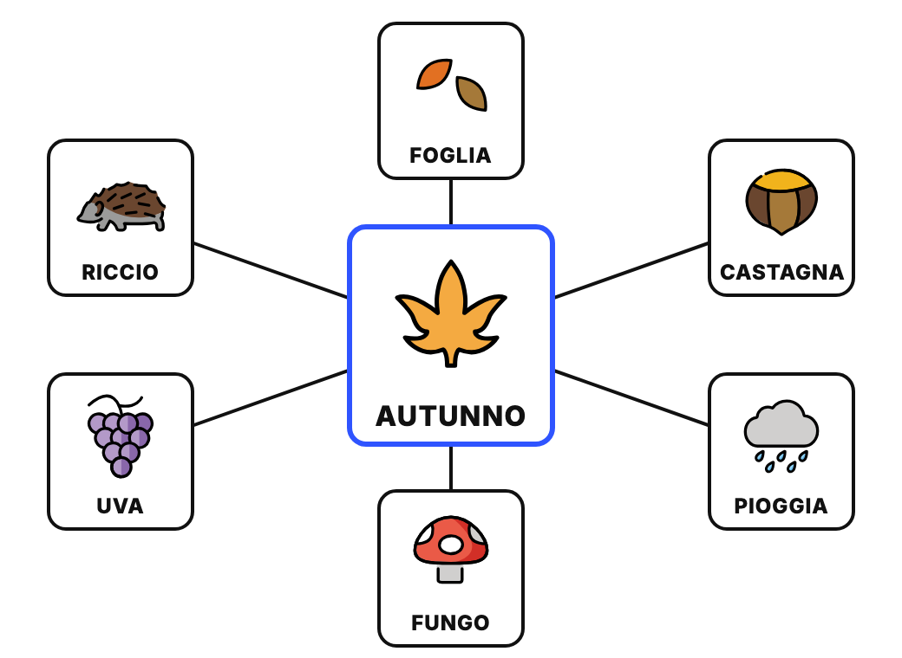
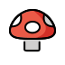

<!-- _class: lead -->
<!-- _paginate: false -->

### Canvas · Esercitazione, infanzia

# La mappa che parla

<p class="meta">Giuseppe Mastrandrea</p>

---

### Cosa facciamo

Con **Gemini Canvas** costruiamo una mappa concettuale da usare alla LIM: il tema al centro, le parole intorno, ognuna con la sua emoji. Toccando un'immagine, la pagina dice la parola.

Il prompt lo costruiamo **un pezzo alla volta**, nella stessa chat.

<p class="meta">Tecniche: prompt incrementale, collaudo dopo ogni passo, correggere descrivendo il problema</p>

---

### Dove arriviamo

<div class="schema"></div>

---

### Le regole del gioco

<div class="cols">
<div class="card"><h2>Un passo per messaggio</h2><p>Ogni richiesta aggiunge una sola funzione alla pagina.</p></div>
<div class="card"><h2>Provate subito</h2><p>Dopo ogni passo toccate, trascinate, scaricate: la pagina fa quello che avete chiesto?</p></div>
<div class="card"><h2>Descrivete il problema</h2><p>Se qualcosa non va, scrivete cosa vedete. Non riscrivete tutto da capo.</p></div>
</div>

---

### Passo 0 · Attivare Canvas

In Gemini, nella barra del prompt: **Strumenti → Canvas**.

Tutti i passi successivi si scrivono **nella stessa chat**: Canvas modifica la pagina che c'è già.

---

### Passo 1 · La mappa

```text
Ambito: scuola dell'infanzia, bambini di 4-5 anni.
Compito: crea una pagina web con una mappa concettuale da usare alla LIM.
Al centro il tema AUTUNNO, grande. Intorno, a raggiera, collegate
al centro da linee, queste parole: foglia, castagna, pioggia,
fungo, uva, riccio.
Per ogni parola un'emoji grande e, sotto, la parola in
STAMPATELLO MAIUSCOLO. Sfondo bianco, caratteri grandi.
```

<p class="note">Controllo: le emoji scelte da Gemini corrispondono alle parole?</p>

---

### Passo 2 · Le parole le scelgo io

```text
Aggiungi in alto un campo per il tema e un riquadro per le parole,
una per riga, con un pulsante "Crea la mappa".
Ogni riga contiene la parola e la sua emoji, per esempio: castagna 🌰
Se in una riga manca l'emoji, mostra un punto interrogativo
e scrivi la parola in rosso.
```

---

### Dove trovo le emoji

<div class="cols">
<div>

Chiedetele a Gemini, in una chat a parte:

```text
Per ognuna di queste parole proponi un'emoji,
una riga per parola, nel formato: parola emoji.
Se non esiste un'emoji adatta, scrivi solo la parola.
[elenco delle parole]
```

</div>
<div>

Oppure dalla tastiera:
- **Windows**: tasto Windows + punto
- **Mac**: Ctrl + Cmd + Spazio

</div>
</div>

---

### Guardate zucca e fungo

<div class="cols">
<div class="card" style="text-align:center"><h2>Zucca</h2><p>L'emoji della zucca semplice non esiste: questa è la zucca di Halloween, con la faccia.</p></div>
<div class="card" style="text-align:center"><h2>Fungo</h2><p>Il fungo rosso a pois bianchi è l'amanita, velenosa. Va bene per la mappa, ma va detto ai bambini?</p></div>
</div>

<p class="note">Le emoji sono circa 3.700: per oggetti, animali e cibo bastano, per azioni e concetti spesso no.</p>

---

### Passo 3 · Le stesse emoji su ogni schermo

La stessa emoji è disegnata in modo diverso su Windows, iPad e Android. OpenMoji le ridisegna tutte nello stesso stile.

<div class="small">

```text
Mostra le emoji come immagini OpenMoji:
https://cdn.jsdelivr.net/npm/openmoji@15.1.0/color/svg/CODICE.svg
dove CODICE è il codice Unicode dell'emoji in maiuscolo, senza FE0F
(per esempio 1F330 per 🌰).
In fondo alla pagina scrivi: "Emoji: OpenMoji (openmoji.org),
licenza CC BY-SA 4.0".
```

</div>

---

### Passo 4 · La voce

```text
Quando tocco un'immagine, la pagina pronuncia la parola in italiano
con la sintesi vocale del browser, un po' più lentamente del normale.
```

<p class="note">La voce è quella installata sul computer o sulla LIM: se manca la voce italiana, la parola esce con un accento straniero.</p>

---

### Passo 5 · Spostare le immagini

```text
Fammi trascinare le immagini con il dito o con il mouse.
Le linee devono seguire le immagini.
Un tocco breve continua a far parlare la parola.
```

<p class="note">L'ultima riga serve: senza, spesso il trascinamento "ruba" il tocco e la voce smette di funzionare.</p>

---

### Passo 6 · Il gioco "cosa manca?"

```text
Aggiungi un pulsante "Gioco: cosa manca?". Copre un'immagine
a caso con un grande punto interrogativo. Quando la tocco,
l'immagine ricompare e la pagina dice la parola.
```

---

### Passo 7 · Il PDF

```text
Aggiungi un pulsante "Scarica PDF" che salva solo la mappa
in A4 orizzontale, con le librerie html2canvas e jsPDF.
Carica le immagini con crossOrigin="anonymous".
```

<p class="note">Il pulsante "Stampa" dentro Canvas non funziona: l'anteprima è in un riquadro protetto che blocca la stampa. Il PDF sì.</p>

---

### Se qualcosa non va

Descrivete quello che vedete:

```text
Le immagini non compaiono, vedo solo le parole.
Mostrami nella pagina il messaggio di errore.
```

```text
Quando trascino un'immagine, la linea resta ferma.
```

```text
Toccando l'immagine non sento niente.
```

---

### Il prompt unico

Alla fine, nella stessa chat:

```text
Scrivi un prompt unico che, incollato in una chat nuova con
Canvas attivo, ricrei questa pagina con tutte le funzioni.
Mettilo in un blocco di codice.
```

Copiatelo nel kit e provatelo in una chat nuova: la pagina che esce è uguale?

---

### Ritrovare e condividere la mappa

<div class="cols">
<div>

- La pagina resta nella chat: riaprendo la chat, la ritrovate.
- **Condividi** in alto nel pannello di Canvas crea un link che apre la mappa.
- Il PDF si stampa in A3 per il cartellone.

</div>
<div class="shot">Screenshot: il menu Condividi di Canvas</div>
</div>

---

### In sezione

- **Alla LIM**: i bambini toccano un'immagine, ascoltano e ripetono la parola.
- **Cosa manca?**: si gioca in cerchio, a turno.
- **La mappa costruita insieme**: le parole le propongono i bambini, la docente le scrive.
- **Il cartellone**: si stampa e si completa con foglie, castagne e disegni veri.

---

### Da ricordare

- Un passo per messaggio, e dopo ogni passo si prova la pagina.
- Ogni emoji si controlla: è la cosa giusta? è adatta ai bambini?
- Nella pagina vanno solo parole ed emoji: niente nomi o foto dei bambini.

---

### Crediti

<div class="credits">

Emoji: OpenMoji (openmoji.org), licenza CC BY-SA 4.0.

</div>
