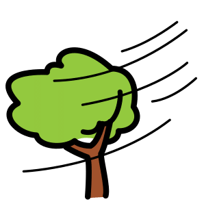
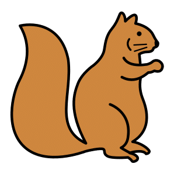

<!-- _class: lead -->
<!-- _paginate: false -->

### Canvas · Esercitazione, mappa concettuale

# Una mappa di pittogrammi

<p class="meta">Giuseppe Mastrandrea</p>

---

### Cosa facciamo

Una pagina con un argomento al centro e, intorno, le parole collegate. Ogni parola ha il suo **pittogramma**, preso da un archivio gratuito.

Nient'altro: niente tabelle, niente PDF, niente pubblicazione.

---

### Il risultato che vogliamo

<div class="mappa">
<div>FOGLIA</div>
<div>CASTAGNA</div>
<div>PIOGGIA</div>
<div>OMBRELLO</div>
<div class="c">AUTUNNO</div>
<div>FUNGO</div>
<div>UVA</div>
<div>VENTO</div>
<div>SCOIATTOLO</div>
</div>

<p class="note" style="text-align:center">Nella pagina le parole saranno collegate al centro da linee.</p>

---

### Da dove vengono i pittogrammi

- **ARASAAC** è un archivio di oltre **10.000 pittogrammi**, cercabili in italiano.
- Si usano gratis a scuola.
- Gemini **non li disegna**: la pagina li va a prendere da ARASAAC, parola per parola.


<p class="note">Come funziona un'API e come si prova dal browser: deck <a href="api.html">Le API</a>, da fare prima di questa esercitazione.</p>

---

### Aprire Canvas

1. Aprite Gemini in una **chat nuova**.
2. Cliccate **Strumenti** sotto la casella del prompt.
3. Scegliete **Canvas**.

<div class="check"><b>Cosa vedete:</b> la voce Canvas evidenziata vicino alla casella del prompt.</div>

---

### Il prompt

<div class="small">

```text
Ambito: scuola primaria, materiali con i pittogrammi.
Compito: crea una pagina web per creare mappe concettuali.
Bisogna prevedere una casella di testo con il concetto centrale
e un altro campo di testo multi riga.

Per ciascuna delle parole (sia nel campo di testo che nelle singole
righe dell'altro campo) bisogna:
cercare il pittogramma con l'API di ARASAAC:
https://api.arasaac.org/v1/pictograms/it/search/PAROLA
prendere il campo _id del primo risultato e mostrare l'immagine
https://static.arasaac.org/pictograms/ID/ID_500.png.

Es.
Al centro la parola "autunno". Intorno, in cerchio, queste parole:
foglia, castagna, pioggia, ombrello, fungo, uva, vento, scoiattolo.
Ogni parola è collegata al centro con una linea.

Per ogni parola visualizza il pittogramma e la parola in maiuscolo.
```

</div>

---

### Il collaudo

<div class="cols">
<div>

1. Nella casella del concetto centrale scrivete **autunno**.
2. Nel campo grande, una per riga:

```text
foglia
castagna
pioggia
ombrello
fungo
uva
vento
scoiattolo
```

</div>
<div>

<div class="check"><b>Cosa vedete:</b> AUTUNNO al centro, 8 parole in maiuscolo intorno, ognuna con il suo pittogramma e una linea verso il centro.</div>

</div>
</div>

---

### Se qualcosa non va

Descrivete a Gemini **cosa vedete**:

```text
Le immagini non compaiono: al loro posto c'è un'icona rotta.
```

<div class="warn">Una correzione per messaggio. Se dopo tre tentativi non funziona, alzate la mano.</div>

---

### Guardate la foglia

Per "foglia" ARASAAC restituisce **4 pittogrammi**. La pagina prende sempre il primo.

<div class="cols">
<div class="card" style="text-align:center"><p>1° · quella che prende la pagina</p></div><div class="card" style="text-align:center"><p>2°</p></div><div class="card" style="text-align:center"><p>3° · la foglia secca</p></div><div class="card" style="text-align:center"><p>4° · un insetto</p></div>
</div>

<p class="note">Prova del 13 ottobre 2026. Per l'autunno servirebbe il terzo: la scelta deve restare a voi.</p>

---

### Scegliere il pittogramma

Nella stessa chat:

```text
Quando una parola ha più pittogrammi, mostrali in piccolo
sotto la parola e fammi cliccare quello che preferisco.
```

<div class="check"><b>Cosa vedete:</b> sotto "foglia" 4 miniature. Cliccate la foglia secca: il pittogramma grande cambia.</div>

---

### Un altro argomento

Non serve un prompt nuovo: cambiate le parole nella pagina.

1. Concetto centrale: **merenda**.
2. Nel campo grande, una per riga: mela, pane, succo, biscotto, acqua, bere, mangiare, tovagliolo.

<div class="check"><b>Cosa vedete:</b> la nuova mappa, con i pittogrammi della merenda.</div>

---

### Portarla fuori da Canvas

1. In alto, nel riquadro di Canvas, cliccate **Scarica**.
2. Aprite il file scaricato con **Chrome**.
3. Per stamparla: **Ctrl+P** (sul Mac **Cmd+P**).

<p class="note">Dentro Canvas la stampa è bloccata. Fuori funziona.</p>

---

### Da ricordare

- I pittogrammi arrivano da **ARASAAC**, non li disegna Gemini.
- Il primo risultato non è sempre quello giusto: si controlla ogni immagine.
