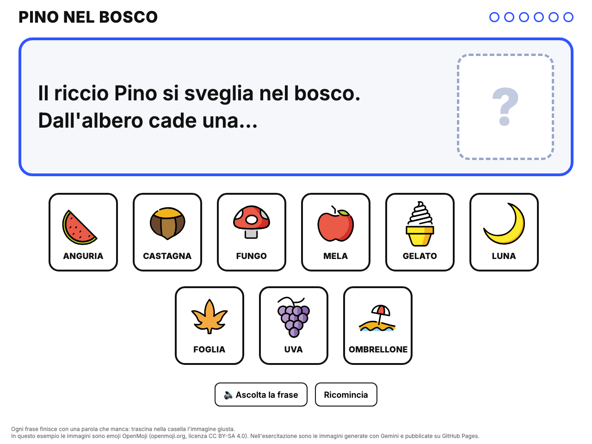

<!-- _class: lead -->
<!-- _paginate: false -->

### Canvas · Esercitazione, infanzia, versione completa

# Una storia da completare

<p class="meta">Giuseppe Mastrandrea</p>

---

### Cosa facciamo

Un gioco per la LIM guidato da una storia. La maestra legge una frase, che finisce con una parola che manca. Un bambino trascina nella casella l'immagine che la completa, e arriva la frase dopo.

- **Gemini** scrive la storia e disegna un'immagine per ogni parola.
- **GitHub Pages** dà un indirizzo a ogni immagine.
- **Canvas** costruisce il gioco con quelle immagini.
- Alla fine il gioco si pubblica, anche lui su GitHub Pages.

---

### Dove arriviamo

<div class="schema"></div>

<p class="note" style="text-align:center">Nel risultato d'esempio (<a href="esempio-storia-caselle.html">esempio-storia-caselle.html</a>) le immagini sono emoji. Nel vostro gioco sono quelle disegnate da Gemini.</p>

---

### Il percorso

| Parte | Cosa si fa | Dove | Tempo |
|---|---|---|---|
| 1 | La storia e l'elenco delle parole | Gemini | 15' |
| 2 | Un'immagine per parola, scaricata e rinominata | Gemini | 30' |
| 3 | Le immagini sul sito | GitHub | 15' |
| 4 | Il gioco | Canvas | 40' |
| 5 | Il gioco sul sito | GitHub | 10' |

<p class="note">I tempi sono indicativi, per chi ha già fatto la versione semplice "Ogni cosa al suo posto".</p>

---

### Prima di iniziare

- Account GitHub, repository **username.github.io** e pagina di prova "Ciao": si preparano con il deck <a href="github-pages.html">GitHub Pages</a>.
- Il gioco è lo stesso della versione semplice, <a href="caselle-emoji.html">Ogni cosa al suo posto</a>: se l'avete fatta, i passi di Canvas li conoscete già.

<div class="check"><b>Cosa vedete:</b> all'indirizzo username.github.io la scritta <b>Ciao</b>.</div>

---

<!-- _class: big -->

# Parte 1 · La storia

---

### Storia · Il prompt

<div class="small">

```text
Ambito: scuola dell'infanzia, bambini di 4-5 anni, autunno.
Compito: scrivi una storia di 6 frasi su un riccio di nome Pino.
Ogni frase è breve, al presente, e finisce con "..." al posto
di una cosa concreta che un bambino riconosce in un disegno:
un oggetto, un frutto, un animale. Ogni cosa compare una volta sola.
Poi scrivi 3 intrusi: cose che non c'entrano con l'autunno.
Formato: una tabella con due colonne, frase e parola che manca.
```

</div>

<div class="check"><b>Cosa vedete:</b> una tabella con 6 frasi e 6 parole, più 3 intrusi.</div>

---

### Storia · Il controllo

<div class="cols">
<div class="card"><h2>Si disegna?</h2><p>"Castagna" sì, "freddo" e "sonno" no. Ogni parola deve diventare un'immagine.</p></div>
<div class="card"><h2>Si confonde?</h2><p>Noce e castagna, disegnate piccole, si somigliano. Tenetene una.</p></div>
<div class="card"><h2>Si legge?</h2><p>Leggete la storia ad alta voce: se una frase vi inciampa in bocca, chiedete di accorciarla.</p></div>
</div>

<p class="note">L'articolo prima dei puntini ("una...", "un...") aiuta i bambini a indovinare: lasciatelo.</p>

---

### Storia · I nomi dei file

Ogni immagine diventa un file, e il nome del file sarà parte dell'indirizzo:

```text
Per ogni parola della storia e per ogni intruso scrivi il nome
del file dell'immagine: la parola in minuscolo, senza accenti,
con i trattini al posto degli spazi, e .png alla fine.
Una riga per parola.
```

| Parola | File |
|---|---|
| castagna | `castagna.png` |
| foglia secca | `foglia-secca.png` |

<p class="note">Copiate storia, intrusi e nomi dei file in un documento: servono in tutte le parti successive.</p>

---

<!-- _class: big -->

# Parte 2 · Le immagini

---

### Immagini · Lo stile, una volta sola

In una chat nuova:

<div class="small">

```text
Ambito: immagini per un gioco della scuola dell'infanzia.
Compito: disegna una castagna.
Stile: illustrazione piatta per bambini, contorno nero spesso,
colori pieni, un solo oggetto al centro, sfondo bianco uniforme,
niente testo, niente ombre, formato quadrato.
```

</div>

Per le altre, nella **stessa chat**, una per messaggio:

```text
Ora disegna una foglia, nello stesso stile.
```

<p class="note">Lo stile si scrive una volta. Se un'immagine esce diversa dalle altre, chiedete di rifarla "nello stesso stile della castagna".</p>

---

### Immagini · Il controllo

<div class="cols">
<div class="card"><h2>La cosa</h2><p>È davvero una castagna e non una noce? Il fungo ha l'aspetto di un fungo velenoso?</p></div>
<div class="card"><h2>I dettagli</h2><p>Zampe in più, occhi spaiati, scritte inventate sullo sfondo.</p></div>
<div class="card"><h2>Lo stile</h2><p>Stesso contorno, stesso sfondo bianco, stessa grandezza dell'oggetto in tutte e 9.</p></div>
</div>

<div class="warn">Disegnate oggetti e animali. Niente bambini, e mai immagini che somiglino a un bambino della sezione.</div>

---

### Immagini · Scaricare e rinominare

1. Passate sopra l'immagine e cliccate **Scarica**.
2. Aprite la cartella **Download** e rinominate il file con il nome della tabella: `castagna.png`.
3. Ripetete per tutte le immagini, intrusi compresi.

<div class="warn">Se il file scaricato finisce con .jpg, tenetelo: si chiamerà castagna.jpg. Usate lo stesso finale per tutte e scrivetelo nel prompt di Canvas.</div>

<div class="check"><b>Cosa vedete:</b> 9 file nella cartella Download, con i nomi della tabella.</div>

---

<!-- _class: big -->

# Parte 3 · Le immagini sul sito

---

### Sito · Caricare le immagini

1. Su GitHub, nel repository **username.github.io**: **Add file → Upload files**.
2. Trascinate nel riquadro **tutte e 9 le immagini** insieme.
3. Aspettate che i nomi compaiano sotto il riquadro.
4. In fondo alla pagina cliccate **Commit changes**.

<div class="check"><b>Cosa vedete:</b> nel repository i 9 file accanto a index.html.</div>

---

### Sito · Il collaudo degli indirizzi

1. Aspettate un paio di minuti.
2. Aprite **username.github.io/castagna.png**.

<div class="check"><b>Cosa vedete:</b> la castagna da sola, su una pagina bianca. Questo è l'indirizzo che userà Canvas.</div>

| Cosa vedete | Cosa fare |
|---|---|
| Errore 404 | Aspettate un minuto e ricaricate |
| Errore 404 solo su un'immagine | Il nome è diverso: maiuscole, spazi, .PNG, .jpg |

---

<!-- _class: big -->

# Parte 4 · Il gioco con Canvas

---

### Gioco · Passo 0

In una chat nuova di Gemini: **Strumenti → Canvas**.

Tutti i passi si scrivono **nella stessa chat**, uno per messaggio. Dopo ogni passo si prova la pagina.

---

### Gioco · Passo 1, la storia e la casella

<div class="small">

```text
Ambito: scuola dell'infanzia, bambini di 4-5 anni.
Compito: crea una pagina web con un gioco da usare alla LIM.
La pagina mostra una storia una frase alla volta, scritta grande.
Ogni frase finisce con "..." e accanto c'è una casella vuota.
Queste sono le frasi e la parola che completa ognuna:
[incollate la tabella della Parte 1]
In basso, mescolate, le immagini di tutte le parole. Ogni
immagine si trova all'indirizzo https://USERNAME.github.io/PAROLA.png
Sotto ogni immagine scrivi la parola in STAMPATELLO MAIUSCOLO.
```

</div>

<p class="note">Al posto di USERNAME scrivete il vostro. Controllo: si vedono tutte le immagini?</p>

---

### Gioco · Passo 2, trascinare

<div class="small">

```text
Il bambino trascina un'immagine nella casella.
Se è la parola giusta, l'immagine resta nella casella, la parola
compare alla fine della frase e dopo 2 secondi arriva la frase dopo.
Se è sbagliata, l'immagine torna al suo posto.
Il trascinamento deve funzionare con il dito sulla LIM e sul
tablet, non solo con il mouse.
```

</div>

<p class="note">Provate a sbagliare apposta: trascinate la parola della frase successiva. Deve tornare indietro.</p>

---

### Gioco · Passo 3, intrusi e voce

<div class="small">

```text
Aggiungi tra le immagini 3 intrusi: [i vostri intrusi].
Quando un'immagine giusta entra nella casella, la pagina dice la
parola in italiano con la sintesi vocale del browser, un po' più
lentamente del normale. Se è sbagliata, dice "Riprova".
Niente croci rosse, niente suoni di errore.
```

</div>

---

### Gioco · Passo 4, dove siamo

```text
In alto a destra mostra un pallino per ogni frase:
si colora quando la frase è completata.
Aggiungi un pulsante "Ascolta la frase" che la legge
ad alta voce.
```

<p class="note">La frase la legge la maestra. Il pulsante serve quando un bambino vuole riascoltarla da solo.</p>

---

### Gioco · Passo 5, la fine

```text
Dopo l'ultima frase mostra "FINE!" e sotto tutta la storia,
ogni frase completa con la sua immagine piccola accanto.
Aggiungi un pulsante "Ricomincia".
```

---

### Se qualcosa non va

```text
Al posto delle immagini vedo un'icona rotta.
Scrivi nella pagina l'indirizzo che stai usando.
```

<p class="note">Confrontatelo con quello che avete aperto nel browser nella Parte 3: di solito cambia una lettera o il finale .png.</p>

```text
Trascino l'immagine giusta ma torna indietro.
```

```text
Con il dito sulla LIM si muove tutta la pagina.
```

---

### Il prompt unico

Alla fine, nella stessa chat:

```text
Scrivi un prompt unico che, incollato in una chat nuova con
Canvas attivo, ricrei questa pagina con tutte le funzioni.
Mettilo in un blocco di codice.
```

Copiatelo nel kit. Per una storia nuova si cambiano la tabella e gli intrusi.

---

<!-- _class: big -->

# Parte 5 · Il gioco sul sito

---

### Pubblicare · Dalla chat al sito

1. In Canvas cliccate **Scarica**.
2. Rinominate il file in `pino-nel-bosco.html`
3. Su GitHub: **Add file → Upload files**, trascinate il file, **Commit changes**.

<p class="note">I passaggi, con gli errori più frequenti, sono nel deck <a href="github-pages.html">GitHub Pages</a>, "Pubblicare una pagina fatta con Canvas".</p>

<div class="check"><b>Cosa vedete:</b> nel repository il file pino-nel-bosco.html accanto alle immagini.</div>

---

### Pubblicare · Il collaudo finale

1. Aspettate un paio di minuti.
2. Aprite **username.github.io/pino-nel-bosco.html**.
3. Giocate fino alla fine, sbagliando almeno una volta.
4. Se potete, provate con il dito su un tablet o sulla LIM.
5. Mandate il link a una collega e fatelo provare a lei.

<p class="note">La sezione ha già un sito Google? Con <b>Inserisci → Incorpora → Da URL</b> il gioco compare dentro il sito. Il gioco resta su GitHub: Sites lo mostra e basta.</p>

---

### In sezione

- **Prima la storia**: la maestra la legge tutta, senza gioco.
- **Poi si rilegge giocando**: a ogni "..." un bambino cerca l'immagine e la trascina.
- **Si anticipa**: "cosa troverà Pino adesso?", prima di mostrare le immagini.
- **Si riusa**: le immagini restano sul sito. Una storia nuova con le stesse immagini costa solo la Parte 1 e la Parte 4.

---

### Da ricordare

- La storia di Gemini si legge ad alta voce prima di usarla.
- Ogni immagine si controlla: la cosa, i dettagli, lo stile.
- I nomi dei file sono le parole, in minuscolo e senza accenti.
- L'indirizzo di un'immagine si prova nel browser **prima** di darlo a Canvas.
- Pubblico vuol dire pubblico: niente nomi, foto o disegni dei bambini.

---

### Crediti

<div class="credits">

Immagini del gioco: generate con Gemini.
Risultato d'esempio: emoji OpenMoji (openmoji.org), licenza CC BY-SA 4.0.

</div>
