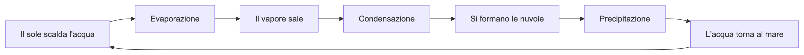
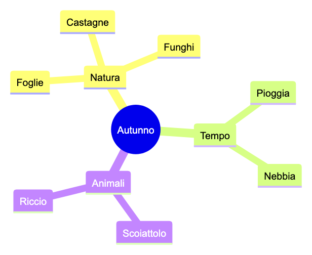
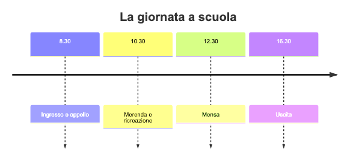
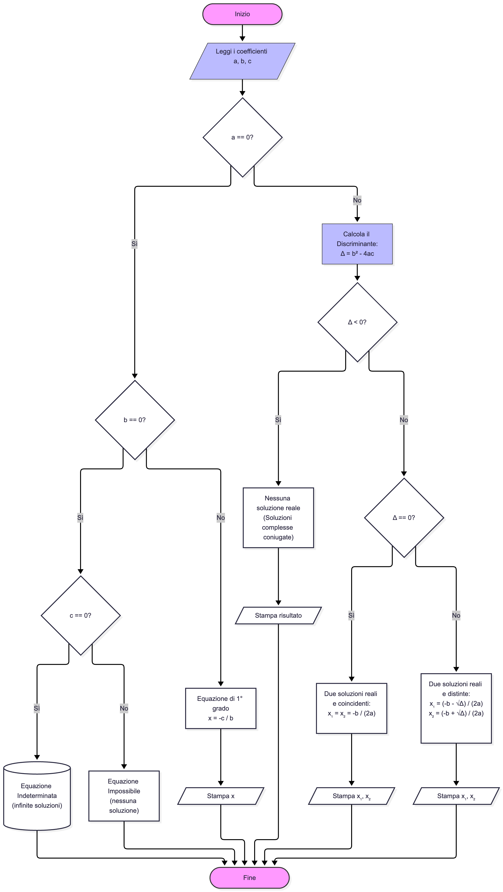
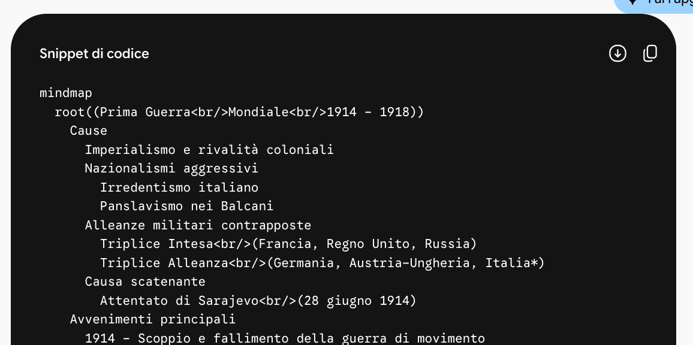
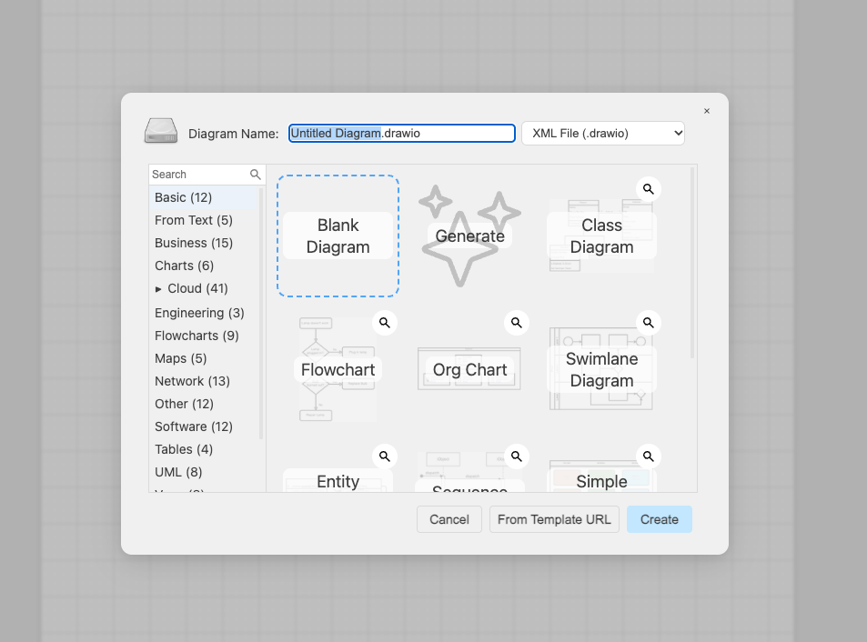
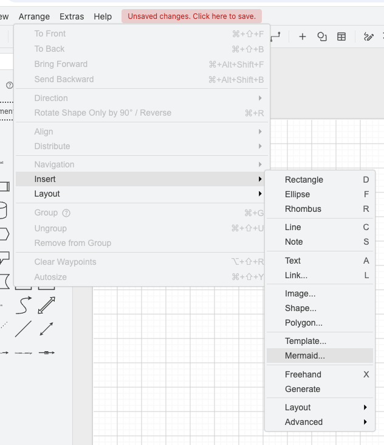
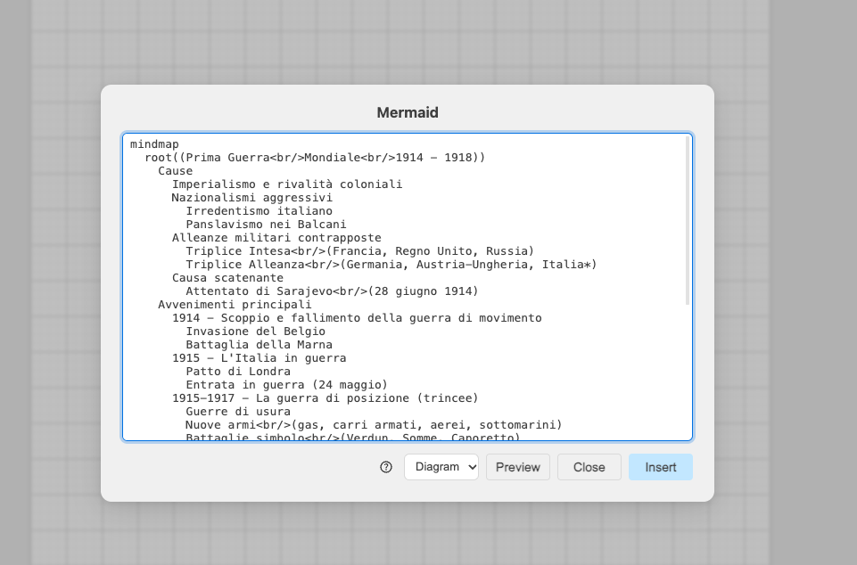
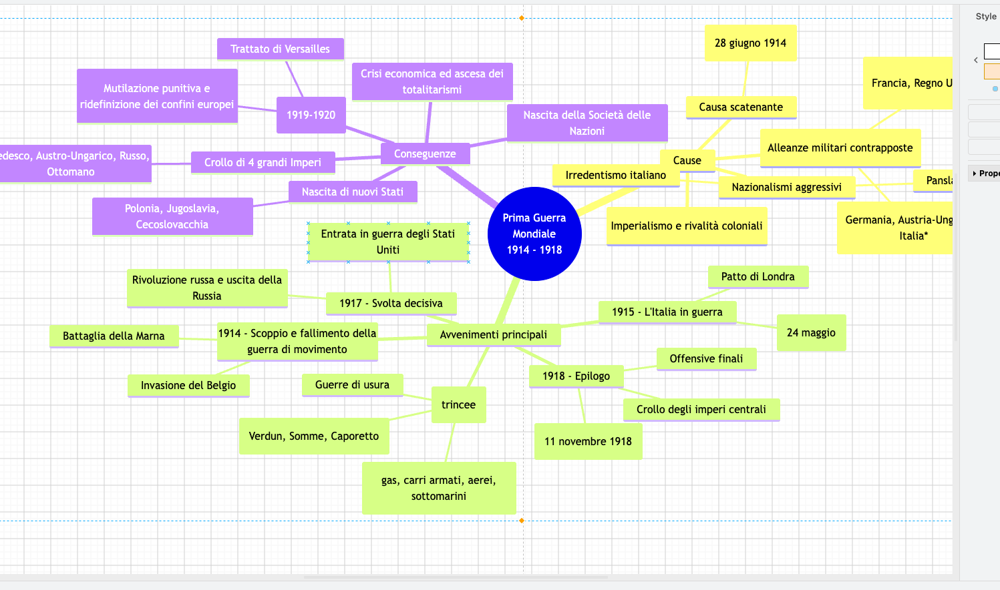

<!-- _class: lead -->
<!-- _paginate: false -->

### Prompt e strumenti · Esercitazione

# Diagrammi con Mermaid

<p class="meta">Giuseppe Mastrandrea</p>

---

### Il problema

<div class="cols">
<div class="card"><h2>Disegnare a mano</h2><p>Trascinare caselle, allineare frecce, ridimensionare: per un diagramma di 8 caselle se ne va mezz'ora.</p></div>
<div class="card"><h2>Chiedere un'immagine all'IA</h2><p>Il generatore di immagini sbaglia le scritte, sposta le frecce, e il risultato non si modifica.</p></div>
</div>

<p class="note">C'è una terza strada: scrivere il diagramma come testo.</p>

---

<!-- _class: big -->

# Un diagramma si può scrivere<br>come si scrive un testo

---

### Mermaid

# Un linguaggio per i diagrammi

- **Mermaid** è un linguaggio gratuito e open source: si scrivono le caselle e le frecce, un programma le disegna.
- Il file è **testo semplice**, come un .txt o un .md.
- Lo leggono molti strumenti: GitHub, Notion, Obsidian e **draw.io**.

<p class="note">Documentazione: <a href="https://mermaid.js.org/intro/">mermaid.js.org</a></p>

---

### Mermaid · Diagramma di flusso

```text
flowchart LR
  A[Il sole scalda l'acqua] --> B[Evaporazione]
  B --> C[Il vapore sale]
  C --> D[Condensazione]
  D --> E[Si formano le nuvole]
  E --> F[Precipitazione]
  F --> G[L'acqua torna al mare]
  G --> A
```

<div class="fig"></div>

<p class="note">Una riga per freccia: <code>A --&gt; B</code> vuol dire "da A a B".</p>

---

### Mermaid · Mappa mentale

<div class="cols">
<div>

```text
mindmap
  root((Autunno))
    Natura
      Foglie
      Castagne
      Funghi
    Tempo
      Pioggia
      Nebbia
    Animali
      Scoiattolo
      Riccio
```

<p class="note">Il rientro decide chi sta sotto chi.</p>

</div>
<div class="fig"></div>
</div>

---

### Mermaid · Linea del tempo

```text
timeline
    title La giornata a scuola
    8.30 : Ingresso e appello
    10.30 : Merenda e ricreazione
    12.30 : Mensa
    16.30 : Uscita
```

<div class="fig"></div>

---

### Mermaid · Anche diagrammi complessi

<div class="cols">
<div>

L'equazione di secondo grado: rombi per le domande, rami Sì e No, forme diverse per inizio, dati e risultati.

Tutto scritto come testo, in una ventina di righe.

</div>
<div class="fig"></div>
</div>

---

### Perché funziona con l'IA

# I modelli sono bravi a scrivere codice

- Mermaid è **codice**: poche regole precise, testo breve.
- I modelli ne hanno visto moltissimo durante l'addestramento.
- Il risultato si corregge **a parole**: "aggiungi un ramo", "accorcia le scritte".

<p class="note">Il modello non disegna: scrive il testo. Il disegno lo fa un altro programma.</p>

---

### Il percorso

<div class="flow">
<div>Prompt<span>Gemini, ChatGPT o un altro chatbot</span></div><b>→</b>
<div>Codice Mermaid<span>la risposta</span></div><b>→</b>
<div>draw.io<span>incolla e inserisci</span></div><b>→</b>
<div>Diagramma<span>si modifica e si esporta</span></div>
</div>

<p class="note" style="text-align:center">draw.io è gratuito e si usa dal browser: app.diagrams.net</p>

---

### Il prompt · I quattro pezzi

- <span class="tag">Ambito</span> scuola, classe, disciplina.
- <span class="tag">Obiettivo</span> che diagramma serve e a cosa.
- <span class="tag">Contesto</span> cosa sanno gli alunni, dove verrà usato.
- <span class="tag">Vincoli</span> Mermaid con il link alla documentazione, quante caselle, quanto testo, solo codice.

---

### Il prompt completo

<div class="small">

```text
Ambito: scuola primaria, classe quarta, scienze.

Obiettivo: un diagramma di flusso del ciclo dell'acqua da proiettare
alla LIM e stampare per il quaderno.

Contesto: gli alunni hanno già studiato evaporazione, condensazione e
precipitazione. Il diagramma serve per il ripasso prima della verifica.

Vincoli:
- usa la sintassi Mermaid, tipo flowchart, come descritta qui:
  https://mermaid.js.org/syntax/flowchart.html
- al massimo 8 caselle, al massimo 4 parole per casella;
- niente parentesi, virgolette o due punti dentro le caselle;
- niente colori né stili;
- rispondi solo con il blocco di codice, senza spiegazioni.
```

</div>

---

### Passo 1 · Il prompt

1. Aprite **Gemini** (va bene anche ChatGPT).
2. Incollate il prompt e inviate.

<div class="check"><b>Cosa vedete:</b> un riquadro "Snippet di codice" che inizia con il tipo di diagramma: <code>flowchart</code>, <code>mindmap</code>...</div>

<div class="warn">Se il chatbot risponde con un'immagine o con una spiegazione lunga, scrivete: "Solo il codice Mermaid, niente altro".</div>

---

### Passo 2 · Copiare il codice

<div class="cols">
<div>

1. In alto a destra del riquadro cliccate l'icona **Copia** (i due fogli sovrapposti).

<div class="check"><b>Cosa vedete:</b> un avviso di copia in basso.</div>

<div class="warn">Selezionando a mano, non copiate le righe con <code>```mermaid</code> e <code>```</code>: draw.io non le capisce.</div>

</div>
<div class="sc"></div>
</div>

---

### Passo 3 · Aprire draw.io

<div class="cols">
<div>

1. In una nuova scheda aprite **app.diagrams.net**
2. Scegliete **Blank Diagram**.
3. Cliccate **Create**.

<div class="check"><b>Cosa vedete:</b> un foglio a quadretti con le forme nella colonna di sinistra.</div>

</div>
<div class="sc"></div>
</div>

---

### Passo 4 · Il menu Mermaid

<div class="cols">
<div>

1. Nel menu in alto cliccate **Arrange**.
2. Poi **Insert**.
3. Poi **Mermaid...**

<div class="check"><b>Cosa vedete:</b> una finestra intitolata "Mermaid" con un riquadro di testo.</div>

</div>
<div class="sc"></div>
</div>

---

### Passo 5 · Incollare il codice

<div class="cols">
<div>

1. Cancellate il testo d'esempio nel riquadro.
2. Incollate il vostro codice.
3. Lasciate **Diagram** nel menu a tendina.
4. Cliccate **Insert**.

<p class="note">Preview mostra il disegno prima di inserirlo.</p>

</div>
<div class="sc"></div>
</div>

<div class="warn">Compare un errore? Copiatelo, incollatelo nella chat e chiedete: "Correggi il codice".</div>

---

### Passo 6 · Il diagramma in draw.io

<div class="sc"></div>

<div class="check"><b>Cosa vedete:</b> il diagramma sul foglio, fatto di caselle e linee di draw.io. Ogni casella si seleziona e si sposta.</div>

---

### Passo 7 · Rifinire

1. Doppio clic su una casella per cambiare il testo.
2. Cliccate una casella e, a destra, sceglietene il colore.
3. Trascinate le caselle per sistemare la disposizione.

<div class="check"><b>Cosa vedete:</b> il diagramma come lo volete voi, modificato a mano dove serve.</div>

---

### Passo 8 · Salvare ed esportare

1. **File → Export as → PNG** per un'immagine da proiettare o mettere in un documento.
2. **File → Export as → PDF** per stampare.
3. **File → Save as** per riaprirlo e modificarlo in futuro.

<div class="check"><b>Cosa vedete:</b> il file nella cartella Download.</div>

---

### Correggere a parole

Il codice si sistema nella stessa chat, senza riscrivere il prompt:

- "Aggiungi una casella tra condensazione e precipitazione: le gocce si ingrandiscono."
- "Disponi il diagramma da sinistra a destra." (`flowchart LR`)
- "Trasforma il diagramma in una mappa mentale." (`mindmap`)

Poi si incolla di nuovo in draw.io.

<p class="note">Diagrammi di flusso e mappe mentali diventano caselle modificabili. Altri tipi, come la linea del tempo, possono arrivare in draw.io come immagine.</p>

---

### Gli errori più frequenti

| Cosa vedete | Cosa fare |
|---|---|
| Errore in draw.io | Incollate l'errore nella chat e chiedete la correzione |
| Il chatbot disegna un'immagine | "Solo il codice Mermaid, niente altro" |
| Caselle con testo troppo lungo | "Al massimo 4 parole per casella" |
| Il diagramma è un groviglio | Meno caselle, oppure `flowchart LR` |

---

### Da ricordare

- Mermaid scrive i diagrammi come **testo**: il modello scrive, draw.io disegna.
- Il prompt ha quattro pezzi: **Ambito, Obiettivo, Contesto, Vincoli**.
- Nei vincoli: **Mermaid con il link alla documentazione** e "solo il codice".
- In draw.io: **Arrange → Insert → Mermaid**.
- Le correzioni si chiedono a parole, nella stessa chat.
