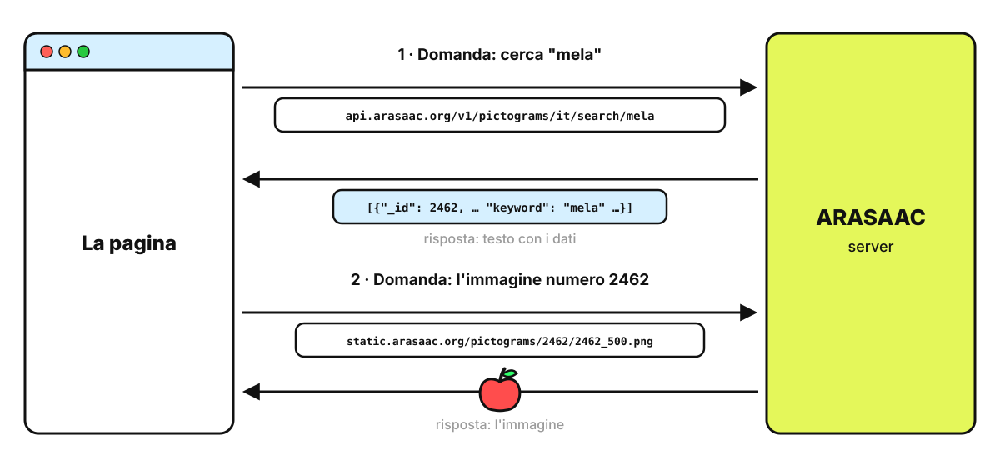
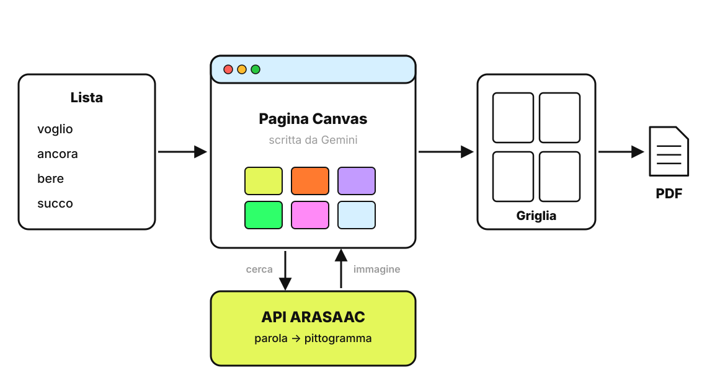
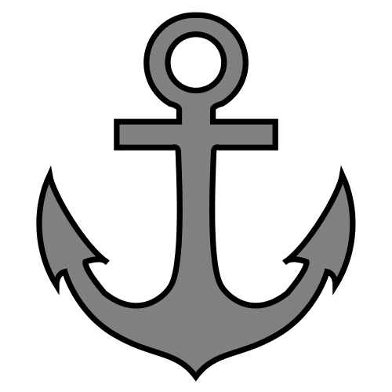
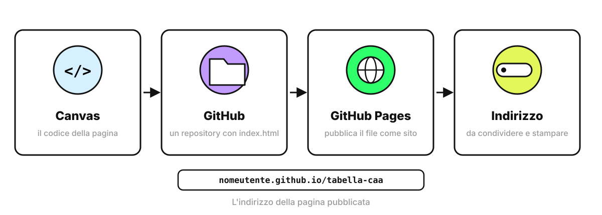

<!-- _class: lead -->
<!-- _paginate: false -->

### Esercitazione 4

# Una tabella CAA per la merenda

<p class="meta">Giuseppe Mastrandrea</p>

---

### Cosa facciamo

<div class="cols">
<div>

Dal vocabolario alla **tabella stampabile**, con i pittogrammi ARASAAC.

<p class="meta">Tecniche: prompt strutturato, iterazione, generare uno strumento con Canvas</p>

</div>
</div>

---

### La CAA in tre righe

- **Comunicazione aumentativa alternativa**: simboli che affiancano o sostituiscono la parola.
- La tabella raccoglie i simboli di una situazione: la merenda, la palestra, il cerchio del mattino.
- Il sistema di CAA di un alunno lo decide **il team con il logopedista**. Qui prepariamo solo materiali.

---

### Passo 1 · Il prompt povero

```text
Fammi una tabella CAA per la merenda.
```

<p class="note">Cosa manca? Per chi è, quante parole, in che formato.</p>

---

### Passo 2 · Il prompt strutturato

<div class="small">

```text
Ambito: insegnamento di sostegno nella primaria,
comunicazione aumentativa alternativa.
Compito: prepara il vocabolario per una tabella di comunicazione da usare
durante la merenda in classe con un bambino di 7 anni
che comunica con singoli simboli.
Vincoli: massimo 16 parole; metà vocabolario di base
(es. voglio, ancora, finito, aiuto), metà specifico della merenda;
solo parole rappresentabili con un pittogramma.
Formato: tabella con colonne
Parola | Categoria (persona, azione, oggetto, aggettivo, sociale) |
Colore (chiave di Fitzgerald modificata).
```

</div>

---

### Passo 3 · Iterare

Correggete l'output con richieste brevi, una per volta:

```text
Togli le parole troppo astratte e sostituiscile.
```

```text
Aggiungi 5 frasi che l'adulto può dire indicando
i simboli durante la merenda.
```

---

### Passo 4 · E se i simboli li disegna Gemini?

```text
Genera 4 simboli in stile pittogramma: mela, bere, ancora, finito.
```

Guardate lo stile: tratto, colori, proporzioni. In CAA i simboli devono essere **della stessa famiglia grafica**, altrimenti il bambino fatica a riconoscerli.

<p class="note">Anche Global Symbols, che offre uno strumento per generare simboli con l'IA, scrive che serve la supervisione umana perché i simboli siano sicuri e comprensibili (globalsymbols.com, 13 maggio 2026).</p>

---

### ARASAAC

<div class="cols">
<div>

- Oltre **10.000 pittogrammi**, cercabili in italiano
- Licenza **CC BY-NC-SA**: uso libero a scuola, con attribuzione, senza fini commerciali
- Un'**API pubblica**: un indirizzo web che restituisce i pittogrammi per una parola

</div>
</div>

---

### Che cos'è un'API

- Un'**API** è un indirizzo web pensato per essere letto da un programma, non da una persona.
- Il programma scrive la domanda **dentro l'indirizzo**, per esempio la parola da cercare.
- La risposta arriva in un **formato fisso**, che il programma sa leggere senza ambiguità.

<p class="note">ARASAAC offre un'API gratuita, senza registrazione.</p>

---

### Un'API all'opera: due domande

<div class="schema"></div>

---

### Provate dal browser

<div class="cols">
<div>

1. In una scheda nuova aprite
`api.arasaac.org/v1/pictograms/it/search/mela`
2. Cercate nel testo **"_id": 2462**: è il numero del pittogramma.
3. Ora aprite
`static.arasaac.org/pictograms/2462/2462_500.png`
4. Ripetete con un'altra parola.

</div>
<div class="shot">Screenshot: la risposta dell'API aperta nel browser</div>
</div>

<p class="note">Il testo tra graffe si chiama JSON: coppie nome-valore. La pagina farà la stessa cosa per ogni parola della lista.</p>

---

### Passo 5 · La tabella con Gemini Canvas

Attivate **Strumenti → Canvas**, poi incollate il prompt della slide successiva.


---

### Passo 5 · Come funziona la pagina

<div class="schema"></div>

<p class="note" style="text-align:center">Gemini scrive la pagina; i pittogrammi arrivano da ARASAAC, non sono generati.</p>

---

### Passo 5 · Il prompt per Canvas

<div class="small">

```text
Crea una pagina web per costruire tabelle di comunicazione CAA.
- Un riquadro dove incollo una lista di parole, una per riga.
- Per ogni parola cerca il pittogramma con l'API di ARASAAC:
  https://api.arasaac.org/v1/pictograms/it/search/PAROLA
  prendi il campo _id del primo risultato e mostra l'immagine
  https://static.arasaac.org/pictograms/ID/ID_500.png
- Mostra una griglia a 4 colonne, con la parola scritta sotto ogni immagine.
- Se una parola non ha pittogramma, mostra la casella vuota
  con la scritta in rosso.
- Un pulsante "Scarica PDF" che salva solo la griglia, con le librerie
  html2canvas e jsPDF. Carica le immagini con crossOrigin="anonymous".
- In fondo alla pagina inserisci questa dicitura: "Autore pittogrammi:
  Sergio Palao. Origine: ARASAAC (arasaac.org). Licenza: CC BY-NC-SA.
  Proprietà: Governo di Aragona".
```

</div>

---

### Passo 5 · Il collaudo

<div class="cols">
<div>

Incollate questa lista:

```text
voglio
ancora
finito
bere
succo
aiuto
mela
xyzabc
```

</div>
<div>

- 7 caselle con il pittogramma
- **xyzabc**: casella vuota con la scritta in rosso
- **Scarica PDF**: un file con la sola griglia
- In fondo, la dicitura ARASAAC

</div>
</div>

---

### Passo 5 · Il risultato

<div class="shot">Screenshot: la pagina generata in Canvas con la griglia della merenda</div>

---

### Passo 5 · Guardate "ancora"

<div class="cols">
<div class="card" style="text-align:center"><h2>Primo risultato</h2><p>L'àncora della nave</p></div>
<div class="card" style="text-align:center"><h2>Quello che serve</h2><p>"Ne voglio ancora"</p></div>
</div>

<p class="note">Prova del 3 ottobre 2026: per "ancora" l'API restituisce 4 pittogrammi e il primo è la nave. La pagina prende il primo: il controllo resta alla docente.</p>

---

### Passo 6 · Migliorare la pagina

Una richiesta per volta, nella stessa chat di Canvas:

```text
Quando una parola ha più pittogrammi, mostrali in piccolo sotto
la casella e fammi cliccare quello che preferisco.
```

```text
Colora il bordo di ogni casella secondo la chiave di Fitzgerald
modificata: persone gialle, azioni verdi, aggettivi blu,
oggetti arancioni, parole sociali rosa.
```

---

### Passo 7 · Perché pubblicare la pagina

<div class="cols">
<div class="card"><h2>Dentro Canvas</h2><p>La pagina vive nella chat di Gemini, in un riquadro protetto che blocca la stampa. Per riusarla bisogna ritrovare la chat.</p></div>
<div class="card"><h2>Pubblicata</h2><p>Ha un indirizzo fisso, si apre da qualsiasi browser, si stampa e si passa alle colleghe.</p></div>
</div>

---

### GitHub e GitHub Pages

- **GitHub** è un sito che conserva i file di un progetto insieme alla storia delle modifiche. Ogni progetto si chiama **repository**.
- **GitHub Pages** è un servizio di GitHub che pubblica come sito i file HTML di un repository pubblico.
- L'account base è gratuito, e Pages lo è per i repository pubblici.

<p class="note">L'interfaccia di GitHub è in inglese: nelle slide i nomi dei pulsanti sono quelli originali.</p>

---

### Il percorso

<div class="schema"></div>

---

### Passo 7 · Creare l'account

<div class="cols">
<div>

1. Aprite **github.com** e cliccate **Sign up**.
2. Email, password e **username**.
3. Inserite il codice di verifica arrivato per email.

Lo username finisce nell'indirizzo della pagina: sceglietene uno che vi sta bene vedere in pubblico.

</div>
<div class="shot">Screenshot: la pagina Sign up di GitHub</div>
</div>

---

### Passo 7 · Copiare il codice da Canvas

<div class="cols">
<div>

1. Tornate alla pagina in Canvas.
2. Passate alla vista **Codice**.
3. Selezionate tutto e copiate.

</div>
<div class="shot">Screenshot: Canvas in vista Codice</div>
</div>

---

### Passo 7 · Creare il repository

<div class="cols">
<div>

1. In alto a destra **+ → New repository**.
2. Nome: **tabella-caa**, visibilità **Public**.
3. **Create repository**.
4. Cliccate **creating a new file**, chiamatelo **index.html**, incollate il codice.
5. **Commit changes**.

</div>
<div class="shot">Screenshot: il file index.html appena creato</div>
</div>

---

### Passo 7 · Attivare GitHub Pages

<div class="cols">
<div>

1. Nel repository: **Settings → Pages**.
2. Source: **Deploy from a branch**.
3. Branch: **main**, cartella **/ (root)**, poi **Save**.
4. Dopo un paio di minuti, in cima alla stessa pagina compare l'indirizzo.

</div>
<div class="shot">Screenshot: la sezione Pages con l'indirizzo pubblicato</div>
</div>

---

### Passo 7 · Il collaudo finale

1. Aprite l'indirizzo **nomeutente.github.io/tabella-caa**.
2. Incollate la lista di parole e scaricate il PDF.
3. Provate anche la stampa del browser (**Ctrl+P** o **Cmd+P**): fuori da Canvas funziona.
4. Mandate il link a una collega e fatelo provare a lei.

---

### Pubblico vuol dire pubblico

- Chiunque abbia il link vede la pagina, e chiunque apra il repository ne legge il codice.
- Nella pagina vanno solo parole e pittogrammi, **mai nomi di alunni**.
- Per modificarla: su GitHub aprite **index.html**, cliccate la matita, poi **Commit changes**. La pagina si aggiorna in pochi minuti.

---

### Da ricordare

- Nel prompt **mai** nome, diagnosi o dati dell'alunno: basta "un bambino di 7 anni".
- Gemini prepara **parole e testi**, i simboli arrivano da **ARASAAC** o dalla famiglia che l'alunno usa già.
- Ogni tabella si controlla casella per casella prima di darla al bambino.


---

### Crediti

<div class="credits">

Pittogrammi: autore Sergio Palao. Origine: ARASAAC (<a href="https://arasaac.org">arasaac.org</a>). Licenza: CC BY-NC-SA. Proprietà: Governo di Aragona (Spagna).

</div>
