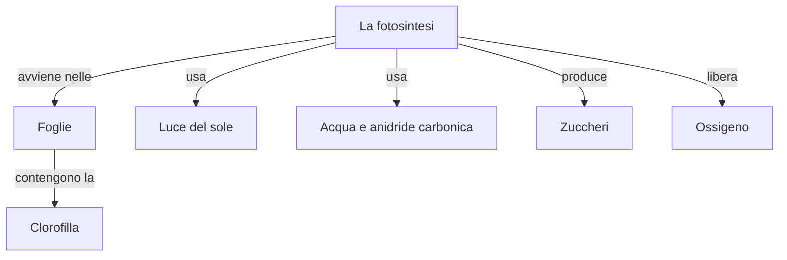
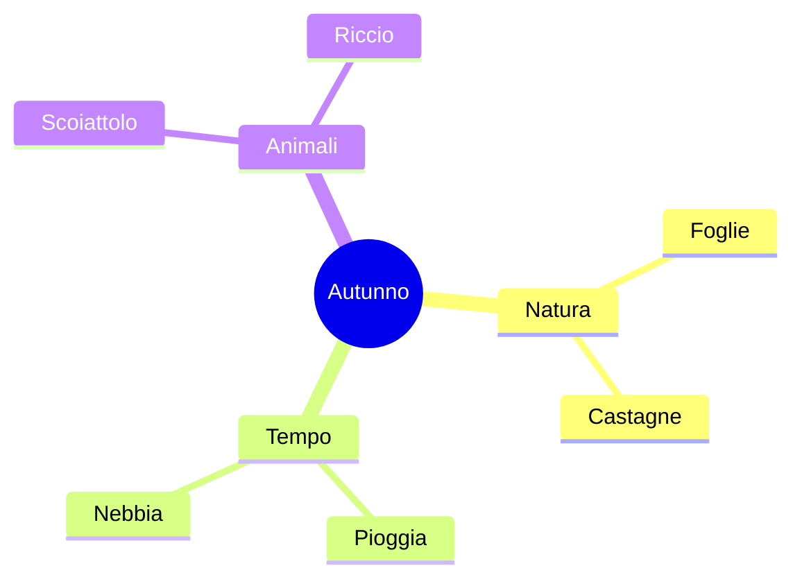
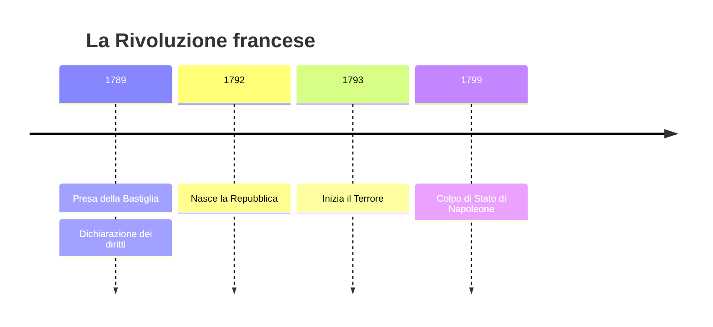
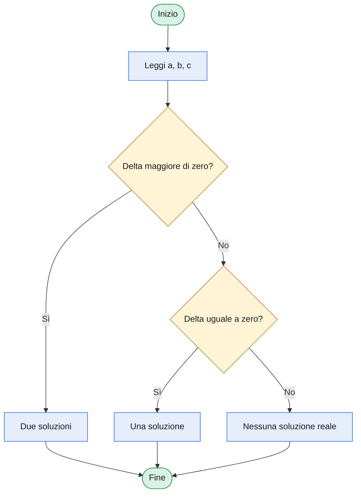
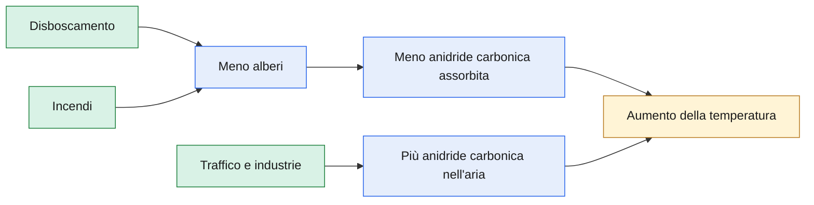

# Modelli per crea-mappa-mermaid

Un modello per tipo di diagramma. Si parte dal modello e si cambiano testo e numero di caselle.

## Mappa concettuale

## Mappa mentale

## Linea del tempo

## Diagramma di flusso

## Schema causa-effetto

Nello schema causa-effetto il colore giallo segna l'effetto finale, il verde le cause di partenza.
