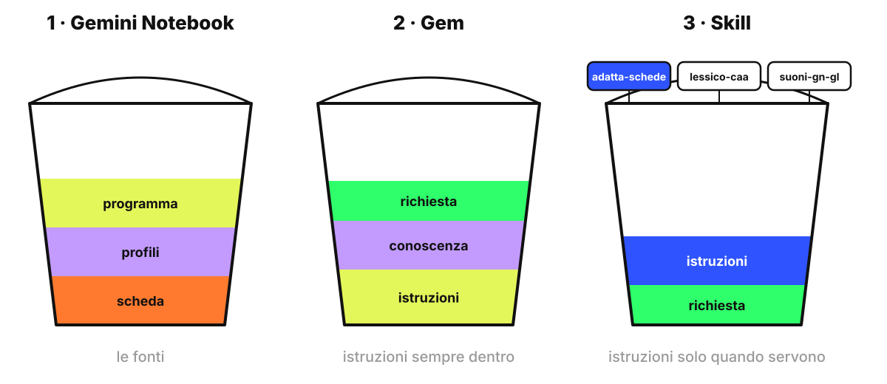
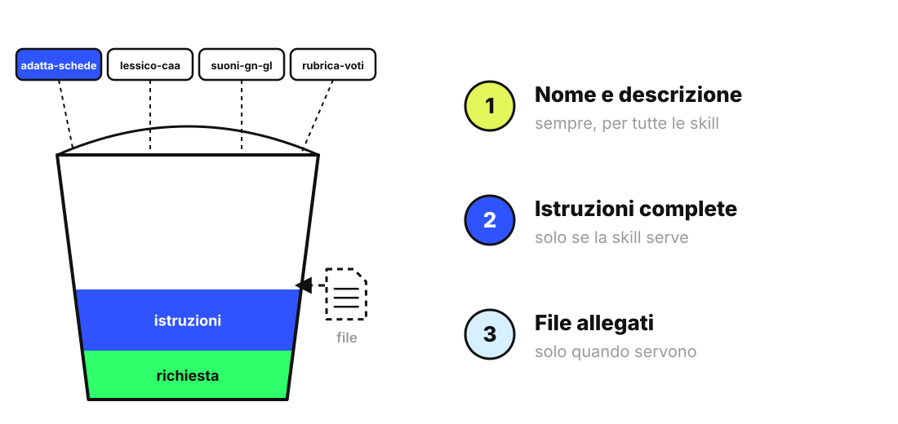

<!-- _class: lead -->
<!-- _paginate: false -->

### Gem e skill · Esercitazione

# Dal Gem alla skill

<p class="meta">Giuseppe Mastrandrea</p>

---

### Cosa facciamo

Trasformiamo il Gem di sostegno in una **skill**: le stesse regole, ma caricate nel contesto solo quando servono.

<p class="meta">Tecniche: scrivere una descrizione che attiva la skill, provarla con richieste pertinenti e non pertinenti</p>

<p class="note">Nel vostro dominio le skill arrivano tra il 13 ottobre e metà novembre 2026. Se non sono ancora attive, questa parte è una dimostrazione.</p>

---

### Il percorso

<div class="schema"></div>

---

### Come entra una skill nel contesto

<div class="schema"></div>

<p class="note" style="text-align:center">Google: Gemini controlla solo nome e descrizione; legge le istruzioni complete se la skill è pertinente; apre i file solo quando servono (support.google.com/gemini/answer/17102773).</p>

---

### Gem e skill a confronto

<div class="cols">
<div class="card"><h2>Gem</h2><p>Si sceglie il Gem prima di cominciare. Istruzioni e conoscenza entrano tutte, a ogni risposta.</p></div>
<div class="card"><h2>Skill</h2><p>Gemini la usa da solo quando la richiesta corrisponde alla descrizione, oppure la richiamate con <b>/</b>. Più skill possono lavorare nella stessa richiesta.</p></div>
</div>

---

### La descrizione decide tutto

Le regole di Google per nome e descrizione:

- **Nome**: minuscole, parole separate da trattini, comincia con un verbo. Esempio: `adatta-schede-per-profili`.
- **Descrizione**: 1 o 2 frasi, al massimo 1024 caratteri, senza "io" e senza "tu". Dice **quando** usarla, con esempi di situazioni.

---

### La nostra descrizione

```text
Adatta schede ed esercizi di scuola primaria ai profili di alunni
con bisogni diversi, spiegando cosa cambia e perché.
Da usare quando si chiede di adattare, semplificare o differenziare
una scheda, una consegna o un testo per uno o più profili.
```

<p class="note">Google consiglia di aprire la seconda frase con "Use when…": in italiano, "Da usare quando…".</p>

---

### Creare la skill

<div class="cols">
<div>

1. Su **gemini.google.com**: **Impostazioni → Skill**.
2. **Crea manualmente**.
3. Nome, descrizione e istruzioni: le istruzioni sono quelle del Gem.
4. In fondo alle istruzioni incollate il testo dei 4 profili.
5. **Crea**.

</div>
<div class="shot">Screenshot: pagina Skill con il pulsante "Crea manualmente"</div>
</div>

---

### Perché i profili nelle istruzioni

- I file si aggiungono a una skill solo caricando una cartella con un file `SKILL.md`: è un passaggio tecnico, lo vediamo in dimostrazione.
- Sono accettati file di testo e PDF, non `.docx` né Documenti Google.
- Per 4 profili brevi basta incollarli nelle istruzioni.

<p class="note">Fonte: support.google.com/gemini/answer/17094296, sezione "Upload requirements".</p>

---

### Mettere alla prova la skill

In una chat nuova, **senza** nominare la skill:

```text
Adatta questa consegna di matematica per il profilo C: [incolla].
```

```text
Scrivi un avviso per i genitori sull'uscita di giovedì.
```

La skill deve attivarsi con la prima richiesta e **non** con la seconda. Se sbaglia, si corregge la descrizione.

---

### E i Gem che avete già?

- Google li trasforma in **skill in bozza** con nome, descrizione, istruzioni e file di conoscenza.
- Per le scuole succede non prima del **1° giugno 2027**.
- Google consiglia di copiare a mano le istruzioni prima della migrazione automatica.

<p class="note">Fonte: Google Workspace Help, "About the transition from Gems to skills".</p>

---

### Il prodotto

Una skill **adatta-schede-per-profili** che si attiva da sola sulle richieste giuste e resta ferma sulle altre.
