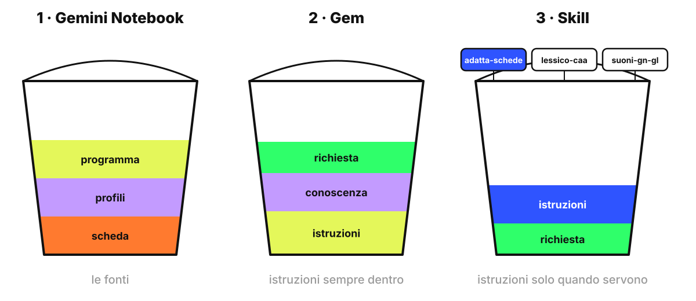
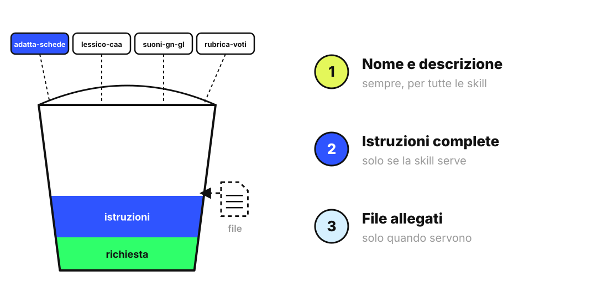

<!-- _class: lead -->
<!-- _paginate: false -->

### Gem e skill · Esercitazione

# Dal Gem alla skill

<p class="meta">Giuseppe Mastrandrea</p>

---

### Cosa facciamo

Costruiamo due **skill**, cioè istruzioni che Gemini carica nel contesto solo quando servono:

1. **crea-mappa-mermaid**: istruzioni più un file di modelli. La creiamo a mano.
2. **esporta-quiz**: istruzioni con una lista di controlli e il modello dello script. La carichiamo come cartella.

<p class="note">Nel vostro dominio le skill arrivano tra il 13 ottobre e metà novembre 2026. Se non sono ancora attive, questa parte è una dimostrazione.</p>

---

### Il percorso

<div class="schema"></div>

---

### Come entra una skill nel contesto

<div class="schema"></div>

<p class="note" style="text-align:center">Google: Gemini controlla solo nome e descrizione; legge le istruzioni complete se la skill è pertinente; apre i file solo quando servono (support.google.com/gemini/answer/17102773).</p>

---

### Gem e skill a confronto

<div class="cols">
<div class="card"><h2>Gem</h2><p>Si sceglie il Gem prima di cominciare. Istruzioni e conoscenza entrano tutte, a ogni risposta.</p></div>
<div class="card"><h2>Skill</h2><p>Gemini la usa da solo quando la richiesta corrisponde alla descrizione, oppure la richiamate con <b>/</b>. Più skill possono lavorare nella stessa richiesta.</p></div>
</div>

---

### La descrizione decide tutto

Le regole di Google per nome e descrizione:

- **Nome**: minuscole, parole separate da trattini, comincia con un verbo. Esempio: `crea-mappa-mermaid`.
- **Descrizione**: 1 o 2 frasi, al massimo 1024 caratteri, senza "io" e senza "tu". Dice **quando** usarla, con esempi di situazioni.

<p class="note">Google consiglia di aprire la seconda frase con "Usa quando…": nelle nostre skill, "Da usare quando…".</p>

---

<!-- _class: big -->

# Prima skill<br>crea-mappa-mermaid

---

### Perché proprio questa

- Nell'esercitazione "Diagrammi con Mermaid" i vincoli del prompt si riscrivevano ogni volta: quante caselle, niente parentesi, solo il codice.
- Nella skill si scrivono **una volta**, insieme agli errori che rompono il diagramma.
- Il risultato si controlla subito: in draw.io il diagramma compare oppure dà errore.

---

### La descrizione

```text
Scrive in codice Mermaid mappe concettuali, mappe mentali, linee del tempo,
diagrammi di flusso e schemi causa-effetto a partire da una lezione,
un testo o un argomento. Da usare quando si chiede una mappa, uno schema,
un diagramma o una linea del tempo da proiettare, stampare o modificare
in draw.io.
```

---

### Cosa c'è nelle istruzioni

<div class="cols">
<div>

- **Procedura**: quale tipo di diagramma per quale richiesta.
- **Regole**: caselle e parole per ordine di scuola.
- **Formato**: solo il codice, più due righe.
- **Colori**: tre, sempre gli stessi.
- **Errori comuni**: virgolette, ID ripetuti, `end`, due punti nella linea del tempo.

</div>
<div class="card"><h2>modelli.md</h2><p>Un file a parte con un modello per ogni tipo di diagramma. Gemini lo apre solo dopo aver scelto il tipo.</p></div>
</div>

<p class="note">Scaricate i file: <a href="skill-crea-mappa-mermaid/SKILL.md">SKILL.md</a> e <a href="skill-crea-mappa-mermaid/modelli.md">modelli.md</a>.</p>

---

### Creare la skill a mano

<div class="cols">
<div>

1. Su **gemini.google.com**: **Personalizza → Skill**.
2. **Crea → Crea manualmente**.
3. Nome e descrizione: copiateli da `SKILL.md`.
4. Istruzioni: tutto quello che in `SKILL.md` viene dopo la descrizione.
5. **Aggiungi → File**: caricate `modelli.md`.
6. **Crea**.

</div>
<div class="shot">Screenshot: pagina Skill con il pulsante "Crea manualmente"</div>
</div>

---

### Mettere alla prova la skill

In una chat nuova, **senza** nominare la skill:

```text
Mi serve una mappa sulla fotosintesi per una seconda media.
```

```text
Riassumi in cinque punti la lezione sul ciclo dell'acqua.
```

La skill deve attivarsi con la prima richiesta e **non** con la seconda: un riassunto non è un diagramma. Se sbaglia, si corregge la descrizione.

---

### Dal codice al diagramma

1. Copiate il codice con l'icona **Copia**.
2. In **app.diagrams.net**: **Arrange → Insert → Mermaid**, incollate, **Insert**.
3. Per un'immagine senza draw.io: **mermaid.live**, poi **Actions → PNG**.

<div class="warn">Compare un errore? Incollatelo nella stessa chat: la skill ha una sezione "Errori comuni" e di solito lo corregge al primo colpo. Se l'errore si ripete, aggiungete la regola alla skill.</div>

---

<!-- _class: big -->

# Seconda skill<br>esporta-quiz

---

### Perché proprio questa

- In "Verifiche per profili, fino al Google Form" il passaggio verifica, array `DOMANDE`, script si faceva con un prompt lungo e un controllo a occhio.
- La skill fa lo stesso lavoro e **controlla le domande** con una lista scritta prima di montare lo script.
- Il Modulo lo crea Apps Script con il vostro account: Gemini non tocca il vostro Drive.

---

### Cosa c'è nella cartella

```text
esporta-quiz/
├── SKILL.md                    istruzioni e procedura
├── scripts/
│   └── controlla_quiz.py       lo stesso controllo, come programma
└── assets/
    ├── genera-form-quiz.js     lo script di "Verifiche per profili"
    └── esempio-domande.json    il formato delle domande
```

<p class="note">Scaricate la cartella compressa: <a href="skill-esporta-quiz.zip">skill-esporta-quiz.zip</a>. In Gemini non contiamo sul programma: i controlli li fa seguendo la lista. Il programma lo fa girare un agente, nel modulo sugli agenti con Antigravity.</p>

---

### Cosa controlla la skill

<div class="cols">
<div class="card"><h2>Errori: si ferma</h2><p>Indice della risposta fuori dalle opzioni, opzioni ripetute, tipo di domanda sconosciuto, scala non valida per Moduli, email o numeri di telefono nel testo.</p></div>
<div class="card"><h2>Avvisi: decidete voi</h2><p>Risposta giusta quasi sempre nella stessa posizione, risposta giusta molto più lunga delle altre, feedback mancante per chi sbaglia.</p></div>
</div>

<div class="warn">La skill controlla la <b>forma</b>, non la correttezza: se la verifica dice che la risposta giusta è la B e invece è la C, la skill non se ne accorge.</div>

---

### Caricare la skill

<div class="cols">
<div>

1. **Personalizza → Skill**.
2. **Crea → Carica**.
3. Scegliete `skill-esporta-quiz.zip`.
4. Controllate che compaiano i 3 file sotto le istruzioni.
5. **Crea**.

<p class="note">Per cambiare un file bisogna ricaricare tutta la skill.</p>

</div>
<div class="shot">Screenshot: finestra di caricamento con la cartella esporta-quiz</div>
</div>

---

### La prova

Riprendete la verifica in 3 versioni di "Verifiche per profili" e scrivete:

```text
/esporta-quiz Porta in Google Moduli la versione B di questa verifica.
[incollate la verifica con le risposte corrette]
```

<div class="check"><b>Cosa vedete:</b> il numero di domande e il punteggio, gli eventuali avvisi, lo script completo e le istruzioni per Apps Script.</div>

<div class="warn">Gemini controlla seguendo una lista, e una lista si può saltare: la revisione del Modulo, risposta per risposta, resta vostra.</div>

---

### Dallo script al Modulo

1. **script.google.com** con l'account della scuola, **Nuovo progetto**.
2. Cancellate il codice d'esempio e incollate lo script.
3. Salvate, scegliete `creaForm`, **Esegui**, autorizzate.
4. Nel registro di esecuzione trovate i link al Modulo.
5. Nelle impostazioni del Modulo: raccolta email **"Verificati"** e **rilascio del punteggio**.
6. Compilate il Modulo come uno studente e controllate ogni risposta corretta.

---

### E i Gem che avete già?

- Google li trasforma in **skill in bozza** con nome, descrizione, istruzioni e file di conoscenza.
- Per le scuole succede non prima del **1° giugno 2027**.
- Google consiglia di copiare a mano le istruzioni prima della migrazione automatica.

<p class="note">Fonte: Google Workspace Help, "About the transition from Gems to skills".</p>

---

### Il prodotto

Due skill attive:

- **crea-mappa-mermaid**, che si attiva sulle richieste di mappe e resta ferma sulle altre;
- **esporta-quiz**, con un Modulo quiz creato da una vostra verifica e controllato risposta per risposta.

<p class="note">Fonti per creazione e caricamento: support.google.com/gemini/answer/17094296 (controllato il 02/11/2026).</p>
