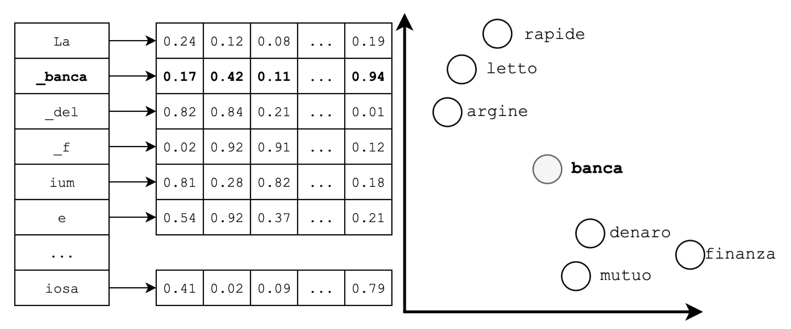
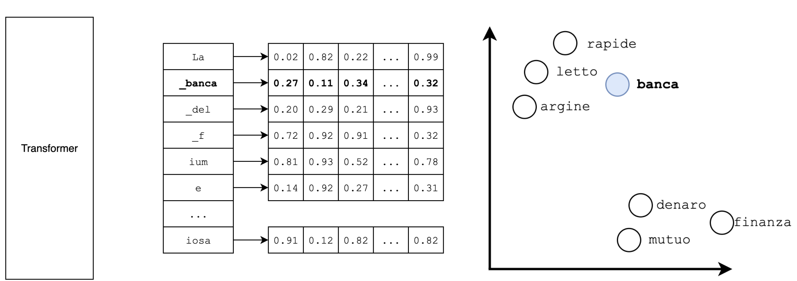
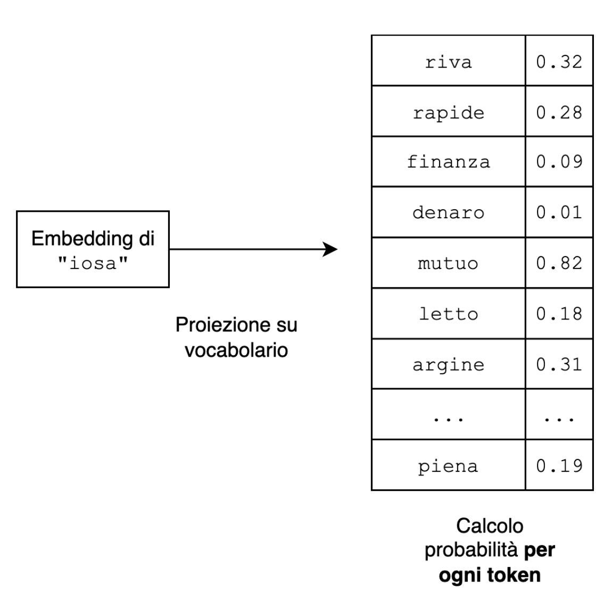
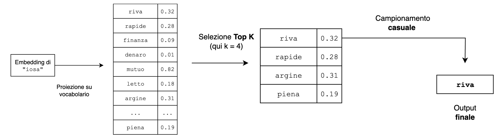

<!-- _class: lead -->
<!-- _paginate: false -->

# Introduzione all'IA e all'IA generativa

<strong style="color:var(--fg)">Giuseppe Mastrandrea</strong>

---

### Outline

1. **Introduzione ad IA e IA generativa**
2. Prompt Engineering
3. Agenti AI
4. Piattaforme di automation

---

### Agenda

1. IA: definizioni generali
2. Classificazione dei sistemi di IA
3. IA generativa: introduzione agli LLM
4. Etica nei sistemi di IA
5. Successi e fallimenti dell'IA

---

### Definizioni generali

> «Un problema fondamentale della definizione di "Intelligenza artificiale" è che nessuno sa cosa sia realmente l'intelligenza.»

<cite>Shane Legg, Marcus Hutter — <em><a href="https://arxiv.org/abs/0712.3329">Universal Intelligence: A Definition of Machine Intelligence</a></em></cite>

---

### Definizioni generali

> In computer science, artificial intelligence (AI) […] is intelligence demonstrated by machines, in contrast to the natural intelligence displayed by humans.

<cite>Definizione di Intelligenza Artificiale di Wikipedia fino al 2020</cite>

---

### Definizioni generali

> Ai fini presenti, il problema dell'intelligenza artificiale viene considerato come quello di far comportare una macchina in modi che verrebbero definiti intelligenti se fosse un essere umano a comportarsi così.

<cite>John McCarthy, nota alla lista dei partecipanti al <em><a href="http://www-formal.stanford.edu/jmc/history/dartmouth/dartmouth.html">Dartmouth Summer Research Project on Artificial Intelligence</a></em>, dopo l'estate 1956</cite>

---

<!-- _class: big -->

# Una lavatrice può essere definita intelligente?

---

### Definizioni

- La definizione originaria **non ha niente a che fare col pensiero**
- È più legata al **comportamento** (behavior)
- Alan Turing giunse alle stesse conclusioni quando sviluppò il **Test di Turing**

---

### Definizioni generali

> «La domanda se un computer possa pensare non è più interessante della domanda se un sottomarino possa nuotare»

<cite>Edsger Dijkstra</cite>

---

### Definizioni

La domanda «Un computer può pensare?» è semplicemente **mal posta**

**Keypoints:**

- non fissarsi su analogie fuorvianti
- è più utile studiare **cosa** fa un computer e **come** lo fa

---

### Cosa stiamo misurando?

## Due anime nell'Intelligenza Artificiale

<h2>Ingegneristica</h2>
Aspetto rilevante: eseguire con successo un compito

<h2>Cognitiva</h2>

---

### Cosa stiamo misurando?

<h2>Task Focused AI</h2>
oppure IA debole, IA stretta

<h2>Process Focused AI</h2>
oppure IA cognitiva, IA forte, AGI

---

<!-- _class: lead -->
<!-- _paginate: false -->

### Parte 2

# Classificazione dei sistemi di IA

---

<!-- _class: big -->

### AI simbolica

---

### AI simbolica

- Sistemi che seguono un **set di regole predefinite**
- Logica proposizionale
- Se tutto è regola, tutto è deducibile
- Esempio: [un algoritmo che gioca a Tris](https://gabri-sh.github.io/tris/tris-nes.css%20ai/indexAI.html)

---

<!-- _class: big -->

### Machine Learning

---

### Machine Learning

- Un sistema che fa **predizioni su base statistica**
- Introduzione del concetto di **addestramento**
- La logica lascia spazio alla **probabilità**
- L'algoritmo «impara» osservando le correlazioni senza essere cosciente

---

### Machine Learning

## L'importanza dei dati nell'epoca dei big data

Tutto quello che facciamo è sorgente di dati che sono utilizzati dai provider di servizi per:

- vendita dei dati
- addestramento diretto di modelli

Esistono **dataset pubblici** praticamente per [qualsiasi cosa](https://www.kaggle.com/datasets/rounakbanik/pokemon)

---

<!-- _class: big -->

### Deep Learning

---

### Deep Learning

- Principi identici al machine learning ma con modelli di **reti neurali**
- **Costosi** da addestrare (tempo e denaro)
- **Difficili da spiegare** (bassa explainability)
- **Efficacissimi** in determinati scenari
- Un esempio: [la guida autonoma](https://www.youtube.com/watch?v=u_eZoOS5bFc)

---

### Deep Learning

- Oltre ai dati si creano enormi possibilità per i **produttori di chip**
- Possedere GPU diventa il must have
- [Il successo di **nVidia**](https://www.forbes.com/sites/tylerroush/2025/07/15/nvidia-shares-hit-all-time-high-as-trump-administration-backs-china-chip-sales/)

Jensen Huang, CEO di Nvidia

---

### Deep Learning

- Oltre ai dati si creano enormi possibilità per i **produttori di chip**
- Possedere GPU diventa il must have
- [**AlphaGo – The Movie**](https://www.youtube.com/watch?v=WXuK6gekU1Y)

Lee Se-Dol durante il match contro AlphaGo

---

<!-- _class: big -->

### Generative AI

---

### Generative AI

- Dal **2014** le deep neural networks sono utilizzate per creare contenuti «originali» basandosi sui dati di addestramento
- [this-person-does-not-exist.com](https://this-person-does-not-exist.com/)

**Ma è dal 2017 che cambia tutto…**

---

### Generative AI

…quando Google pubblica il paper **«[Attention is all you need](https://proceedings.neurips.cc/paper/2017/hash/3f5ee243547dee91fbd053c1c4a845aa-Abstract.html)»**

Nel paper si introduce una nuova architettura di reti neurali chiamata **transformer**:

- specializzati nell'elaborazione del linguaggio naturale (NLP)

Schema dell'architettura Transformer

---

### Generative AI

- Originariamente nati per la **traduzione automatica**
- Sono la base degli attuali **Large Language Models**

Schema dell'architettura Transformer

---

<!-- _class: lead -->
<!-- _paginate: false -->

### Parte 3

# Large Language Models

---

### Recap – Da dove partiamo

L'IA generativa è un sottoinsieme dell'Intelligenza Artificiale che si concentra sullo sviluppo di sistemi e modelli capaci di **creare contenuti originali** a partire da **dati esistenti**.

---

### Recap – Da dove partiamo

<h2>Modelli</h2>
Software

<h2>Creare contenuti originali</h2>
Creare contenuti molto probabilmente inesistenti

<h2>A partire da testi esistenti</h2>
«Copiando» testi già noti al software (dati di addestramento)

---

### Large Language Models

Si tratta di **modelli matematici** in grado di codificare informazioni statistiche su uno o più linguaggi, ossia **quanto è probabile che una parola appaia** in una determinata frase.

---

### Punti chiave

- Il processo di generazione avviene in maniera **sequenziale**
- La generazione avviene su **base statistica**
- Le statistiche sono calcolate in base ai **dati di addestramento**
- I contenuti generati sono scelti da un **vocabolario**

---

### LLM – Come generano i contenuti?

Si parte dall'input dell'utente (**prompt**) e si **tokenizza**

---

### LLM – Come generano i contenuti?

- Ciascun token diventa una sequenza di numeri, detti **embeddings**
- Gli embedding sono calcolati sulla base dei dati di addestramento

---

### LLM – Come generano i contenuti?

- Ciascun token diventa una sequenza di numeri, detti **embeddings**
- Gli embedding sono calcolati sulla base dei dati di addestramento

---

### LLM – Come generano i contenuti?

- L'ultimo embedding modificato viene **"proiettato" sul vocabolario** di token
- **Obiettivo:** avere per ogni token una probabilità

---

### LLM – Come generano i contenuti?

- Avviene un **campionamento casuale** fra i top N
- Il token campionato è l'output del LLM

---

### Recap – Da dove partiamo

Generano contenuti:

- con un processo **iterativo**
- su **base statistica** con una **componente casuale**

---

<!-- _class: big -->

# I Large Language Models non modellano la **conoscenza**, ma il **linguaggio**

---

### LLM – Limiti invalicabili

<h2>Knowledge cutoff</h2>
Non conoscono fatti avvenuti dopo il loro addestramento

<h2>Hallucinations</h2>
La loro creatività può ritorcersi loro contro producendo risposte false o errate

<h2>Conoscenza di dominio assente</h2>
Non sanno rispondere a domande che richiedono informazioni specifiche

---

<!-- _class: big -->

### Hands on

> «L'autolavaggio è a 40 metri da casa. Devo lavare la macchina. Dovrei andarci a piedi o in macchina?»

---

### Mitigazioni

- **Prompt Engineering:** chiedere le cose nel miglior modo possibile
- **Retrieval:** inviare dei file o della conoscenza «esterna» per l'analisi durante la conversazione
- **Fine tuning:** ri-addestrare il modello aggiungendo fra i dati di addestramento altre informazioni (altri testi)

---

### Oltre gli LLM – Agenti AI

Le piattaforme più blasonate di IA generativa possono interagire con moduli terzi per:

- fare ricerche sul web
- analizzare e leggere contenuti da file
- generare grafici anche interattivi

Quando un'applicazione che fa uso di LLM può interagire con altri componenti e **riesce a capire quando farlo** si parla di **agente AI**

---

<!-- _class: lead -->
<!-- _paginate: false -->

### Parte 4

# Rischi dei Large Language Models

---

### Rischi degli LLM

## Risultati non deterministici

- Gli LLM sono modelli linguistici statistici con una **componente casuale**
- **NON** possiamo avere la certezza che ci diano risposte riproducibili
- Questo ci porta a comportamenti non prevedibili che possono avere esiti anche **pericolosi**

---

### Rischi degli LLM

## Risultati non deterministici

La risposta di Gemini ad uno studente dopo una <a href="https://gemini.google.com/share/6d141b742a13">conversazione</a> apparentemente innocua

---

### Rischi degli LLM

## Questioni di copyright: [New York Times vs. OpenAI](https://www.nytimes.com/2023/12/27/business/media/new-york-times-open-ai-microsoft-lawsuit.html)

- Secondo il NY Times OpenAI ha usato in maniera illegittima i suoi contenuti per addestrare ChatGPT
- Nella primavera 2025 un giudice ha respinto la richiesta di archiviazione di OpenAI

---

### Rischi degli LLM

## Questioni di copyright

<a href="https://help.nytimes.com/115014893428-Terms-of-Service">Estratto dai termini di utilizzo del New York Times</a>

---

### Rischi degli LLM

## Questioni di copyright: [class action contro Anthropic](https://www.anthropiccopyrightsettlement.com/)

- Nel **2024** tre autori fanno causa ad Anthropic sostenendo che ha addestrato Claude su libri coperti da copyright e scaricati illegalmente
- Nell'autunno **2025** Anthropic ha patteggiato un accordo di **1,5 miliardi di dollari** per risarcire gli autori dei libri, pur non ammettendo la colpa

---

### Rischi degli LLM

## Bias nei dati

**[Humans are biased: generative AI is even worse](https://www.bloomberg.com/graphics/2023-generative-ai-bias/)**

Nel 2023 Bloomberg conduce uno studio su una nota libreria di generazione di immagini scoprendo che le immagini generate perpetuano **stereotipi** di genere, razza, età, posizione sociale

---

### Rischi degli LLM

## Sostenibilità

L'IA generativa ha un elevatissimo **consumo energetico** in termini di:

- uso di modelli
- costruzione di data center

L'impatto più immediato e preoccupante è sul **[consumo di acqua](https://www.forbes.com/sites/cindygordon/2024/02/25/ai-is-accelerating-the-loss-of-our-scarcest-natural-resource-water/)** legato all'uso di modelli di IA

---

### Rischi degli LLM

## Opacità e pubblicità

- Usare una IA come motore di ricerca **non ci dà il controllo delle fonti** consultate dall'IA
- Alcune società (OpenAI) stanno introducendo le **pubblicità** all'interno delle risposte di ChatGPT

---

### Rischi degli LLM · Opacità e pubblicità

> «Gli utenti interagiscono con una voce adattiva e conversazionale alla quale hanno rivelato i loro pensieri più intimi. Le persone confidano ai chatbot le proprie paure mediche, i problemi relazionali, le proprie credenze su Dio e sull'aldilà.»

<cite>Zoë Hitzig — <em><a href="https://www.nytimes.com/2026/02/11/opinion/openai-ads-chatgpt.html">OpenAI Is Making the Mistakes Facebook Made. I Quit.</a></em></cite>

---

### Rischi degli LLM

## Etica e misusi

- Molti (tutti) gli utenti tendono a rispondere agli LLM **come se fossero [esseri senzienti](https://www.youtube.com/watch?v=CyyL0yDhr7I)**
- Uno studio del Center for Democracy and Technology ha evidenziato come **un terzo** degli intervistati (studenti adolescenti) abbia usato l'IA generativa in cerca di relazioni romantiche

Joaquin Phoenix si innamora di una IA in Her (2013)

---

### Rischi degli LLM

## Etica e misconception

Cause in corso fra aziende operanti nell'AI e famiglie per accuse legate ad **istigazione al suicidio**:

- [Adam Raine](https://www.theguardian.com/us-news/2025/aug/29/chatgpt-suicide-openai-sam-altman-adam-raine)
- [Sewell Setzer III](https://www.theguardian.com/technology/2024/oct/23/character-ai-chatbot-sewell-setzer-death)
- [Zane Shamblin](https://edition.cnn.com/2025/11/06/us/openai-chatgpt-suicide-lawsuit-invs-vis)

---

<!-- _class: lead -->
<!-- _paginate: false -->

### Parte 5

# Use case e scenari efficaci

---

### LLM – Sono da buttare via?

- Customer Service di nuova generazione
- Personalizzazione del marketing
- Supporto nell'automazione di processi aziendali
- Revisione di documentazione

- Creazione di corpus di documenti
- Creatività
- Estrazione dati strutturati da documenti non strutturati

---

<!-- _class: big -->
<!-- _paginate: false -->

# …domande?
