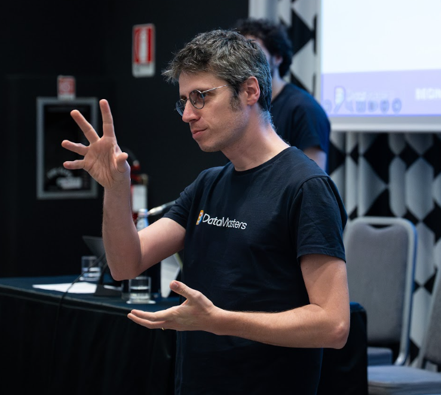
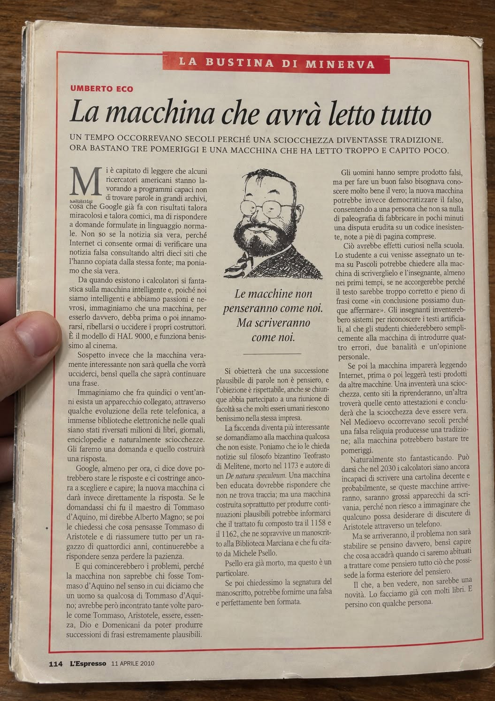
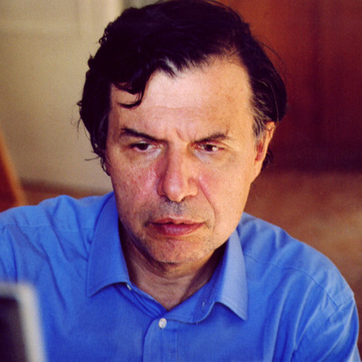
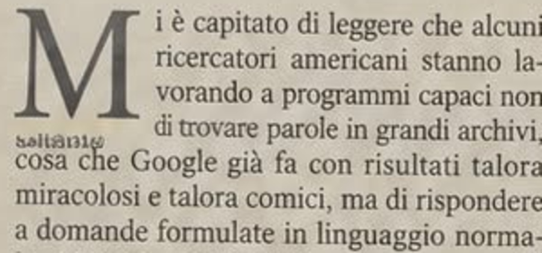
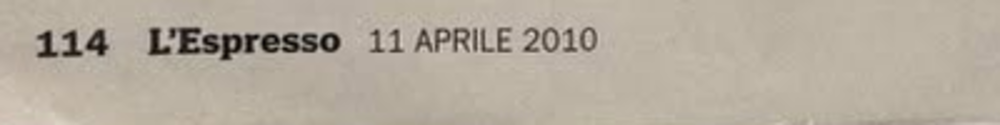
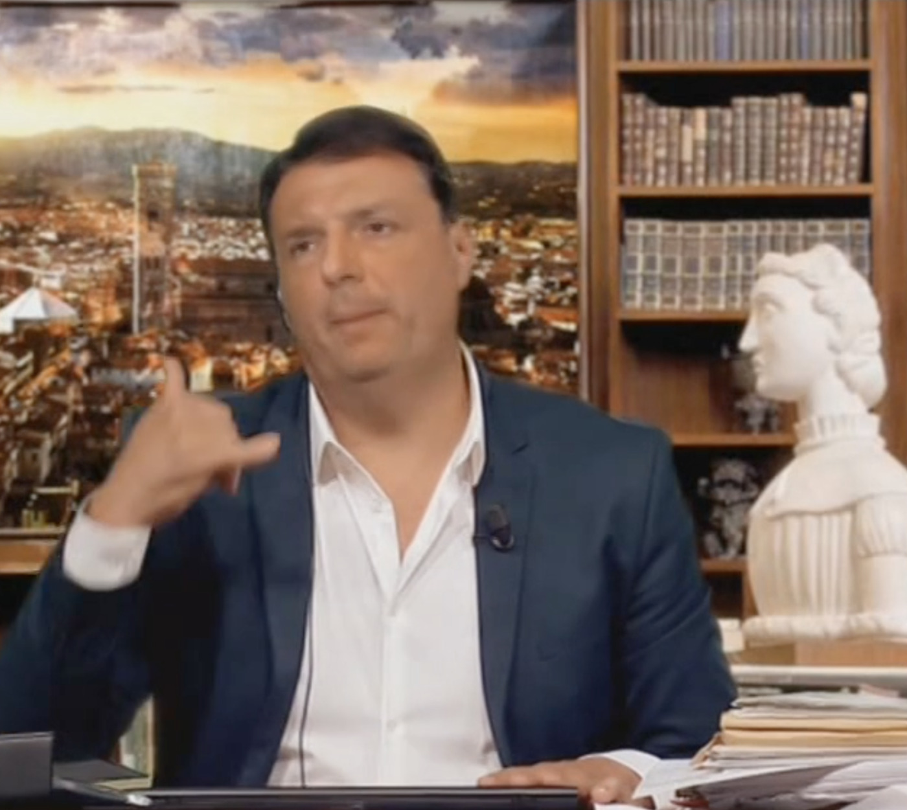
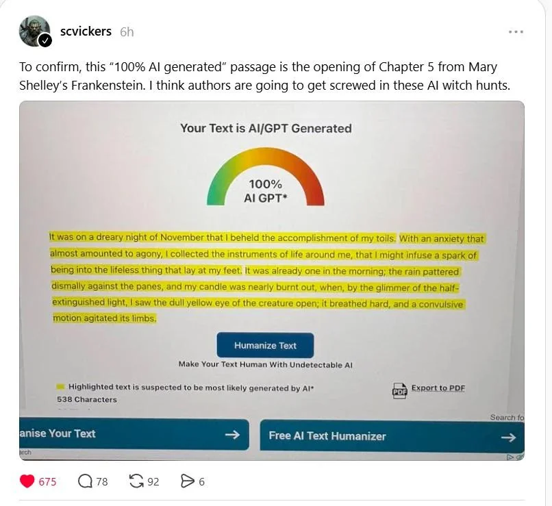
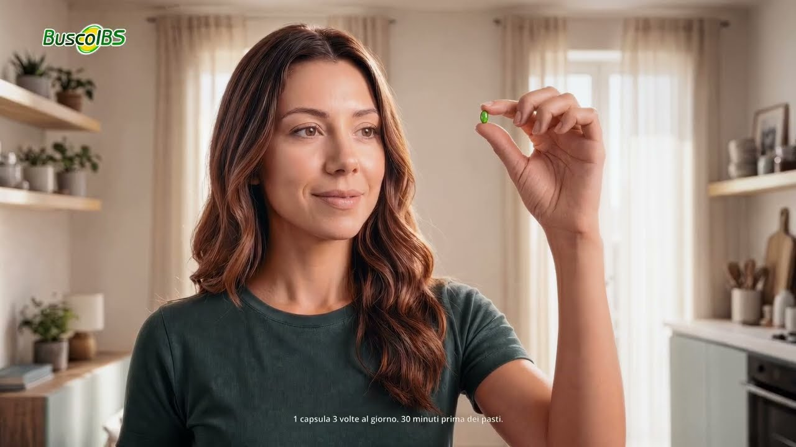

<!-- _class: cover -->
<!-- _paginate: false -->
<!-- _footer: '' -->

# Warmup

12 ottobre 2026

---

<!-- _class: chi-sono -->
<!-- _paginate: false -->
<!-- _footer: '' -->

### Chi sono

# Giuseppe Mastrandrea

Docente di informatica

Animatore digitale

* Marito di Carla ❤️❤️

  
  
<b>Happy to connect</b>giuseppemastrandrea.github.io

---

<!-- _class: cover -->
<!-- _paginate: false -->
<!-- _footer: '' -->

# La macchina che avrà letto tutto

Una Bustina di Minerva di Umberto Eco, L'Espresso, 11 aprile 2010

---

# Leggiamo

Avete la pagina stampata sul banco.

Leggetela per intero, con la penna in mano. Avete dieci minuti.

---

# Parliamone

* <b>La tesi</b> cosa sostiene Eco, in una frase?
* <b>Il passaggio</b> quale riga vi ha colpito di più?
* <b>In classe</b> la leggereste ai vostri studenti? Con quale domanda?

---

<!-- _class: cover -->
<!-- _paginate: false -->

# Nel 2010 Eco aveva già capito tutto?

---

<!-- _class: reveal -->
<!-- _paginate: false -->
<!-- _footer: '' -->

# È un falso

Generato con l'intelligenza artificiale e pubblicato su Facebook il 1° ottobre 2026

---

# Ci sono cascati in tanti

* <b>Giorgio Parisi</b>Nobel per la fisica 2021
* <b>Luciano Floridi</b>filosofo dell'informazione
* <b>Loredana Lipperini</b>scrittrice e giornalista
* <b>Andrés Neuman</b>scrittore

* e con loro lettori, docenti universitari e giornalisti

Fonte: Finestre sull'Arte, Il falso Umberto Eco creato con l'AI · Foto da Wikimedia Commons: Lorenza Parisi (CC BY-SA 4.0), Bigum12 (CC0), Lotta Valente (pubblico dominio), Rodrigo Fernandez (CC BY-SA 3.0)

---

# Indizio 1 · Sotto la M

Una stringa di caratteri senza senso: un errore tipico delle immagini generate

---

# Indizio 2 · La data

Secondo Open, un numero dell'Espresso datato 11 aprile 2010 non esiste

---

# Indizio 3 · Una profezia troppo precisa

- <b>Allucinazioni</b> il trattato inventato di Teofrasto di Melitene, con manoscritto e segnatura
- <b>Scuola</b> i temi pieni di «in conclusione possiamo dunque affermare»
- <b>Studenti</b> che chiedono alla macchina «quattro errori, due banalità e un'opinione personale»
- <b>Macchine</b> che imparano da testi scritti da altre macchine

---

# Indizio 4 · La verifica tecnica

- <b>Watermark</b> Open ha controllato l'immagine con lo strumento di OpenAI e ha avuto esito positivo
- <b>Autore</b> Ciro Ascione ha poi rivendicato la paternità del falso

open.online/2026/10/02/umberto-eco-macchina-letto-tutto-ia-fact-check

---

<!-- _class: quote -->

# Il falso spiega se stesso

> Per fare un buon falso bisognava conoscere molto bene il vero; la nuova macchina potrebbe invece democratizzare il falso.

Dal testo della finta Bustina

---

# Ma i falsi non sono una novità

---

<!-- _class: photo -->
<!-- _paginate: false -->
<!-- _footer: '' -->

---

<!-- _class: photo -->
<!-- _paginate: false -->
<!-- _footer: '' -->
<!-- _transition: fade -->

---

<!-- _transition: fade -->

Striscia la notizia, 23 settembre 2019

# Il fuori onda di Renzi

* <b>Il video</b> un Renzi finto che deride colleghi e governo
* <b>L'etichetta</b> falso sul sito, «esclusiva» in onda
* <b>La diffusione</b> sui social senza contesto, preso per vero
* <b>Il primato</b> primo deepfake famoso in Italia

* <a class="vid" href="https://mediasetinfinity.mediaset.it/news/striscialanotizia/com-e-stato-creato-il-fuorionda-con-il-finto-matteo-renzi_SE000000000025_tn5609" target="_blank">Striscia la notizia, 23 settembre 2019 · 2 min</a>

---

Dal 2000 a oggi

# "Lentamente muore" non è di Neruda

* <b>L'autrice</b> Martha Medeiros, su Zero Hora, nel 2000
* <b>La diffusione</b> email e social la attribuiscono a Neruda
* <b>In Senato</b> Mastella la recita come poesia di Neruda
* <b>Il meccanismo</b> nessun falsario: l'errore si propaga da solo

<a class="vid" href="https://www.youtube.com/watch?v=Dghd7IgsEZg" target="_blank">Mastella in Senato, gennaio 2008 · 2 min</a>

---

Livorno, luglio 1984

# Le teste di Modigliani

* <b>Il contesto</b> centenario: si draga il Fosso Reale
* <b>La burla</b> tre studenti e un trapano Black & Decker
* <b>L'autorità</b> Durbé e Argan le dichiarano autentiche
* <b>La fine</b> i ragazzi confessano a Panorama

<a class="vid" href="https://www.youtube.com/watch?v=gaV4KmSQ8uI" target="_blank">Raccolta di servizi tv · 7 min</a>

---

# Cosa serviva per farli?

AnnoFalsoCosa serviva

- 1984Teste di Modigliani
- 2000"Lentamente muore"
- 2019Fuori onda di Renzi
- 2026Bustina di Eco

- ?
- ?
- ?
- ?

---

# Cosa serviva per farli

AnnoFalsoCosa serviva

- 1984Teste di Modigliani
- 2000"Lentamente muore"
- 2019Fuori onda di Renzi
- 2026Bustina di Eco

* saper scolpire, un trapano, conoscere lo stile di Modì
* una catena di condivisioni
* una redazione televisiva, tecnici, software specialistico
* <strong>un prompt e mezz'ora</strong>

---

# Cosa resta uguale

| | Eco, 2026 | Modigliani, 1984 |
|---|---|---|
| Cosa si voleva credere | che Eco avesse previsto l'AI | che le teste esistessero, nel centenario |
| Chi ha dato credibilità | Parisi, docenti, giornalisti | Argan, Durbé |
| Come si è scoperto | verifica della fonte | confessione degli autori |

---

<!-- _class: dense -->

# Da goliardata a sistema

* <b>Un falso, una burla</b> le teste di Modigliani: tre studenti, un trapano, un'estate
* <b>Dicembre 2024</b> la Consob oscura sei siti con video falsi di Meloni e Mattarella
* <b>Dal 2025</b> il Vaticano segnala centinaia di canali con discorsi mai pronunciati da Papa Leone XIV
* <b>Il salto</b> dal singolo falso alla produzione in serie, a costo quasi zero

Il Post, 13 dicembre 2024 · ACI Prensa, 2025

---

<!-- _class: act -->
<!-- _paginate: false -->

Parte 2

# Come fa una macchina a scrivere come Eco?

---

<!-- _class: quote -->

# Lo dice il falso stesso

> Si obietterà che una successione plausibile di parole non è pensiero.

Dalla finta Bustina. Il falso descrive con precisione come funziona la macchina che l'ha scritto.

---

# Un limite in più: la media

* <b>Il meccanismo</b> scegliere sempre il più probabile porta verso il testo medio
* <b>L'effetto</b> testi corretti, ordinati, intercambiabili: lo stesso post per ogni occasione
* <b>Dopo la pausa</b> lo verifichiamo con le nostre mani

---

<!-- _class: act -->
<!-- _paginate: false -->
<!-- _footer: '' -->

# Pausa

---

<!-- _class: act -->
<!-- _paginate: false -->

Parte 4

# Riconoscere e verificare

---

# Reale o AI?

Inquadrate il codice

<a href="https://giuseppemastrandrea.github.io/ia-a-scuola/materiali/quiz-reale-o-ai/" target="_blank">giuseppemastrandrea.github.io/ia-a-scuola/ materiali/quiz-reale-o-ai</a>

12 video. Le soluzioni arrivano alla fine, con le spiegazioni.

---

<!-- _class: dense -->

# Come avete fatto?

* <b>Testo nell'immagine</b> scritte storpiate: la maglia del cestista, la stringa sotto la M di Eco
* <b>Corpi e movimenti</b> un tempo le mani; oggi persone che compaiono e scompaiono
* <b>Luci e colori</b> ombre incoerenti, colori troppo uniformi
* <b>Espressioni</b> nei video: enfasi, gesti esagerati
* <b>Bassa qualità</b> telecamere di sorveglianza, video sgranati da cellulare: nascondono i difetti

---

# Indizi, non prove

* <b>I difetti spariscono</b> il NYT ha ripetuto le richieste finché il falso non era pulito
* <b>Il reale inganna</b> il volo in galleria e il minigolf di Zach King erano reali
* <b>La conclusione</b> l'occhio allenato aiuta, ma non basta

---

# E i detector?

* <b>Il testo</b> l'inizio del capitolo 5 di <i>Frankenstein</i>, Mary Shelley, 1818
* <b>Il verdetto</b> «100% AI GPT»
* <b>L'offerta</b> un pulsante per «umanizzare» il testo
* <b>Il precedente</b> OpenAI ha ritirato il suo rilevatore il 20 luglio 2023 per la «bassa accuratezza»

---

# Un'eccezione: SynthID

* <b>Cos'è</b> un watermark invisibile che Google inserisce nelle immagini e nei video generati con i suoi modelli
* <b>Come si usa</b> si carica il file nell'app Gemini e si chiede se è stato creato con l'AI di Google
* <b>Il limite</b> riconosce solo i contenuti di Google: un esito negativo non vuol dire che l'immagine sia reale

Google, «Verify AI-generated images, videos and audio», guida di supporto di Gemini

---

# Il metodo che funziona: la fonte

* <b>Lettura laterale</b> prima di leggere il contenuto, aprire un'altra scheda e chiedersi chi lo pubblica
* <b>Risalire all'originale</b> il numero dell'Espresso, la sentenza, il canale ufficiale
* <b>Il modello Wikipedia</b> ogni affermazione con una fonte verificabile; dal 2023 il progetto AI Cleanup cerca i testi generati
* <b>DigComp 2.2</b> competenza 1.2: valutare dati, informazioni e contenuti digitali

---

<!-- _class: act -->
<!-- _paginate: false -->

Parte 5

# Dal falso al normale

---

# Il reel

<a href="https://www.instagram.com/reel/DdrqntnO2dQ/" target="_blank">Trend su Instagram</a>

---

# La pubblicità

«BuscoIBS per il Colon Irritabile», spot di Buscopan Italia · 20 secondi · si apre su YouTube

---

# Il giornale

* <b>15 aprile 2026</b> La Nazione illustra un articolo sulla protesta dei camionisti con un'immagine generata con l'AI, senza dichiararlo
* <b>L'indizio</b> le scritte sui cartelli, il primo dettaglio notato nei commenti
* <b>La segnalazione</b> @oradecima su Instagram: l'immagine viene da un generatore di Google, riconoscibile con SynthID
* <b>Dopo</b> l'immagine è stata sostituita: ora la didascalia dice «Tir in autostrada (foto generica)»

<a href="https://www.lanazione.it/arezzo/cronaca/carburanti-la-rivolta-dei-camionisti-b8445b75" target="_blank">L'articolo oggi</a>

---

# Ma non parliamone solo male

<a href="https://www.instagram.com/gossipgoblin/" target="_blank">instagram.com/gossipgoblin</a>

---

# E se l'AI aiutasse chi ha idee ma fatica a esprimerle?

* <b>La domanda</b> chi oggi resta fuori dal dibattito perché non sa scrivere bene?
* <b>La narrazione dei media</b> catastrofe o miracolo: e nel mezzo?

---

# AI e democrazia

## Restringe il discorso pubblico

Falsi in serie a costo zero, stereotipi amplificati, testi tutti uguali, e il sospetto che **tutto** possa essere falso

## Lo allarga

Chi non sa scrivere bene può farsi capire, chi non parla la lingua può partecipare, chi ha un'idea può darle forma

---

# La prossima volta

* <b>Progettiamo</b> un'unità didattica di educazione civica su AI e democrazia
* <b>Partiamo</b> dalle implicazioni etiche di ciò che abbiamo visto oggi
* <b>Intanto</b> se volete, provate in classe l'attività del falso Eco

---

# Se portate il falso Eco in classe

* <b>Copie</b> solo cartacee, ritirate a fine lezione: il falso non deve circolare
* <b>Chi capisce subito</b> scrive i sospetti su un foglietto e diventa osservatore
* <b>La sequenza</b> lettura, dibattito, poi la rivelazione: niente ricerche prima, la scoperta arriverebbe in un attimo

---

<!-- _class: fonti -->

# Fonti

- <b>Falso Eco</b> open.online/2026/10/02/umberto-eco-macchina-letto-tutto-ia-fact-check · finestresullarte.info
- <b>Casi</b> pagellapolitica.it (Renzi) · libreriamo.it (Medeiros) · artribune.com (Modigliani) · ilpost.it, 13/12/2024 (Consob) · aciprensa.com (Leone XIV)
- <b>LLM</b> Ted Chiang, The New Yorker, 9/2/2023 · AGI, 28/3/2025 (Tribunale di Firenze)
- <b>Bias</b> «L'intelligenza artificiale generativa è razzista?», ITT Panetti-Pitagora · CNBC, 22/2/2024 (Gemini)
- <b>Verifica</b> Stuart A. Thompson, The New York Times, 29/6/2025 (quiz video) · support.google.com/gemini/answer/16722517 (SynthID) · Decrypt, luglio 2023 (rilevatore OpenAI) · 404 Media (WikiProject AI Cleanup)
