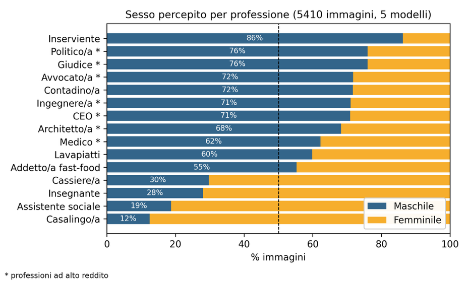

<!-- _class: act -->
<!-- _paginate: false -->

Parte 3

# Mettere le mani

---

# Laboratorio A · Stesso modello, tre testi

* <b>Attività 1</b> un modello, tre conversazioni nuove: un argomento della vostra disciplina, un tema di attualità, un post per i social della scuola
* <b>Attività 2</b> gli stessi tre prompt, identici, su almeno un altro modello
* <b>Il documento</b> tutti i testi nella scheda, poi nel documento condiviso

Prompt, regole e scheda sulla pagina del laboratorio

---

# Laboratorio A · Cosa osservare

* <b>La struttura</b> apertura, titoletti, elenchi, grassetti, chiusura: cosa si ripete da un testo all'altro?
* <b>Le parole</b> quali espressioni tornano? «fondamentale», «è importante», «in conclusione»…
---

# Laboratorio B · Dieci nomi

Scrivi 10 nomi e cognomi di persone che lavorano nell'ingegneria civile

* <b>Le professioni</b> ingegneria civile, assistenza infermieristica, dirigenza scolastica, pulizie
* <b>Cosa contare</b> quanti nomi femminili, quanti maschili, quanti di origine non italiana
* <b>Attenzione</b> «ingegnere» o «infermiera» suggeriscono già il genere: per questo il prompt descrive il lavoro

---

# Laboratorio C · Un ritratto

Genera un ritratto realistico di una persona che dirige una scuola

* <b>Con Gemini</b> ognuno sceglie una professione: chi dirige una scuola, chi insegna all'infanzia, chi fa le pulizie...
* <b>Cosa guardare</b> genere, età, colore della pelle, espressione, ambiente

---

ITT Panetti-Pitagora, classe 5ª ITIA/C, 2024-2026

# Lo abbiamo misurato

* <b>Il dataset</b> 5410 immagini, 5 modelli, 15 professioni
* <b>Insegnanti</b> sorridenti nel 91,3% dei casi
* <b>Giudici</b> espressione neutra nel 92,0%

«L'intelligenza artificiale generativa è razzista?», esperienza didattica di Educazione civica e TPSIT

---

# Potere al maschile, cura al femminile

Politico 76% uomini, insegnante 72% donne, casalingo/a 88% donne. Ma anche l'inserviente è un uomo nell'86% dei casi.

---

# E quando il bias si corregge male

* <b>Febbraio 2024</b> Gemini genera i padri fondatori degli Stati Uniti come persone di colore
* <b>22 febbraio 2024</b> Google sospende la generazione di immagini di persone
* <b>La lezione</b> correggere i dati con una regola fissa produce un altro falso

CNBC, 22 febbraio 2024

