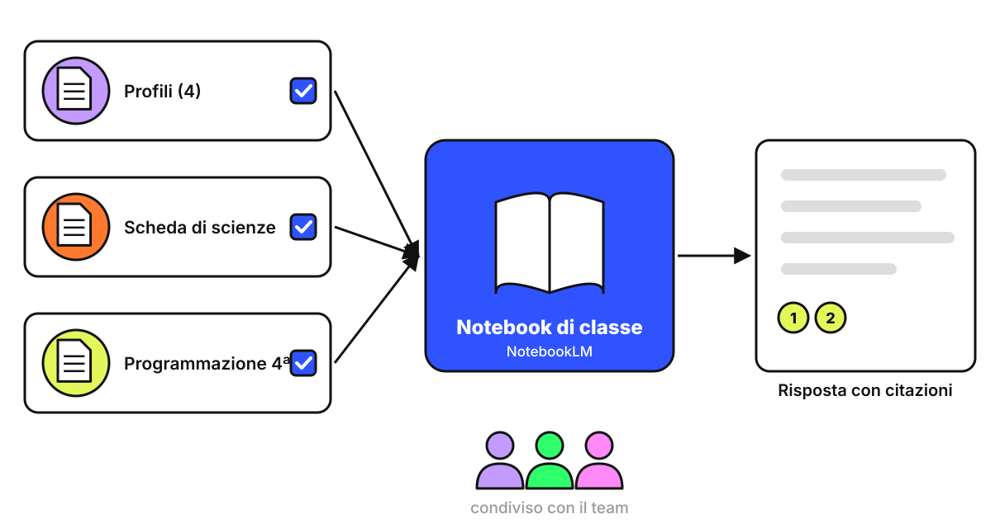

<!-- _class: lead -->
<!-- _paginate: false -->

### NotebookLM · Esercitazione

# Il notebook di classe

<p class="meta">Giuseppe Mastrandrea</p>

---

### Cosa facciamo

<div class="cols">
<div>

Raccogliamo in **NotebookLM** le fonti della vostra classe e adattiamo una scheda di scienze ai 4 profili.

Le risposte partono **solo dalle fonti caricate** e le citano: si chiama grounding.

<p class="meta">Tecniche: grounding, output con criteri, revisore in una chat nuova</p>

</div>
</div>

---

### Lo schema

<div class="schema"></div>

---

### Le fonti

<div class="cols">
<div class="card"><h2>Profili</h2><p>Il Documento "Profili della classe" dell'esercitazione "Costruire i profili".</p></div>
<div class="card"><h2>Scheda di scienze</h2><p>Testo di 15 righe sul ciclo dell'acqua e 6 domande di comprensione.</p></div>
<div class="card"><h2>Programmazione</h2><p>L'estratto di scienze della programmazione di classe quarta.</p></div>
</div>

---

### Creare il notebook

<div class="cols">
<div>

1. Apri **notebooklm.google.com**.
2. **Crea nuovo** e dai il nome **Classe 4ª (esercitazione)**.
3. **Aggiungi fonti → Google Drive**.
4. Seleziona i 3 documenti.

</div>
<div class="shot">Screenshot: aggiunta delle fonti da Google Drive</div>
</div>

---

### Perché proprio NotebookLM

- Risponde **a partire dalle fonti** e mette un numero di citazione accanto a ogni affermazione: cliccandolo si vede il passaggio.
- Dal 29 ottobre 2025 la chat usa la finestra di contesto completa di Gemini, **1 milione di token**: finché le fonti ci stanno, le legge per intero.

<p class="note">Fonte: blog.google, "Chat in NotebookLM", 29 ottobre 2025.</p>

---

### Fase 1 · Quattro versioni

<div class="small">

```text
Ambito: insegnamento di sostegno nella primaria.
Usa la scheda di scienze e i quattro profili presenti tra le fonti.
Per ogni profilo crea una versione adattata della scheda.
Vincolo: l'obiettivo di apprendimento resta lo stesso per tutti
(capire le fasi del ciclo dell'acqua), come indicato nella programmazione.
Per ogni versione aggiungi una tabella:
Cosa ho cambiato | Perché, collegato al profilo | Cosa NON ho cambiato.
```

</div>

---

### Fase 1 · Leggere la risposta

<div class="cols">
<div>

- Aprite le **citazioni**: ogni adattamento rimanda al profilo giusto?
- Leggete per prima la colonna **Cosa NON ho cambiato**: Gemini può abbassare l'obiettivo, soprattutto per gli alunni con difficoltà nella lingua, semplificando il contenuto invece della lingua.

</div>
<div class="shot">Screenshot: risposta con i numeri di citazione</div>
</div>

---

### Prova del grounding

```text
Adatta la scheda anche per il profilo E.
```

Il profilo E non esiste. NotebookLM deve rispondere che **nelle fonti non c'è**.

<p class="note">Se inventa un profilo, segnatevelo: è il caso da raccontare in aula.</p>

---

### Prova del secchio

<div class="cols">
<div>

1. Togliete la spunta alla fonte **Profili**.
2. Ripetete il prompt della fase 1.
3. Confrontate le due risposte.

Le fonti senza spunta **non entrano nel contesto**: la risposta torna generica.

</div>
<div class="shot">Screenshot: elenco delle fonti con le caselle di spunta</div>
</div>

---

### Fase 2 · Il revisore

In una **chat nuova di Gemini**, una sola versione per gruppo:

```text
Ambito: insegnamento di sostegno nella primaria.
Compito: revisione critica. Valuta questa scheda pensata
per questo profilo [incolla]. Elenca 3 cose che non
funzionano e proponi come correggerle.
```

<p class="note">Una chat nuova non ha davanti il lavoro precedente e non tende a confermarlo.</p>

---

### Fase 3 · Una scheda per tutti

Di nuovo nel notebook:

```text
Ora progetta un'unica scheda che funzioni per tutti
e quattro i profili, senza versioni separate.
Usa più canali (testo, immagine, audio),
scelte per l'alunno e livelli opzionali.
```

Discussione: quale usereste lunedì in classe, la scheda unica o le 4 versioni?

---

### Condividere con il team

<div class="cols">
<div>

1. In alto a destra, **Condividi**.
2. Aggiungete le colleghe del team di classe.
3. Scegliete il ruolo: **visualizzatore** per consultare, **editor** per aggiungere fonti.

</div>
<div class="shot">Screenshot: finestra di condivisione del notebook</div>
</div>

---

### Cosa mettere nel notebook

<div class="cols">
<div class="card"><h2>Fonti della classe</h2><p>Programmazione, materiali, criteri di valutazione, strategie che funzionano con la classe.</p></div>
<div class="card"><h2>Profili</h2><p>Descritti per funzionamento, con una lettera al posto del nome e senza diagnosi.</p></div>
</div>

<p class="note">Il notebook si condivide solo con il team di classe.</p>

---

### Da ricordare

- Il notebook dice al modello **cosa sa**: le fonti che scegliete voi.
- Le caselle di spunta decidono **cosa entra nel contesto**.
- L'adattamento lo valida **chi conosce l'alunno**: docente di sostegno, team di classe, famiglia.
