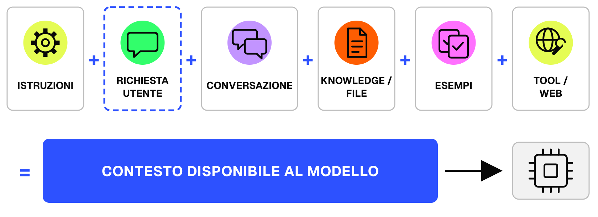
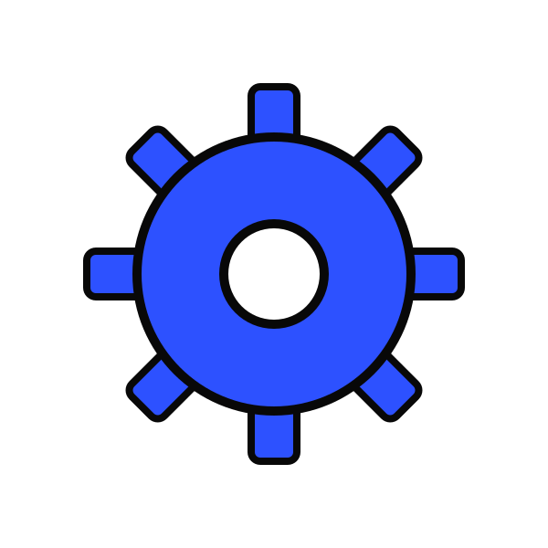
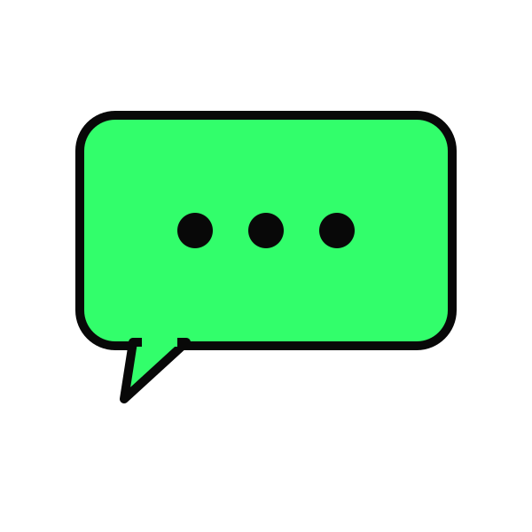
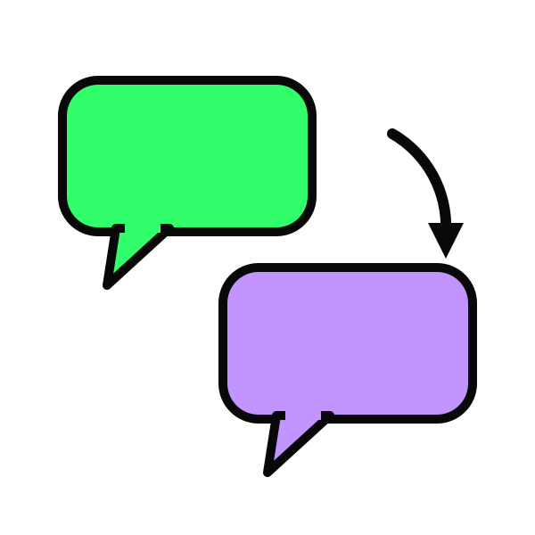
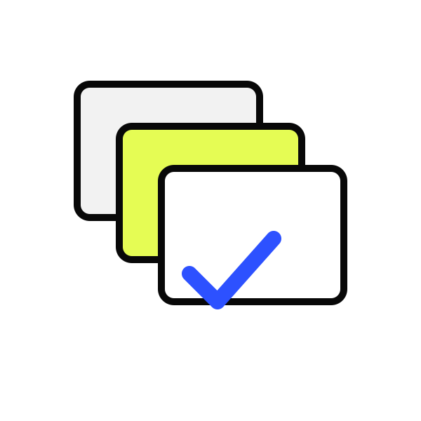
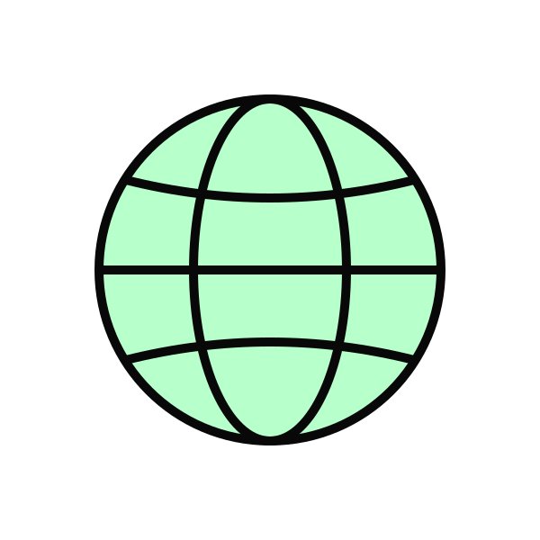
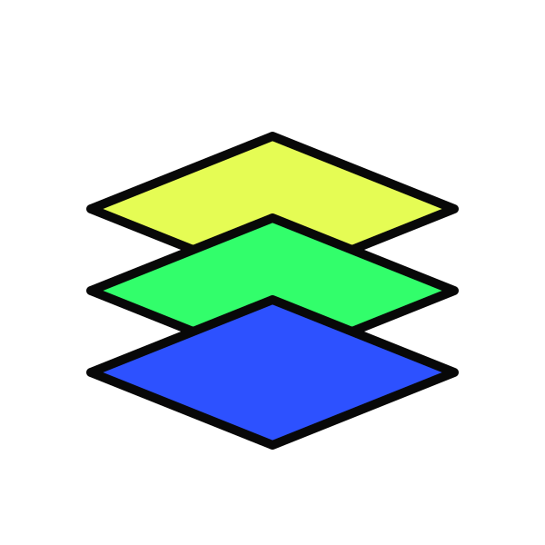
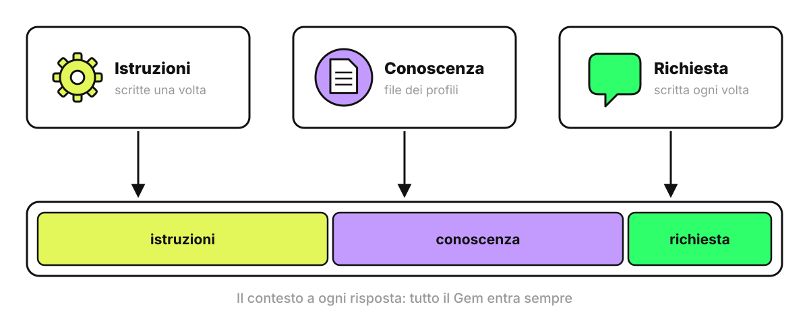
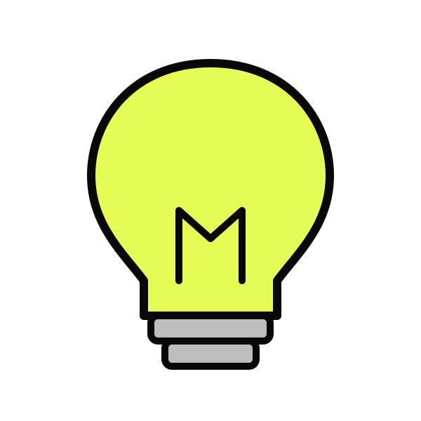

<!-- _class: cover -->
<!-- _paginate: false -->
<!-- _footer: '' -->

# Prompt Engineering → Context Engineering

Che cosa arriva al modello oltre alla tua frase

---

# Dalla frase al contesto

## Prompt engineering

Riguarda la frase scritta in chat

Domanda guida: come formulo la richiesta?

## Context engineering

Riguarda tutto ciò che il modello ha a disposizione

Domanda guida: quali istruzioni, dati, esempi e strumenti fornisco?

---

<!-- _class: quote -->

# Tobi Lütke (Shopify), giugno 2025

> The art of providing all the context for the task to be plausibly solvable by the LLM.

Simon Willison, Context engineering, 27 giugno 2025 · simonwillison.net/2025/Jun/27/context-engineering

---

<!-- _class: quote -->

# Anthropic

> The smallest possible set of high-signal tokens that maximize the likelihood of some desired outcome.

Effective context engineering for AI agents, 29 settembre 2025 · anthropic.com/engineering/effective-context-engineering-for-ai-agents

---

# Che cosa arriva al modello

La richiesta scritta in chat è uno dei sei pezzi del contesto.

---

# 1/6 · Istruzioni

- <b>Cosa sono</b> indicazioni valide per tutta la chat, della piattaforma (invisibili) e tue (impostazioni, progetto)
- <b>Esempio</b> "Rispondi in italiano, con un elenco finale di azioni concrete"
- <b>Attenzione</b> si scrivono una volta e agiscono su ogni risposta

---

# 2/6 · Richiesta utente

- <b>Che cos'è</b> il messaggio che scrivi adesso
- <b>Esempio</b> "Riassumi il listino 2026 in cinque punti per il team vendite"
- <b>Attenzione</b> obiettivo, destinatario, vincoli e formato vanno scritti qui o nelle istruzioni

---

# 3/6 · Conversazione

- <b>Che cos'è</b> tutti i messaggi precedenti della chat, tuoi e del modello
- <b>Esempio</b> dopo 10 messaggi su un fornitore, una domanda su un secondo fornitore può mescolare i dati
- <b>Laban et al. (2025)</b> un compito spezzato su più messaggi perde in media il 39% di prestazioni

arxiv.org/abs/2505.06120

---

# 4/6 · Knowledge e file

- <b>Cosa sono</b> PDF, fogli e documenti allegati alla chat o caricati in un progetto
- <b>Esempio</b> il PDF del listino 2026 allegato alla domanda
- <b>Attenzione</b> con molti file il modello legge solo i passaggi recuperati, e un passaggio mancante produce una risposta incompleta

---

# 5/6 · Esempi

- <b>Cosa sono</b> casi di input e output che mostrano la risposta attesa
- <b>Esempio</b> "Il sito è completamente offline" -> URGENTE
- <b>Attenzione</b> il modello copia anche lunghezza e struttura degli esempi

---

# 6/6 · Tool e web

- <b>Cosa sono</b> ricerca web, esecuzione di codice, connettori a email, calendario e file
- <b>Esempio</b> una ricerca web sulle tariffe aggiornate di un fornitore
- <b>Attenzione</b> i risultati entrano nel contesto come testo, e quel testo può contenere istruzioni scritte da altri

---

# Il contesto è un secchio

<svg width="330" height="370" viewBox="0 0 300 340" font-family="Inter, sans-serif" font-size="14" font-weight="600" text-anchor="middle">
<defs><clipPath id="b1"><path d="M40 40 L260 40 L230 320 L70 320 Z"/></clipPath></defs>
<g clip-path="url(#b1)">
<rect x="0" y="273" width="300" height="47" fill="#e4f75a"/>
<rect x="0" y="226" width="300" height="47" fill="#2fff6a"/>
<rect x="0" y="179" width="300" height="47" fill="#c39bff"/>
<rect x="0" y="132" width="300" height="47" fill="#ff7a2f"/>
<rect x="0" y="85" width="300" height="47" fill="#ff8af7"/>
<rect x="0" y="40" width="300" height="45" fill="#d6f0ff"/>
</g>
<path d="M40 40 L260 40 L230 320 L70 320 Z" fill="none" stroke="#111" stroke-width="4" stroke-linejoin="round"/>
<path d="M40 40 Q150 -20 260 40" fill="none" stroke="#111" stroke-width="3"/>
<text x="150" y="302">ISTRUZIONI</text>
<text x="150" y="255">RICHIESTA</text>
<text x="150" y="208">CONVERSAZIONE</text>
<text x="150" y="161">FILE</text>
<text x="150" y="114">ESEMPI</text>
<text x="150" y="68">TOOL E WEB</text>
</svg>

- <b>Un solo contenitore</b> i sei pezzi finiscono nella stessa finestra di contesto
- <b>Capienza limitata</b> si misura in token, cioè pezzi di parola
- <b>A ogni risposta</b> il modello rilegge tutto quello che c'è nel secchio

---

# Il secchio si riempie

<svg width="460" height="280" viewBox="0 0 460 280" font-family="Inter, sans-serif" font-size="14" text-anchor="middle" fill="#6b6b6b">
<defs>
<clipPath id="c1"><path d="M10 20 L130 20 L114 200 L26 200 Z"/></clipPath>
<clipPath id="c2"><path d="M165 20 L285 20 L269 200 L181 200 Z"/></clipPath>
<clipPath id="c3"><path d="M320 20 L440 20 L424 200 L336 200 Z"/></clipPath>
</defs>
<rect x="0" y="165" width="140" height="35" fill="#2f54ff" clip-path="url(#c1)"/>
<rect x="155" y="85" width="140" height="115" fill="#2f54ff" clip-path="url(#c2)"/>
<rect x="310" y="20" width="140" height="180" fill="#2f54ff" clip-path="url(#c3)"/>
<path d="M10 20 L130 20 L114 200 L26 200 Z" fill="none" stroke="#111" stroke-width="3" stroke-linejoin="round"/>
<path d="M165 20 L285 20 L269 200 L181 200 Z" fill="none" stroke="#111" stroke-width="3" stroke-linejoin="round"/>
<path d="M320 20 L440 20 L424 200 L336 200 Z" fill="none" stroke="#111" stroke-width="3" stroke-linejoin="round"/>
<text x="70" y="232">inizio chat</text>
<text x="225" y="232">10 messaggi</text>
<text x="225" y="252">e un PDF</text>
<text x="380" y="232">chat lunga</text>
<text x="380" y="252">e molti file</text>
</svg>

- <b>Resta tutto</b> ogni messaggio, tuo e del modello, occupa spazio fino alla fine della chat
- <b>Pesi diversi</b> un PDF di 50 pagine occupa più spazio di decine di messaggi
- <b>Secchio pieno</b> la piattaforma taglia o riassume i messaggi più vecchi

---

# Più è pieno, peggio lavora

<svg width="400" height="280" viewBox="0 0 400 280" font-family="Inter, sans-serif" font-size="14" fill="#6b6b6b">
<line x1="40" y1="20" x2="40" y2="230" stroke="#111" stroke-width="2"/>
<line x1="40" y1="230" x2="380" y2="230" stroke="#111" stroke-width="2"/>
<polyline points="40,45 110,50 170,62 220,85 270,120 320,150 370,185" fill="none" stroke="#2f54ff" stroke-width="5" stroke-linecap="round" stroke-linejoin="round"/>
<text x="210" y="258" text-anchor="middle">quanto è pieno il contesto</text>
<text x="22" y="125" text-anchor="middle" transform="rotate(-90 22 125)">qualità</text>
</svg>

- <b>Context rot</b> Anthropic (29 settembre 2025): più token nel contesto, meno precisione nel richiamare le informazioni
- <b>Chroma (luglio 2025)</b> su 18 modelli le prestazioni calano quando l'input si allunga, anche in compiti semplici
- <b>Liu et al. (2023)</b> le informazioni a metà di un contesto lungo vengono usate meno di quelle all'inizio e alla fine

Andamento schematico, non un dato misurato · trychroma.com/research/context-rot · arxiv.org/abs/2307.03172

---

# Come si svuota il secchio

- <b>Argomento nuovo</b> chat nuova
- <b>File</b> allega solo quelli che servono alla domanda
- <b>Chat lunga</b> chiedi un riassunto dei punti decisi e riparti da lì in una chat nuova
- <b>Istruzioni</b> brevi: occupano spazio in ogni risposta

---

# Tre modi di riempire il secchio

---

# Gemini Notebook: le fonti nel secchio

- <b>Tutto finché ci sta</b> dal 29 ottobre 2025 la chat usa la finestra completa di Gemini, 1 milione di token
- <b>Le spunte decidono</b> una fonte senza spunta non entra nel contesto
- <b>Grounding</b> le risposte citano il passaggio della fonte da cui vengono

blog.google, Chat in NotebookLM, 29 ottobre 2025

---

# Gem: istruzioni sempre nel secchio

---

# Skill: l'etichetta fuori dal secchio

support.google.com/gemini/answer/17102773 · Anthropic, Equipping agents for the real world with Agent Skills, 16 ottobre 2025

---

# Da ricordare

- La qualità dell'output dipende da tutto il contesto che il modello riceve, compresa la frase scritta in chat.
- Il contesto comprende istruzioni, richiesta, conversazione, file, esempi e tool
- Ogni pezzo del contesto si può progettare

