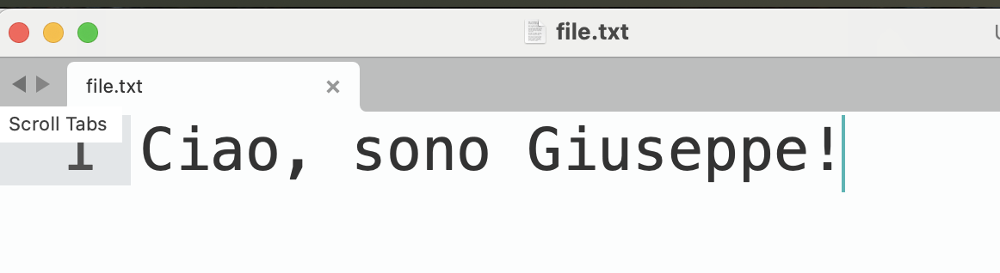
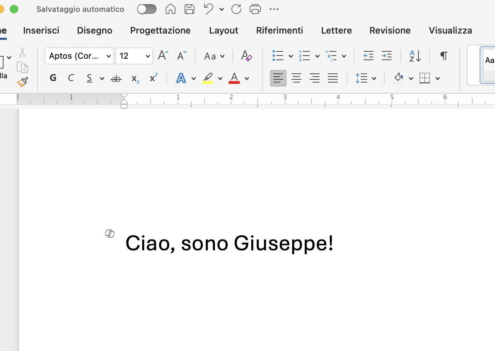
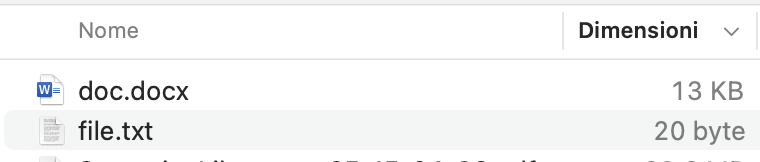
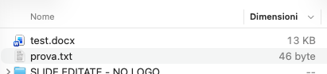

<!-- _class: lead -->
<!-- _paginate: false -->

### Tipologie di file e attività · Modulo 2.1

# File plaintext e file binari

<p class="meta">Giuseppe Mastrandrea<br>Ingegnere informatico, sviluppatore web e docente di informatica</p>

---

### File plaintext e file binari

# Lavorare con i file nei LLM

<div class="cols">
<div>

Far usare file esterni a un LLM è una forma di **retrieval**.

- Mitigazione dei limiti degli LLM.
- Maggior dettaglio su informazioni specifiche.
- Minor rischio di allucinazioni.

</div>
<div class="ico"></div>
</div>

---

### File plaintext e file binari

# File

<div class="cols">
<div>

Due grandi categorie di file:

- **file di testo semplice**
- **file binari**

<p class="note">Le informazioni sui file sono memorizzate come sequenze di byte.</p>

</div>
<div class="ico"></div>
</div>

---

### File plaintext e file binari

# File di testo semplice (plaintext)

È un file in cui sono memorizzati **caratteri direttamente leggibili dall'uomo**.

Esempi ed estensioni:

- file creati con il Blocco note;
- `.txt`, `.md`, `.html`, `.csv`, `.json`;
- `.py`, `.java`, `.cpp` e tutti i file sorgente di programmi.

---

### File plaintext e file binari

# File binari

È un file in cui i dati memorizzati **non possono essere letti direttamente dall'uomo**: serve un software in grado di rendere le informazioni fruibili.

Esempi ed estensioni:

- `.docx`, `.xlsx`, `.pdf`;
- tutti i file multimediali (immagini, video, audio);
- …

---

### File plaintext e file binari

# File .txt vs file .docx

<div class="cols" style="align-items:stretch">
<div class="card">
<h2>File .txt</h2>
<p>Contiene solo i contenuti testuali, senza altri tipi di informazioni.</p>
</div>
<div class="card">
<h2>File .docx</h2>
<p>Contiene anche metainformazioni:</p>
<ul>
<li>formattazione;</li>
<li>tipo di carattere;</li>
<li>dimensione del carattere;</li>
<li>suddivisione in pagine;</li>
<li>immagini.</li>
</ul>
</div>
</div>

---

### File plaintext e file binari

# Esempio pratico

<div class="cols">
<div>

<h2>Contenuti uguali</h2>
<div class="sc"></div>
<br>
<div class="sc"></div>

</div>
<div>

<h2>Dimensioni diverse</h2>
<div class="sc"></div>

<p class="note">Stessa frase: 20 byte nel .txt, 13 KB nel .docx.</p>

</div>
</div>

---

### File plaintext e file binari

# Un'altra prova

<div class="cols">
<div>

Più testo nel .txt: da 20 a **46 byte**.

Il .docx resta a **13 KB**: il peso non viene dalle parole, ma da tutto quello che c'è intorno.

<p class="note">Un byte per carattere nel .txt; nel .docx la struttura pesa centinaia di volte di più del testo.</p>

</div>
<div class="sc"></div>
</div>

---

### File plaintext e file binari

# LLM e tipologie di file

<div class="cols">
<div>

I LLM prediligono nettamente i **file di testo semplice**: non possono comprendere facilmente la struttura complessa dei file binari.

Tuttavia, quasi tutti i LLM:

- hanno moduli **OCR**;
- sono in grado di fornire **descrizioni delle immagini**.

</div>
<div class="ico"></div>
</div>

---

### File plaintext e file binari

# File di testo semplice: .txt

Sono i classici file creati con il Blocco note.

Contengono dati:

- non strutturati;
- non gerarchici.

<div class="tags"><span class="on">Pensato per gli esseri umani</span></div>

---

### File plaintext e file binari

# .md (Markdown)

È un modo per **formattare testi con il testo semplice**.

Rappresenta dati:

- strutturati;
- non gerarchici.

<div class="tags"><span class="on">Pensato per gli esseri umani</span></div>

---

### File plaintext e file binari · .md

# Un file Markdown

```markdown
# Titolo Principale

---

Questo è un **paragrafo** di testo. Puoi usare il _corsivo_ e il **grassetto**.

## Sottotitolo

* Elemento di una lista
* Un altro elemento

1. Primo punto numerato
2. Secondo punto numerato

Visita il [sito di Google](https://www.google.com).
```

---

### File plaintext e file binari

# .html (HyperText Markup Language)

È la lingua in cui sono scritte **le pagine web**.

Rappresenta dati:

- strutturati;
- gerarchici.

<div class="tags"><span class="on">Pensato per i computer</span></div>

---

### File plaintext e file binari · .html

# Un file HTML

```html
<!DOCTYPE html>
<html>
<head>
    <title>Ciao Mondo!</title>
</head>
<body>
    <h1>Ciao Mondo!</h1>
    <p>Questa è la mia prima pagina web.</p>
    <a href="https://www.google.com">Vai su Google</a>
</body>
</html>
```

---

### File plaintext e file binari

# .csv (Comma Separated Values)

Contiene dati organizzati per **righe e colonne**: è l'equivalente plaintext dei file Excel.

Rappresenta dati:

- strutturati;
- non gerarchici.

<div class="tags"><span class="on">Pensato per i computer</span></div>

---

### File plaintext e file binari · .csv

# Un file CSV

```text
Nome,Cognome,Età,Città,Email
Mario,Rossi,30,Roma,mario.rossi@email.com
Anna,Verdi,24,Milano,anna.verdi@email.com
Marco,Bianchi,45,Napoli,marco.bianchi@email.com
Laura,Neri,38,Firenze,laura.neri@email.com
Giulia,Gialli,29,Torino,giulia.gialli@email.com
```

---

### File plaintext e file binari

# .json (JavaScript Object Notation)

Una serie di coppie **chiave/valore**.

Rappresenta dati:

- strutturati;
- gerarchici.

<div class="tags"><span class="on">Pensato per i computer</span></div>

---

### File plaintext e file binari · .json

# Un file JSON

```json
{
  "nome_studente": "Alice Verdi",
  "eta": 16,
  "classe": "3B",
  "materie_preferite": ["Matematica", "Informatica", "Arte"],
  "contatto": {
    "email": "alice.verdi@scuola.it",
    "telefono": "333-1234567"
  },
  "iscritto_a_corso_extra": true
}
```

---

### File plaintext e file binari

# File binari

<div class="cols">
<div>

- Di base, i file binari occupano **molto più spazio** nella finestra di contesto dei LLM.
- I dati in più presenti nei file binari possono essere considerati **distrazioni** per i LLM.

<div class="key">Laddove possibile, dobbiamo prediligere i file di testo semplice!</div>

</div>
<div class="ico"></div>
</div>
