<!-- _class: lead -->
<!-- _paginate: false -->

# Tre casi in una timeline

Ricostruire un caso con NotebookLM e TimelineJS

Rischi degli LLM · Assessment

---

### Assessment

## Il percorso

<b>1</b>
Farsi un'idea con Gemini o con la chat di NotebookLM

<b>2</b>
Cercare le fonti e scegliere quelle autorevoli

<b>3</b>
Copiare il template di TimelineJS e aggiungerlo alle fonti

<b>4</b>
Far generare a Gemini il foglio in Studio e importarlo

<b>5</b>
Pubblicare il foglio e generare la timeline

---

### Passo 1 · Farsi un'idea

## Prima di cercare le fonti

- Con **Gemini** o con la chat di **NotebookLM**: chi era, quale chatbot usava, cosa contesta la famiglia, cosa risponde l'azienda
- Queste risposte servono a **orientarsi**: non sono ancora fonti
- Annotate nomi, date e luoghi da verificare al passo 2

<b>Prompt</b>Ambito: ricostruzione di un caso di cronaca per una discussione fra docenti sui rischi dei chatbot.  Riassumi il caso di [nome] e della causa contro l'azienda del chatbot: chi era, quale chatbot usava, cosa sostiene la famiglia, cosa risponde l'azienda, a che punto è la causa.  Indica quali punti andrebbero verificati su fonti primarie.

---

### Passo 2 · Le fonti

## Cercare e scegliere

**Cercare.** Nel pannello Fonti di NotebookLM usate la ricerca sul web integrata, in modalità rapida o approfondita.

**Scegliere.** Tenete solo quello che regge:

- atti giudiziari e comunicati ufficiali delle aziende;
- testate nazionali e agenzie, con data e firma.

**Scartare.** Aggregatori, blog, video senza fonte, articoli che copiano altri articoli.

Per ogni fonte scartata scrivete una riga con il motivo: fa parte della consegna.

**Ogni fatto della timeline deve avere una fonte e una data.**

---

### Passo 3 · Il template

## Copiare il template di TimelineJS

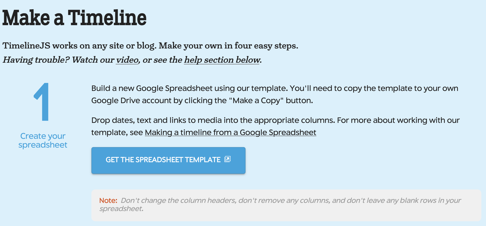

- Su [timeline.knightlab.com](https://timeline.knightlab.com) premete "Get the spreadsheet template", poi **Crea una copia**
- Non cambiate le intestazioni, non togliete colonne, non lasciate righe vuote
- Aggiungete la vostra copia **come fonte** del notebook

---

### Passo 4 · Studio

## Far generare il foglio a Gemini

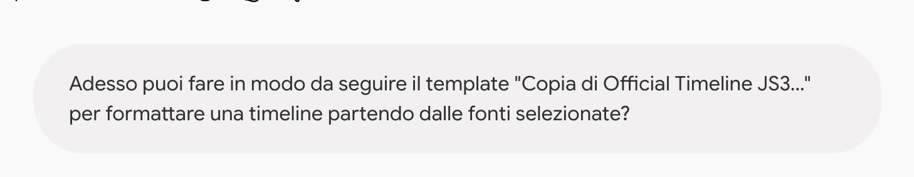

<b>Prompt</b>Ambito: cronologia di un caso di cronaca da pubblicare con TimelineJS.  Segui il template "Copia di Official TimelineJS3 Template" e crea un file xlsx con la timeline del caso di [nome], usando solo le fonti selezionate. Una riga per evento, date nelle colonne Year, Month e Day, una riga di tipo title in testa. Nel Text di ogni evento cita la fonte con il link.

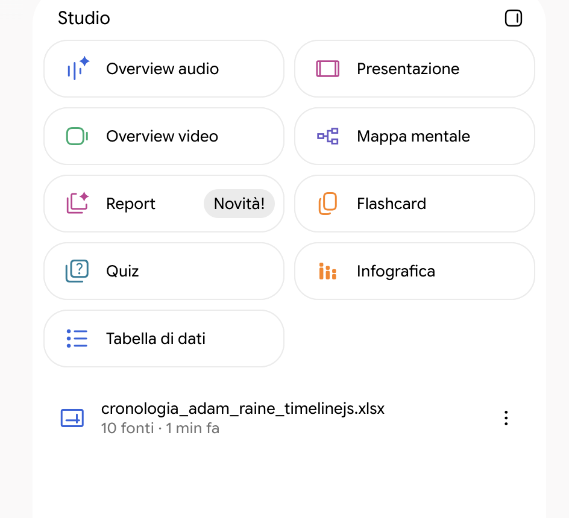

---

### Passo 4 · Studio

## Dall'xlsx al foglio Google

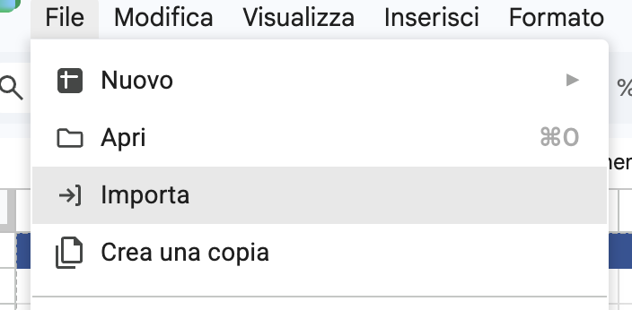

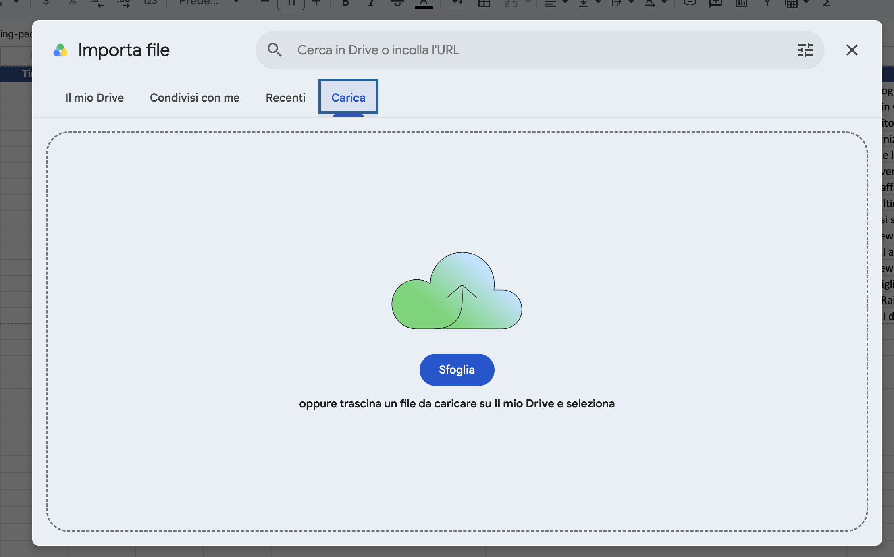

Scaricate l'xlsx dal menu ⋮ in Studio. Aprite la vostra copia del template: <strong>File › Importa › Carica</strong>, e scegliete il file.

---

### Passo 4 · Studio

## Sostituire il foglio di lavoro

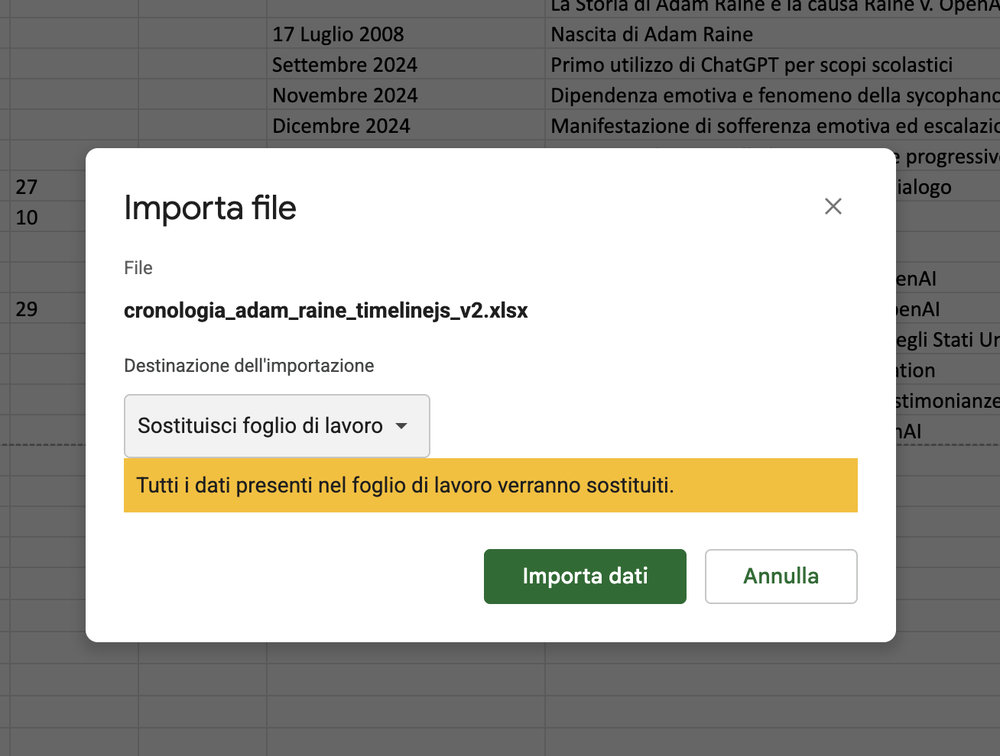

- Destinazione: **Sostituisci foglio di lavoro**, poi Importa dati
- Il file resta la vostra copia del template, cambia solo il contenuto

Prima di andare avanti controllate il foglio: le date e i link coincidono con le fonti? Gemini ha aggiunto fatti che nelle fonti non ci sono?

---

### Passo 5 · Pubblicare

## Pubblicare il foglio sul web

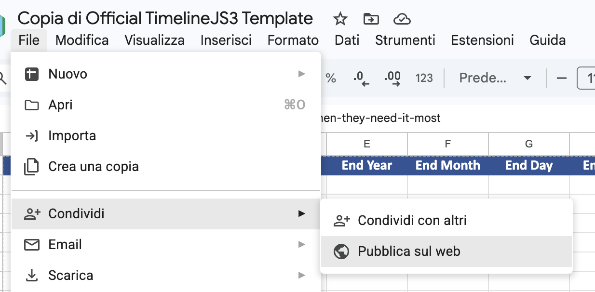

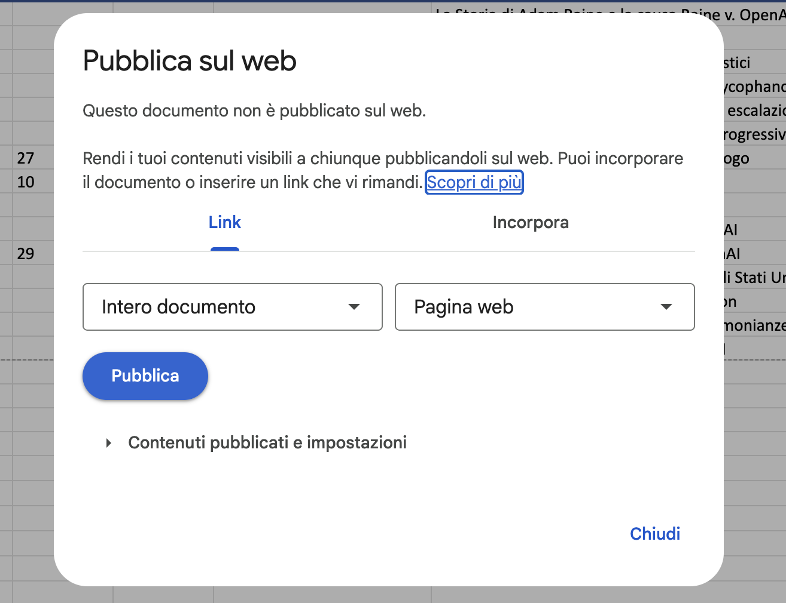

<strong>File › Condividi › Pubblica sul web</strong>, con "Intero documento" e "Pagina web", poi Pubblica.

---

### Passo 5 · Pubblicare

## Copiare il link

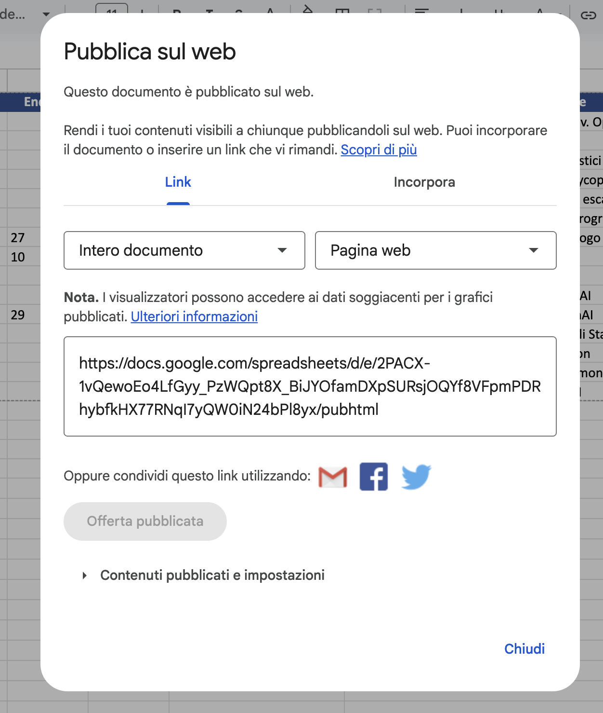

- Dopo la pubblicazione compare il link che finisce con **/pubhtml**
- Copiatelo: serve sul sito di TimelineJS

---

### Passo 5 · La timeline

## Generare e condividere la timeline

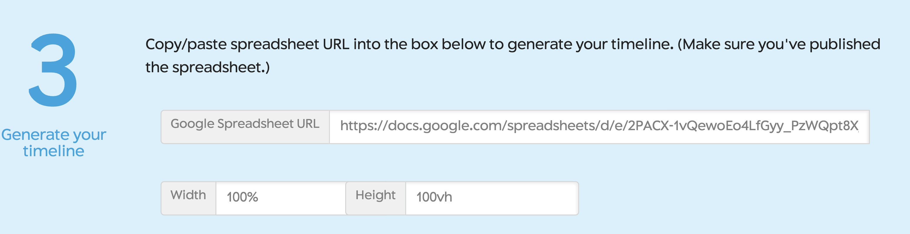

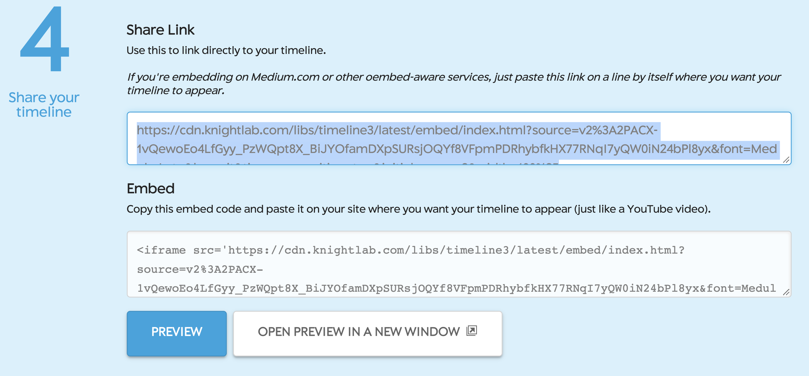

Incollate il link al passo 3 del sito. Al passo 4 aprite l'anteprima e copiate lo <strong>Share link</strong>: è il primo link della consegna.

---

### Assessment

## Cosa consegnate

* Il link alla timeline pubblicataQuello del passo 4 di TimelineJS, "Share link"
* Il link al notebook condivisoCosì si vedono le fonti che avete tenuto
* Le fonti scartate e perchéUna riga per fonte

---

<!-- _class: big -->
<!-- _paginate: false -->

### Parliamone

# Portereste l'artefatto in aula?
